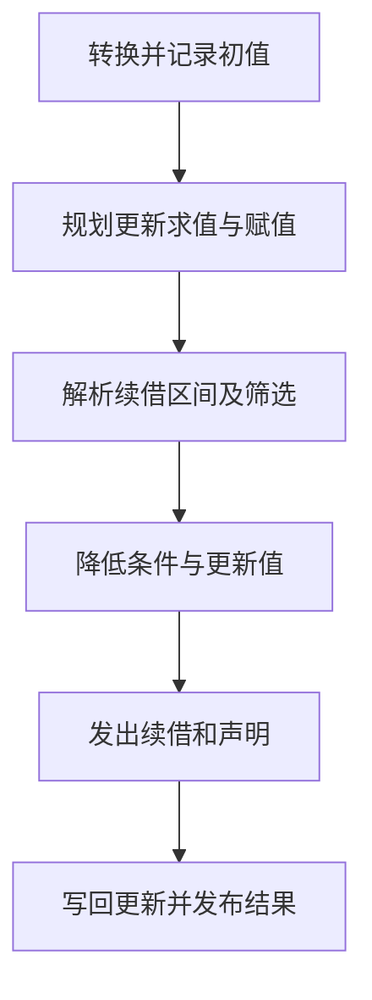
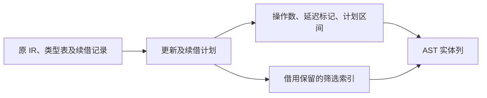

# genz 循环更新计划与续借自举

## Intent · 接通更新计划到续借写入

从 `aea3eed3e` 起，正式的普通、值 ABI、弃用结果和消费入口共用
Source 更新计划。由同一 RX 流程交付运算数、续借区间、内联筛选和写入
顺序。普通 reduce 也直接使用同一续借规划。移除旧的 Zig 更新计划和
续借计划副本及对应生成入口。

## Data · 调用关系

转换初值后，旧 `planLoopUpdate` 分别进入两个独立的 Source 入口。
Zig 存放计划和筛选结果，再由首次条件、更新作用域、赋值和结果发布
逐项读取。两套规划算法已由 Source 表达。
普通 reduce 在初值转换后也通过同一个 Zig 规划桥筛选续借，再发出
累加器的续借语句。

## Edges · 保持原顺序和资源寿命

保留首测、下步求值、投影赋值、延迟续借和初值保护的效果顺序。
没有续借记录的调用继续使用空暂存分配器。存在记录时复用先栈后堆
的两个暂存区域。Loop 在递归降低前回收筛选产生的堆内存，栈缓冲随调用
退出。跳过索引保留到写入，两个入口共用物理暂存区的构造和清理。
Zig 负责借用物理列、分配器、上下文及 AST 节点发布。

## Answer · 验收

核对两个旧生成入口及 Zig 计划副本退出。复用最近的 Source 引导器，
对照五份引导清单和固定清单，运行涉及续借、缓冲和作用域的回归。
记录生成阶段冷暖性能及峰值 RSS。

- 复用 `aea3eed3e` 的 Source 引导器构建 ReleaseSmall 候选，使用 16 个
  主生成分区。372 项编译器测试通过。
- 批首和候选运行相同的 main、execution、host、collections、growth 清单。
  除编译器身份输入戳外，17,824 个文件逐字节一致。
- 使用批首引导器生成候选源码。七组循环、迭代调用、缓冲、跨模块和
  reduce 回归通过，覆盖分配失败清理、编译库路径及副作用顺序。共
  311 个构建步骤、384 项 Zig 测试和 12 项 CLI、Node 检查通过。
- 检查正式值入口的生成代码，计划交接没有对象分配。筛选仍按原约定
  分配工作区和需要保留的索引。

沿用固定兼容清单、工具链和分区数，关闭常驻生成。三个引导器均由
Source 生成，测量使用 Source 分析和生成。以下为交错三次的冷生成中位数。

| 引导器                             |   墙钟 |    CPU | 采样进程树峰值 RSS | 单进程峰值 RSS |
| ---------------------------------- | -----: | -----: | -----------------: | -------------: |
| 固定基线 `declaration-preparation` | 2.08 s | 9.02 s |          737.66 MB |      760.05 MB |
| 批首 `aea3eed3e`                   | 1.95 s | 9.51 s |          530.51 MB |      546.88 MB |
| 候选                               | 1.93 s | 9.44 s |          527.66 MB |      548.90 MB |

较批首，冷生成墙钟减少 0.02 秒，CPU 减少 0.07 秒，进程树峰值减少
2.85 MB，单进程峰值增加 2.02 MB。较固定基线，墙钟减少 0.15 秒，CPU
增加 0.42 秒，进程树峰值减少 209.99 MB。热生成墙钟增加 0.01 秒，CPU
减少 0.03 秒，无修改生成保持 0.03 秒。冻结清单冷暖及批首对照的
9,894 个文件逐字节一致。
