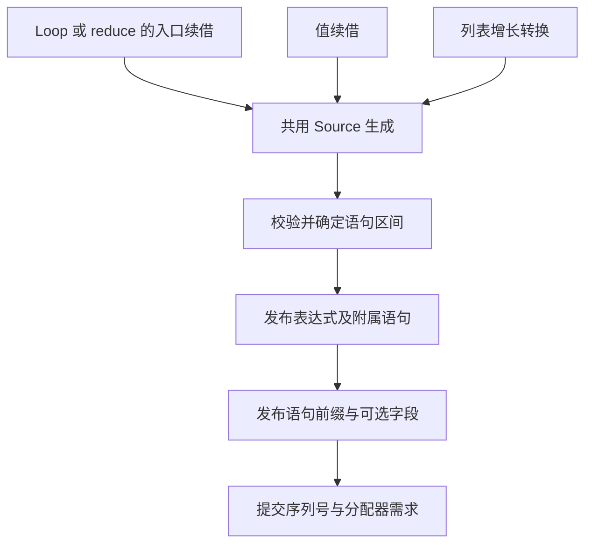

# genz 续借与增长 AST 交付自举

## Intent · 收拢三条正式交付链

从 `eada50fbe` 起，Loop 和 reduce 的入口续借、表达式值续借及列表增长
转换共用 Source 生成和 AST 发布。收口有效性检查、语句前缀交付、字段
发布和最终状态，删除三套独立生成入口及仅用来取得类型的增长调用入口。

## Data · 原正式调用链

Loop 与 reduce 借用续借计划写入语句表，值续借把语句交给已有序列，
增长转换还会发布字段。三路都先写表达式，再写语句及前缀，最后提交
序列号和分配器需求。值续借为适配共享发布，又组装了一次 AST 输出。

## Edges · 保持布局、写入时机和资源寿命

沿用增长与续借子模块的规则。通过同一份输出借用生成列，保持文本复制
和字段名称借用的原有约定。语句前缀按调用方交给实体表或序列。所有可能
失败的行写入完成后才提交状态。实体列预留、字符串持有和短寿命缓冲
释放仍由宿主管理。

## Answer · 验收

沿三个入口验证生成产物与应用行为，覆盖源码和编译库的循环、reduce、
集合增长及分配失败清理。复用上批 Source 引导器，运行五个生成清单及
固定清单的冷暖对照，记录 CPU、墙钟与内存峰值。

- 以 `eada50fbe` 的 Source 引导器构建 ReleaseSmall 候选，主生成使用
  16 个分区。372 项编译器回归通过。
- 同一候选和批首工具运行 main、execution、host、collections、growth
  五份清单。除记录编译器身份的输入戳外，17,819 个文件逐字节一致。
- 应用验收通过 311 个构建步骤、384 项 Zig 测试和 12 项 CLI、Node
  检查。覆盖普通循环、跨模块与编译库循环、嵌套缓冲，以及 reduce 的
  分配清理和副作用顺序。
- 正式入口使用生成的值 ABI。查验生成 Zig，合并入口只组装并借用列
  描述符，交付不新增列数据分配，持久 AST 继续使用既有的实体写入。

实现中分别修正了带宿主接口的生成入口所属清单，以及值 ABI 的借用
视图类型。之后保留一份候选和一组应用产物完成验收。发布入口按生成的
`OutOfMemory` 错误集合直接传递错误。

三个引导器均由 Source 生成，本次使用 Source 分析和生成。固定输入、
Zig 0.17.0、分区数和缓存边界一致，关闭常驻生成。冷生成取三次交错
对照的中位数。

| 引导器                             |   墙钟 |    CPU | 采样进程树峰值 RSS | 单进程峰值 RSS |
| ---------------------------------- | -----: | -----: | -----------------: | -------------: |
| 固定基线 `declaration-preparation` | 2.07 s | 8.99 s |          738.92 MB |      759.97 MB |
| 批首 `eada50fbe`                   | 1.95 s | 9.50 s |          529.14 MB |      555.89 MB |
| 候选                               | 1.97 s | 9.54 s |          528.01 MB |      549.06 MB |

较批首，冷生成墙钟增加 0.02 秒，CPU 增加 0.04 秒，进程树峰值减少
1.13 MB，单进程峰值减少 6.83 MB。较固定基线，墙钟减少 0.10 秒，CPU
增加 0.55 秒，进程树峰值减少 210.91 MB。热生成墙钟增加 0.01 秒，
CPU 增加 0.04 秒，无修改生成保持 0.03 秒。固定清单冷暖及批首对照的
9,894 个文件逐字节一致。
