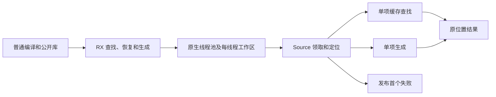
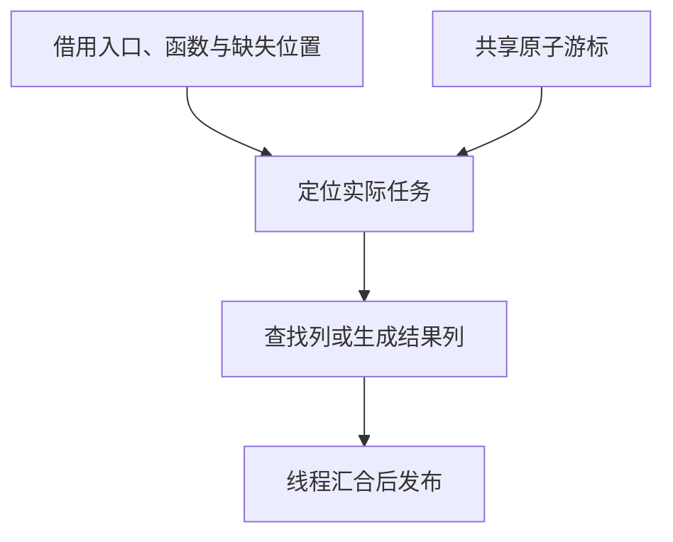

# 函数任务查找与生成工作线程自举

## Intent

沿正式编译器、公开库和重新生成普通调用的入口，迁移前台的函数任务
领取、任务定位、缓存查找和生成循环。取消每项任务往返一次独立的 Source
定位入口。共享类型文件、公开入口和普通函数仍按原位置发布。

## Data

批首 `0c683bf2f`。正式的 `Search.run` 和 `Work.run` 在 Zig 中各自维护
原子游标和错误槽，查找和生成都从 `Dispatch.at` 访问独立定位入口。
查找阶段借用定长结果列；生成阶段的每个参与者复用一个暂存 arena 与
一个类型工作区。缺失项列表将本轮的紧凑位置映回原任务。

## Edges

保留领取粒度、线程池、原子顺序、首个失败、已领取任务以及未提交
结果的释放约定。Source 在工作线程中通过同一份借用视图定位任务。
原生接口完成单项缓存与生成操作，线程工作区仍由各线程独占。

## Answer

用初始 seed 和上一批 Source 工具构建，对实际生成、缓存命中、损坏恢复
与库入口运行现有回归。固定清单核对产物和常驻复用，并对比冷暖性能。

正式入口每个线程只进入一次 Source。普通任务和缓存缺失项都用同一份
借用视图定位，旧 `Dispatch.at` 与独立定位生成入口已退出。源缓存
仍先写任务标识，再写获取结果。生成缓存和未启用缓存时沿用各自的缓冲归属。线程成功处理一个任务后
重置暂存区。失败时由 Source 原子发布首个错误，线程退出并
回收工作区，外层保留原有未发布结果清理。Zig 仍完成单项标识、读盘、
genz 渲染调用和资源交付。初始 seed 继续使用自身的领取循环。

用 Zig 0.17.0、ReleaseSmall 验证。初始 seed 解析器和 Source 工具构建
均通过，五组编译清单的 17,878 个文件逐字节一致。原样保留了 10 次
常驻请求中的产物、编辑后的复用和路径冲突诊断。39 项 RX 回归通过。
23 项 ReleaseSmall 回归通过，覆盖生成缓存、公开入口、缓存损坏修复与
RX 磁盘项目。ReleaseSafe 的 3 项缓冲资格切换和缓存失败重试也通过。
恢复输出分配策略后，重新通过 23 项模块生成回归和 3 个 CLI 缓存执行
场景，并再次得到相同的引导产物与常驻结果。

### 固定输入性能

同一台机器、705 个入口、16 个分区，三个 ReleaseSmall Source 工具
交错运行三轮。固定清单的 9,894 个输出和所有权 memo 载荷一致。

| 场景   | 批首墙钟 / CPU | 本批墙钟 / CPU | 固定基线墙钟 / CPU |
| ------ | -------------- | -------------- | ------------------ |
| 冷生成 | 1.93 / 9.43 秒 | 1.93 / 9.48 秒 | 2.04 / 8.91 秒     |
| 热缓存 | 1.41 / 6.18 秒 | 1.41 / 6.15 秒 | 1.62 / 6.38 秒     |
| 无更改 | 0.03 / 0.03 秒 | 0.03 / 0.03 秒 | 0.04 / 0.03 秒     |

最终冷生成的进程树峰值 RSS 为 523.5 MB，比批首减少 0.5 MB；
单进程峰值为 546.9 MB，比批首减少 2.2 MB。相对固定基线，
墙钟减少 0.11 秒、CPU 增加 0.57 秒，两项 RSS 分别减少 214.2 MB
和 234.0 MB。

试验直接用共享分配器扩展缓存文本时，冷生成进程树和单进程峰值
分别增加 28.6 MB 和 21.5 MB。共享分配器会保留小对象各尺寸类的
空闲块，打印器增长过程中用过的块会计入峰值。只恢复打印输出的
原分配策略后，峰值恢复到批首范围。生成在每线程暂存区扩展，缓存接管
一次定长复制。后续去掉这次复制需要验证输出缓冲增长和缓存释放能共用
同一归属，且不会增加常驻内存。
