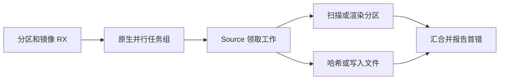
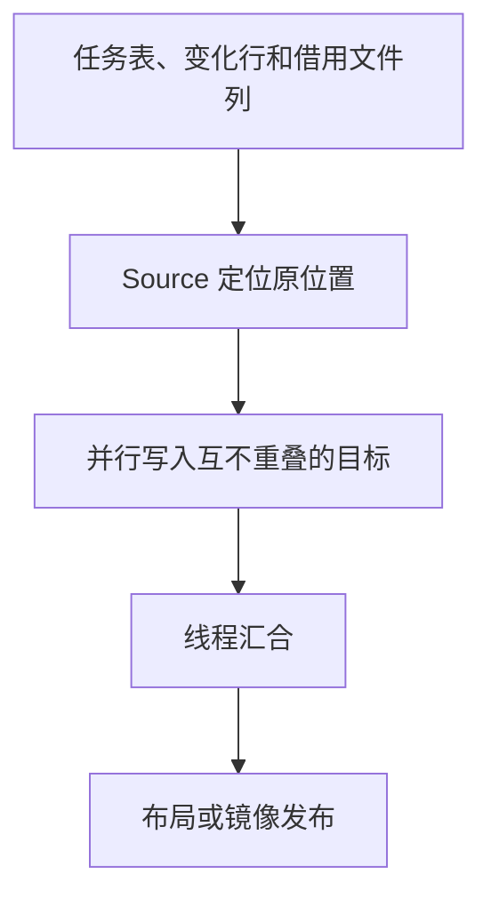

# 分区与镜像并行工作自举

## Intent

迁移编译器产物的并行分区扫描、分区渲染、镜像哈希和镜像写入。四个
正式入口由 Source 共用任务领取与首错发布，保持各自的工作粒度和资源归属。

## Data

批首 `c7b90d57a`。Zig 的 `output/parallel.each` 领取任务并记录首个
失败。分区渲染逐项交回独立的 Source 入口，镜像哈希逐块在 Zig 切片
后调用 Source。已存在的扫描、渲染与哈希逻辑仍是本批的实现基础。

## Edges

保留原 `std.Io.Group`、线程数量和每线程 arena。扫描仍按原大小借用
输入与目标，渲染同一根的导出先于模块清单；哈希按原路径位置写入；
镜像写入只处理变更文件。任何步骤的失败经原子槽报告，已领取的工作
允许结束，线程汇合后还原原生错误。

## Answer

用现有引导清单核对非分区和分区产物、冷暖生成、常驻编辑以及错误
恢复。分别核对 Seed 与 Source 引导路径，比较固定输入的时间与内存。

正式路径每线程只进入一次 Source 工作循环。Source 选择扫描范围、根
分区或普通文件的渲染顺序、哈希源区间和变更文件路径。镜像直接借用原
文件表，哈希写入原结果行。分区渲染的逐项生成入口与镜像哈希的逐块
生成入口退出。保留原生线程组、arena、分区扫描的列窗口、实际渲染与
文件写入。初始 seed 仍使用原生领取循环。

Zig 0.17.0、ReleaseSmall。初始 seed 与 Source 引导器构建通过，39 项
RX 测试通过。同一镜像清单的平铺 36 项、16 分区 105 项生成产物与批首
一致。两个布局均核对了无更改请求的文件时间戳、精简后的过期文件删除、
旧清单缺失后的恢复以及写入任务返回 `IsDir` 后的重试。16 分区也复验了
父目录冲突时的失败与恢复。常驻进程交替按完整、精简、完整清单生成，
产物一致，随后的无更改请求直接复用。

两条引导路径五组清单的 17,878 个产物逐字节一致。另用已有的常驻
编辑夹具核对十次请求的文件复用、冲突诊断和缓存恢复。旧逐项渲染与
逐块哈希入口不再出现在生成登记中。

### 性能

使用三个 ReleaseSmall Source 引导器，对同一 705 入口、16 分区的
固定清单交错运行三轮。表内为墙钟和 CPU 中位数。固定清单的
9,894 个生成文件及所有权 memo 载荷一致。

| 场景   | 批首墙钟 / CPU | 本批墙钟 / CPU | 固定基线墙钟 / CPU |
| ------ | -------------- | -------------- | ------------------ |
| 冷生成 | 1.93 / 9.44 秒 | 1.97 / 9.48 秒 | 2.06 / 8.95 秒     |
| 热缓存 | 1.40 / 6.09 秒 | 1.40 / 6.13 秒 | 1.60 / 6.33 秒     |
| 无更改 | 0.03 / 0.03 秒 | 0.03 / 0.03 秒 | 0.04 / 0.03 秒     |

冷生成进程树峰值 RSS 为 527.6 MB，与批首持平；单进程峰值
551.6 MB，比批首少 1.9 MB。较固定基线，冷生成墙钟少 0.09 秒，CPU
多 0.53 秒，进程树和单进程峰值分别少 210.2 MB 和 208.4 MB。
