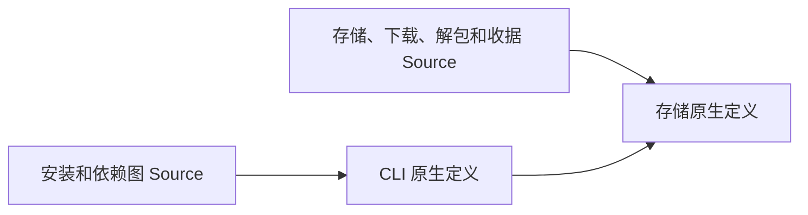
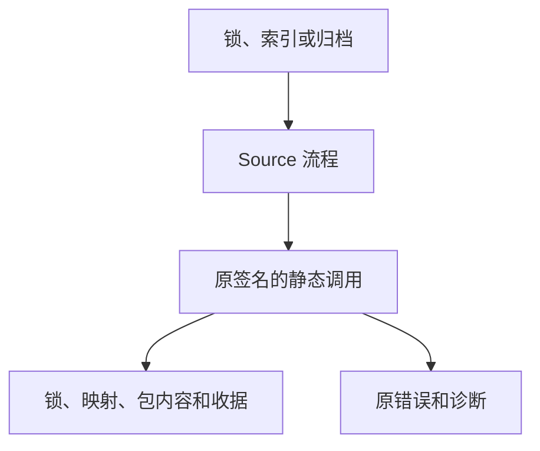

# 包安装与存储原生绑定自举

## Intent

把包安装、已安装依赖图、包缓存、归档解包、收据验证和下载的调用
目标交给各自的 Source 编译清单。删除这条调用链的两套 Zig 转发。

## Data

批首 `d9c375978`。包安装与依赖图共用 `package/install/bindings.zig`。
包存储、下载、解包和收据共用 `package/store/bindings.zig`。
两份文件只把 Source 声明映射回已有的 Zig 定义。

## Edges

两组清单各自使用现有的编译期定义查找。安装锁、版本映射、归档内容、
下载校验与收据均保留原布局。通过编译期解析区分已安装包和索引安装
中的同名归档操作。文件、HTTP 与标准路径原语继续从原定义调用。

## Answer

两套转发文件退出正式调用链。非 seed 包源码 Zig 新增 30 行、
删除 128 行，净减 98 行。全仓新增 39 行、删除 150 行，净减 111 行。

沿用上一批独立构建的初始 seed 与 Source 引导器，两组新清单分别
生成 88 和 73 个文件，两种引导产物逐字节一致。

ReleaseSmall 的 59 项 Zig 回归及包安装、原生包、HTTP 下载和 watch
集成通过。覆盖冷安装、离线热读、归档恢复、包映射损坏和锁文件
更新。使用同一编译器引导器构建批首与本批 CLI，沿用包缓存的固定
夹具交错运行。锁、映射、归档、解包内容、权限、收据和依赖图一致。

下表为七轮热身后样本的墙钟 / CPU 中位数，单位为毫秒。

| 场景                   | 固定基线        | 批首            | 本批            |
| ---------------------- | --------------- | --------------- | --------------- |
| 1,024 个小文件首次安装 | 62.098 / 60.507 | 61.822 / 60.516 | 61.894 / 60.376 |
| 小文件缓存命中         | 15.579 / 14.505 | 15.145 / 14.327 | 15.154 / 14.088 |
| 离线解包恢复           | 62.471 / 60.462 | 61.474 / 59.979 | 62.095 / 60.472 |
| 已安装依赖图           | 14.751 / 13.901 | 14.764 / 13.951 | 15.000 / 14.263 |
| 大文件缓存命中         | 4.582 / 3.748   | 4.624 / 3.771   | 4.686 / 3.771   |

较批首墙钟最多增加 0.621 毫秒，CPU 最多增加 0.493 毫秒。
五个场景的单进程峰值 RSS 中位数均持平。较固定基线墙钟最多增加
0.249 毫秒，CPU 最多增加 0.362 毫秒。
