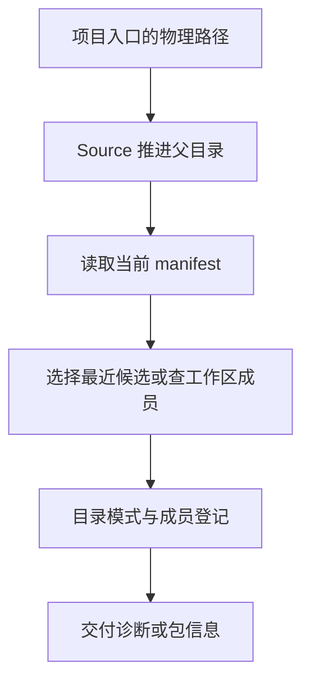

# 包目录发现和工作区登记自举

## Intent · 共用包发现和工作区成员查询的状态

从 `0b45ecfcf` 起，迁移正式 CLI 的向上目录查找、候选选择和工作区
成员核对。让 Source 维护当前目录与已遇到的最近候选，减少逐项
查询原生状态和再次进入生成入口。

## Data · 正式入口

包加载通过 `package/project.zig` 使用包发现。工作区显式加载与
祖先搜索共用目录枚举和成员登记。发现进程保留 manifest 解析区，
目录枚举器保存实际目录句柄。

## Edges · 文件和解析区所有权

保持物理路径、符号链接、祖先匹配、错误顺序和观察文件行为。
目录读取、manifest 解码和分配器仍由现有原生实现负责。

## Answer · 验收

验证工作区发现、成员筛选、诊断、安装和 watch 的正式入口。
比较实际命令输出和性能，登记批次与固定起点的 Zig 差异。

正式调用退出原生目录游标、候选存在性查询、单独的成员匹配入口及目录
路径和名称查询。RX 保留当前目录与最近候选的状态，ZX 执行成员匹配。
原生层提供目录项、成员路径访问、文件读取与资源交付。祖先成功与诊断
的早停路径均保留原有清理顺序。

`test-package-manifest`、`test-package-install`、`test-package-install-watch`
和 `test-semantic-lint` 共 94 个构建步骤、2,103 项 Node 用例全部通过。
两侧均用同一 Source 阶段引导器和 Zig 0.17.0 ReleaseSmall 构建。
在同一 96 成员工作区交替运行八次，输出、诊断和生成 Zig 逐字节一致。

| 实际命令                   | 墙钟中位数变化 | CPU 中位数变化 | 单进程峰值 RSS 中位数变化 |
| -------------------------- | -------------: | -------------: | ------------------------: |
| `pkg workspace`            |      +0.121 ms |      −0.009 ms |                    +8 KiB |
| `pkg graph`                |      −0.018 ms |      −0.030 ms |                   +16 KiB |
| 编译工作区成员入口         |      −0.049 ms |      −0.026 ms |                   +48 KiB |
| 编译未列入工作区的独立入口 |      −0.059 ms |      −0.027 ms |                   +32 KiB |

本批全仓和非 seed 包源码均新增 32 行、删除 71 行，各净减 39 行。
固定起点 `4c11902b6` 以来，按完整快照比较，非 seed 包源码新增
10,054 行、删除 10,849 行，净减 795 行。全仓新增 11,566 行、
删除 11,329 行，净增 237 行。全仓累计仍需下降，下一批迁移 CLI
顶层、包子命令及 check-rx 的参数分类和输入交接。
