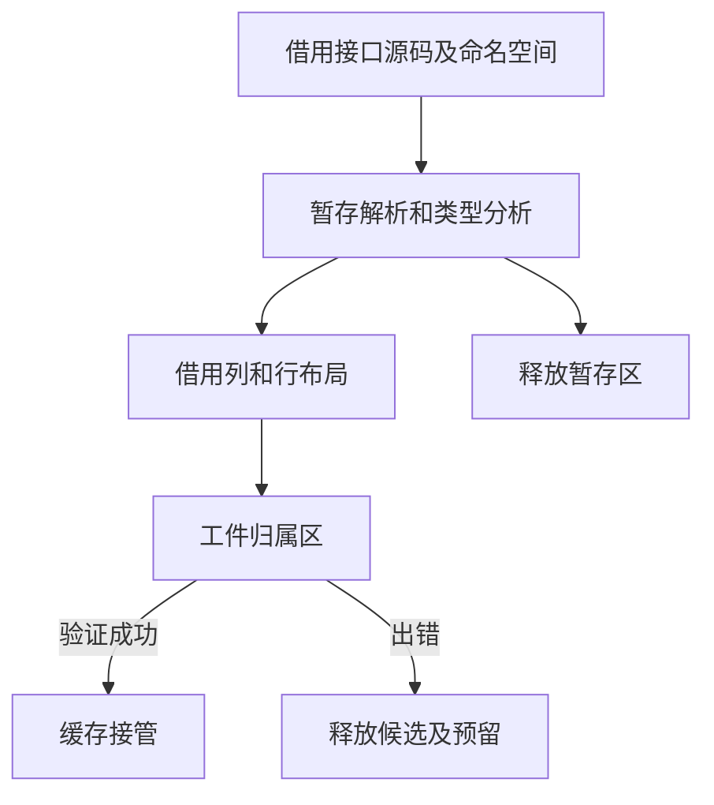

# 原生声明工件创建与发布自举

## Intent

原生声明的冷缓存入口在一条 Source 流程中解析接口、确定名义来源，
再构造缓存持有的工件。缓存验证和命中恢复继续消费同一工件契约。

## Data

批首 `f6b587074`。正式创建入口先生成暂存工件，Zig 再复制类型列、
分配导出行并逐列预留签名，随后调用另一生成入口完成工件发布。
缓存槽在工件建立后预留，候选恢复通过后才提交缓存槽。

## Edges

接口分析使用可立即释放的暂存区。工件承担跨项目缓存所有权，必须
拥有类型名称和 ABI 描述所需的存储。签名按成员数量精确预留，保留
发布顺序、诊断位置和出错后的释放。已缓存工件的核验与恢复继续
发生在缓存槽提交之前。

## Answer

集中验证源码冷写入、已缓存接口恢复、声明编辑、错误诊断和分配
失败。对照两个引导器的产物、固定生成清单和实际磁盘缓存路径。

正式入口由 `create.rx` 编排。解析与名义来源计算仍在暂存区；
`publish.rx` 切换分配区后调用共用类型列发布，再写导出、签名、成员
与来源。原来的 `native_artifact/own.zig` 和单独的发布生成入口已
移除。原生缓存成员与共享项目成员复用同一个行缓冲布局。Zig 只绑定
物理存储、转换诊断并交付 arena；缓存准入及恢复沿原来的 Source 路径。

- 初始 seed 的引导工具与解析器构建通过。正式 Source 工具通过 39 项 RX 回归。
- 两种引导工具的五组清单共 17,834 个生成文件逐字节一致。
- 正式 ReleaseSmall 工具九组回归通过，构建报告为 183/183 步、
  214/214 项测试。覆盖原生声明及分配失败、工件、联结、语义缓存、
  持久缓存、库导入、项目 CLI 及原生接口重排后实际执行。
- 固定 705 入口清单的 9,894 个输出和相邻工具的 memo 载荷一致。
  两个工具本体均由上一代 Source 引导器生成，使用 Source 分析及
  生成。固定对照为原声明准备阶段的 Source 工具。Zig 0.17.0、
  ReleaseSmall、16 分区，三组交错运行取中位数。

| 固定清单冷生成     | 上一批 |  候选 | 固定基线 |
| ------------------ | -----: | ----: | -------: |
| 墙钟，秒           |   1.92 |  1.99 |     2.06 |
| CPU，秒            |   9.41 |  9.50 |     8.95 |
| 进程树峰值 RSS，MB |  522.8 | 527.1 |    737.8 |
| 单进程峰值 RSS，MB |  552.1 | 549.0 |    788.3 |

正式 CLI 原生声明编译用同一真实接口做 11 组交错配对。冷、热和声明
重排场景的墙钟中位数分别增加 0.003、0.014 和 0.032 毫秒。CPU
差异 −0.034 至 +0.022 毫秒，单进程峰值差异不超过 16 KiB。生成的
Zig、ABI 和缓存统计逐项一致。
