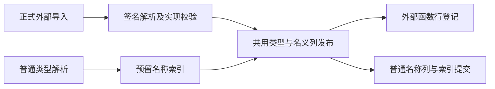
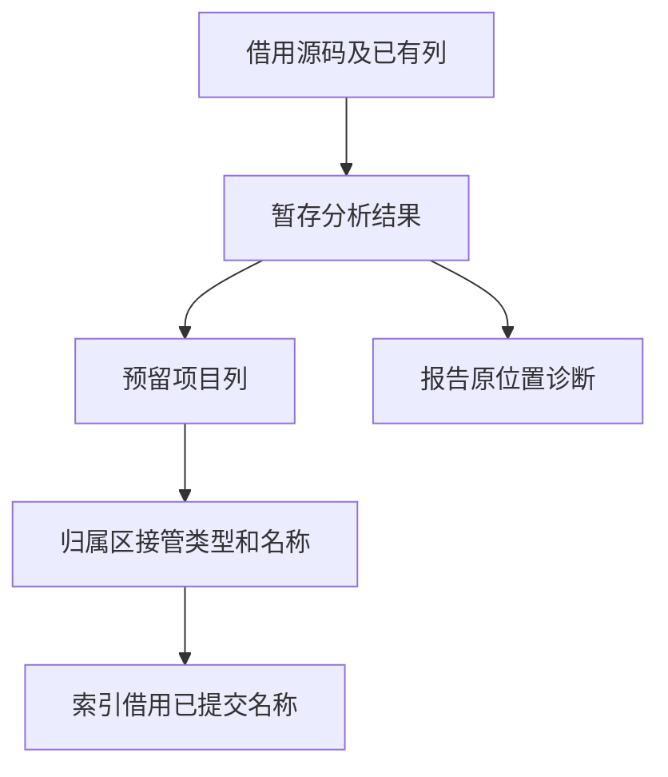

# 外部签名与已解析类型发布自举

## Intent

从正式项目的旧式外部接口导入，贯通声明解析、名义来源确定、类型和
函数行发布。普通类型解析共用类型增量的写入与提交步骤，消除两个入口
共用的专用 Zig 发布回调。

## Data

批首 `d4126a9c5`。外部导入曾调用两个独立的生成入口，中间由 Zig 接管
解析结果并准备类型写入。普通类型解析在名称索引预留后经同一个回调发布
类型，再经另一个 Zig 回调刷新名称索引的借用视图。

## Edges

外部签名解析在暂存区执行，类型、名义来源及函数描述符写入项目拥有区。
先发布允许写回的类型增量，再交付实现校验的原始诊断。成功时在签名准备
与预留后写入函数行。普通类型解析保持名称索引预留、类型写回、名称列
提交、索引更新的顺序。初始 seed 保留原有入口。

## Answer

外部声明由同一个生成入口解析及发布，普通类型解析直接传入借用列。
删除 `publishInterfaceTypes`、`refreshResolvedNames` 及两个专用不透明
类型，名称索引改用通用切片视图绑定。项目外部绑定的注册与导入行追加
仍从项目宿主调用。验收包括源文件与外部枚举身份、原生联结、失败清理、
引导产物和固定输入性能。

- 正式 Source 工具通过 39 项 RX 测试，初始 seed 的引导工具和解析器
  构建通过。两个引导工具的五组清单共 17,848 个生成文件逐字节一致。
- 73 项类型解析回归通过，覆盖延迟解析、名称索引、前向别名深度、源
  视图和失败清理。
- 2 项 ReleaseSafe 名义类型资源测试通过，覆盖重复原生导入和旧式
  外部绑定在逐次分配失败时的资源释放。
- 正式 ReleaseSmall 工具六组回归通过，共 152 个构建步骤、234 项测试，
  覆盖名义来源、类型合并、原生声明、联结、模块记录及项目 CLI。
- 同一旧式外部接口以 CLI 禁用缓存编译，21 组交错配对的 Zig 与 ABI
  输出一致。墙钟中位数从 3.162 降到 3.115 毫秒，CPU 从 2.897 降到
  2.880 毫秒，单进程峰值 RSS 从 7.78 降到 7.75 MB。
- 固定 705 入口清单的 9,894 个输出和相邻工具的 memo 载荷一致。
  两个工具本体均由上一代 Source 引导器构建，使用 Source 分析及生成。
  Zig 0.17.0、ReleaseSmall、16 分区，三组交错运行取中位数。

| 固定清单冷生成     | 上一批 |  候选 | 固定基线 |
| ------------------ | -----: | ----: | -------: |
| 墙钟，秒           |   1.95 |  1.96 |     2.17 |
| CPU，秒            |   9.48 |  9.49 |     9.01 |
| 进程树峰值 RSS，MB |  523.8 | 527.1 |    737.5 |
| 单进程峰值 RSS，MB |  541.2 | 558.1 |    796.8 |

候选的三次单进程峰值为 558.1、559.4、546.6 MB，均在上一版同配置
验收的 538.2 至 562.6 MB 实测区间内。进程树峰值和实际外部接口的
峰值分别按上表及对应 CLI 配对记录。

同一外部接口通过真实 `zxc build` 生成原生程序，输入 9 得到 13。
