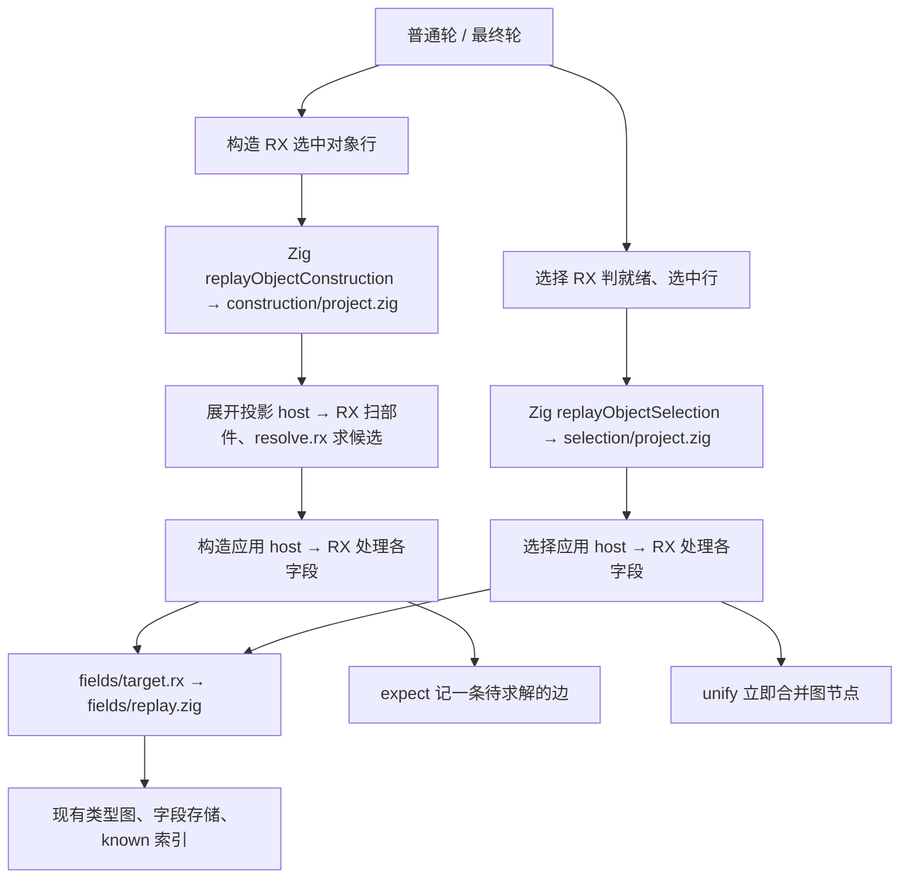
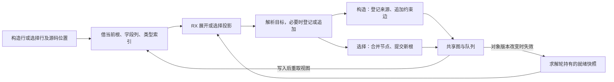

# 对象字段推导还依赖哪些 Zig 状态

## Intent · 本次要解决的问题

对象展开、对象构造和字段选择已经用 RX 控制循环。为什么正式编译器还需要三个专用的 `host.zig`？下一批应当一起迁走哪些读写，才能删除这些文件，并让手写 Zig 净减少？

**结论：构造和选择要一起迁。** 两者都要找到目标字段、把声明类型换成图节点、写完后再取最新视图。构造随后向队列登记约束，选择则当场合并节点。只迁其中一个循环，另一条路径仍需要共享字段桥；只迁两条循环，外层的 Zig 调用者仍要在每行数据上装配输入、调回 RX、刷新图。合适的批次是从两条重放入口贯通到字段写入正式类型图，包含对象临时区、就绪快照的使用、诊断和旧接口清理。整个求解器的存储重写可以独立安排。

## Data · 从正式入口追到写入端

**源码基线**为台北时间 2026-11-23 10:34 的 `9106abb48314c58904c340310f2bed3c530cdefc`。前一提交 `b2fa1d4b5` 加入三个目标文件。后一提交迁了绑定、非空、序列、长度和索引的重放，全仓 Zig 净增 232 行，三个目标文件均未改变。以下是正式 Source 配置的静态调用关系，文末单列未来实现需要的运行证据。[对象字段提交](https://github.com/MatrixAges/zray/commit/b2fa1d4b5) · [后续重放提交](https://github.com/MatrixAges/zray/commit/9106abb48)

### 今天一次字段推导会走哪里

`solve.finish` 创建一份跨轮次复用的就绪性缓存。普通轮与最终轮都可调到构造和选择。外层 RX 已经选出了待处理的行，却仍把这一行交回 Zig；Zig 再调用内部的 RX 投影或字段应用模块。[求解器入口](../../packages/compiler/src/rx/analysis/inference/solve.zig) · [普通轮](../../packages/compiler/src/rx/analysis/inference/solve/propagate.rx) · [最终轮](../../packages/compiler/src/rx/analysis/inference/solve/finalize.rx)

| 当前手写文件                                                                                                             | 行数 | 删它需要接走的职责                                                                                        |
| ------------------------------------------------------------------------------------------------------------------------ | ---: | --------------------------------------------------------------------------------------------------------- |
| [construction/projection/host.zig](../../packages/compiler/src/rx/analysis/inference/construction/projection/host.zig)   |  136 | 按对象绑定部件和图列，按需分配五个展开列，读来源字段，查询就绪性，定位错误部件。                          |
| [construction/application/host.zig](../../packages/compiler/src/rx/analysis/inference/construction/application/host.zig) |   85 | 把候选接到真实图，登记来源类型，读目标形状，为必需字段施加约束或报错。                                    |
| [selection/application/host.zig](../../packages/compiler/src/rx/analysis/inference/selection/application/host.zig)       |   49 | 将选中字段与目标统一，重取根和视图，报告最终结果覆盖错误。                                                |
| [fields/replay.zig](../../packages/compiler/src/rx/analysis/inference/fields/replay.zig)                                 |   80 | 两条路径共用的图指针、结果节点、位置、父节点列及 known 表视图，以及读、增、登记、刷新、施加约束五个回调。 |

前三个文件合计 **270 行**；计入共享字段桥是 **350 行**。另有两份外层 `host.zig` 和两份 `project.zig`，合计 **214 行**。这八个文件在基线共有 564 行，是核算边界和查找调用方的起点。可删除多少，要扣除仍需保留的存储接线和本批新增的所有 Zig。[构造外层](../../packages/compiler/src/rx/analysis/inference/construction/host.zig) · [构造交接](../../packages/compiler/src/rx/analysis/inference/construction/project.zig) · [选择外层](../../packages/compiler/src/rx/analysis/inference/selection/host.zig) · [选择交接](../../packages/compiler/src/rx/analysis/inference/selection/project.zig)

### 哪些状态仍由 Zig 持有，为什么

#### 对象行、部件、选择请求；在求解前登记，求解轮次重读

`graph.pending` 保存构造的 `result/first/count/span`、部件的 `name/value/span`、选择的 `source/result/keys/omit/span`。外层只交给 RX 部分列，遇到实际行还需 Zig 取完整记录。

在已有构造、选择入口借出所需的列。用行号取部件或请求位置，RX 直接接续投影与应用。队列表的生产者可以继续使用现有存储。[图与队列](../../packages/compiler/src/rx/analysis/inference/types.zig) · [构造记录](../../packages/compiler/src/rx/analysis/inference/construction.zig) · [选择记录](../../packages/compiler/src/rx/analysis/inference/selection.zig)

#### 父节点、节点形状、字段名和值；随图增长

声明对象从类型表的字段区间读取，值是 `TypeId`。推导对象从图节点的 `members` 读取，值是 `Graph.Id`。后者的名字、容量和已发布长度藏在一块分配的内存布局里，须由**完整值列**还原描述符。当前 ZX 视图不足以独立取得这两种名字列或安全扩容。

借出带模式的名字和值，以及声明字段区间。推导字段追加时由原拥有者预留内存，由已有 ZX 逻辑发布字段。保留原布局和先前借出的前缀；仅最新已发布前缀且容量足够时可原地扩展。[字段视图](../../packages/compiler/src/rx/analysis/inference/fields/view.zig) · [字段存储](../../packages/compiler/src/rx/analysis/inference/fields.zig) · [追加写入](../../packages/compiler/src/rx/analysis/inference/fields/access.zig)

#### 类型登记与约束；跨对象、跨轮共享

`pending.known_types` 把声明类型映射成图节点。登记会预留节点、可能重排哈希桶，旧切片随之失效。构造的 `expect` 按根去重，只有新边才发布位置、长度并增加 `revision`。选择的 `unify` 立即改根和形状；合并提交会同时增加 `revision` 和 `object_revision`。

两条路径共用已有登记、查根和列视图；构造与选择保留各自的写入语义。写入或扩容后，从当前拥有者重取所需视图，再处理下一字段。共用图只保存一份。[类型登记](../../packages/compiler/src/rx/analysis/inference/known/host.zig) · [约束登记](../../packages/compiler/src/rx/analysis/inference/assignment/registration.zig) · [合并提交](../../packages/compiler/src/rx/analysis/inference/unification/commit.zig)

#### 展开列、名字集合与候选；只活一个对象

`construction/project.zig` 在栈缓冲优先的临时区内处理一个对象，用栈上的空 `StringHashMapUnmanaged` 收集名字，集合扩容使用该临时区。遇到首个展开部件才为该对象预留 `fields/values/roots/open/aliases` 五列，里面借用原字段。ZX 已会填列和选候选；字符串集合接口只提供加入和取键，当前由 Zig 创建集合。

保留单对象临时区及首次展开才分配的时点。可先在临时区的创建处借出空集合与可预留的列，让 RX 贯通同一对象。通用分配继续使用 Zig。保留现有取键与诊断顺序，`setKeys` 当前沿哈希迭代器返回键。[首次预留](../../packages/compiler/src/rx/analysis/inference/construction/projection/begin.rx) · [ZX 填列](../../packages/compiler/src/rx/analysis/inference/construction/publish.zx) · [集合接口](../../packages/std/interfaces/string.d.zx) · [取键实现](../../packages/std/src/string.zig)

#### 对象就绪性快照；一次求解中跨对象、跨轮复用

`solve.finish` 持有 `ObjectClosure` 的 arena 和可空快照。RX/ZX 已会判定和传播就绪性；Zig 仍提供重建、暂存队列及结果发布。查询按 `object_revision` 判陈旧，展开和选择有各自的结果，只有没有选择请求时才可共用。

展开直接使用与选择相同的就绪性上下文和 RX 查询。由原拥有者集中重建、重绑快照。不要为每个字段或对象建新缓存。重建前清除旧引用，分配失败沿原错误出口返回。[查询规则](../../packages/compiler/src/rx/analysis/inference/object_closure/query.zx) · [快照寿命](../../packages/compiler/src/rx/analysis/inference/object_closure.zig) · [已有上下文](../../packages/compiler/src/rx/analysis/inference/object_closure/host.zig)

#### 源码位置与诊断；在首次错误处交付

Zig 的图持有 `Reporter`。展开错误取具体部件的位置，来源类型登记取该部件位置，构造字段缺失取对象位置，选择失败取选择请求位置；不同错误还分别使用 `name` 或 `type_mismatch`。

由 RX/ZX 在原步骤选择错误码、消息和位置，沿已有上层错误出口交给 reporter。不得先统一扫完再报第一项缓存错误。[展开错误](../../packages/compiler/src/rx/analysis/inference/construction/projection/host.zig) · [选择错误](../../packages/compiler/src/rx/analysis/inference/selection/project.zig)

## Edges · 会改变行为或抵消减量的边界

- **构造先目标、再来源。** 先执行 `fields/target.rx` 找到、追加或登记目标，再按部件位置登记来源，最后执行约束或报告缺失、歧义，之后刷新视图。对于未知、受限或缺失的字段，`fields/existing.zx` 可以交给完整的字段访问逻辑；普通访问中的 `length` 也有列表和延迟长度约束分支。保留能从该路径到达的分支，不能把所有缺失字段统一解释为追加。[构造顺序](../../packages/compiler/src/rx/analysis/inference/construction/application/advance.rx) · [字段选择](../../packages/compiler/src/rx/analysis/inference/fields/existing.zx) · [底层访问](../../packages/compiler/src/rx/analysis/inference/fields/access.zig)
- **选择先登记、再投影。** 如果来源是声明对象，按来源顺序先登记**全部**成员类型，然后才能求 `pick/omit` 的索引、判 `Missing/Wait/Ready`。每次有效合并后刷新；普通轮允许等待，最终轮还要验证结果覆盖，零个选中字段也可能要检查。[选择入口](../../packages/compiler/src/rx/analysis/inference/selection/project.zig) · [选择应用与最终检查](../../packages/compiler/src/rx/analysis/inference/selection/application/run.rx)
- **保住数据的寿命。** 新字段名由结果分配器保存；节点和字段列属于图，赋值边和已知类型索引属于待求解区。临时视图不能随对象结束一起释放图数据，也不能整图复制来获得稳定指针。保持原来的名字保留、失败清理和旧字段前缀可读性。[分配器分工](../../packages/compiler/src/rx/analysis/inference/types.zig) · [名字和字段写入](../../packages/compiler/src/rx/analysis/inference/fields/access.zig)
- **限定本批的依赖。** 绑定、索引、序列与其他求解阶段仍共用同一图。本批可以保留已有共享算法内部尚存的 Zig 和 seed 分支，逐一注明仍在正式路径的依赖。需要移除的是对象专用的中转、逐字段语义回调及重复装配图视图。删除文件后若在 `solve/host.zig` 或通用包里重新实现同一套操作，这批仍未收口。[当前求解宿主](../../packages/compiler/src/rx/analysis/inference/solve/host.zig) · [自举完成标准](../../rules/自举完成标准.md)

## Answer · 下一批一起迁什么，怎样验收

### 建议的一批改动

1. **先打通最难写回的一个字段。** 从现有 `fields/target.rx` 的追加分支出发，贯通“创建未知节点 → 保留名字 → 扩展字段 → 发布新成员 → 重取当前视图”。复用 `fields/append.zx` 写名字、值和形状。先验证最新前缀可原地增长、旧前缀另行扩展仍有效。如果现有列接口无法从完整值列取得名字和可写尾段，先维持现有前缀布局，在字段存储处一次交出名字列、节点列和追加位置。分配、对齐和旧前缀复制可以留在那里；决定追加哪个字段、给它哪个节点、何时发布归 RX/ZX。把留下或新写的 Zig 全部算进本批。在这条真实路径上验证首次分配、扩容后再次读写和失败退出，再决定其余接线。[目标字段入口](../../packages/compiler/src/rx/analysis/inference/fields/target.rx) · [已有字段发布](../../packages/compiler/src/rx/analysis/inference/fields/append.zx)
2. **把共同的图读写接到现有规则。** 为本次重放借出对象需要的节点、字段、类型登记、待处理边和版本，沿现有 Source 登记、赋值登记、统一流程接续。由各自原拥有者完成必要的物理扩容；把登记结果、长度、位置、版本和刷新时点接成一次完整操作。立即合并沿用现有递归及深度处理。先前测通的规则继续使用，不增设每字段一个 Zig 转发函数。[已知类型登记](../../packages/compiler/src/rx/analysis/inference/known/run.rx) · [赋值登记](../../packages/compiler/src/rx/analysis/inference/assignment/registration/register.rx) · [统一遍历](../../packages/compiler/src/rx/analysis/inference/unify/run.rx)
3. **两条调用方同批切换。** 构造外层 RX 取得完整对象行后，在同一条 RX 流程内完成展开、就绪性、候选、约束登记和报错。选择外层 RX 在同一流程内完成来源预登记、投影、即时合并和最终覆盖检查。让共用的字段视图从当前图取得；临时资源在一个对象结束时回收，快照留给下一行。切换完成后，`replayObjectConstruction` 和 `replayObjectSelection` 不再需要为了运行下一段 RX 而折返 Zig。[构造外层调用点](../../packages/compiler/src/rx/analysis/inference/construction/advance.rx) · [选择外层调用点](../../packages/compiler/src/rx/analysis/inference/selection/advance.rx)
4. **从调用方拆掉旧接口，再核算整批。** 删除三个目标文件；清理 `fields/replay.zig`、两个 `project.zig` 及外层 host 中已失去调用方的部分。三个目标文件对外提供 12 个专用回调，共享字段桥另有 5 个。同步删除相应的 `root.zig` 导出、`host.d.zx` 的三个专用 opaque 类型与失效声明、本地 `host.zx` 转出。三个内部 RX 仍可供模块调用；在核对引导和 seed 的消费者后，移除只为 Zig 装配设置的独立生成入口。不要重命名旧回调来保留同一条链。[宿主导出](../../packages/compiler/src/rx/analysis/root.zig#L74-L99) · [接口声明](../../packages/compiler/src/rx/analysis/project/workflow/host.d.zx) · [构建登记](../../packages/compiler/build/entries.zig#L1024-L1031)

下图是建议的字段数据流。图上的存储仍可由现有分配器提供，字段的选择、提交顺序和诊断位置由源码流程决定。

### 收口时交付三份证据

- **调用关系。** 从普通轮和最终轮分别追构造与选择，列出消失的专用回调，以及仍然执行的内存预留、登记、合并和快照操作及其拥有者。检查正式 Source 构建读取的文件，再独立核对 seed 路径。把上层转移到别处的 Zig 一并计入。
- **净行数。** 以实际开工时的父提交和该批最终提交作两端比较，分别记录全仓跟踪的 `.zig`、`packages/*/src` 下路径不含 `seed` 的 `.zig`，以及本批触及的共享存储和构建文件。用 `git diff --no-renames --numstat "$base" "$tip" -- '*.zig'`，按路径汇总新增减删除；不把 270 或 350 当成预期净减。若区间夹着无关提交，另列本批差异和同期主线总差异。本批手写 Zig 的实测净值应小于零。
- **行为与成本。** 复用现有 RX 推导及对象字段阶段的回归、诊断位置、分配失败、seed 和 Source 产物对照。沿同一输入检查展开别名、字段缺失/歧义、普通轮等待与最终轮报错、合并后再读取，以及候选生成的分配和内存峰值。基线阶段记录了 153 项 Zig 测试、17 项 CLI 集成和五份引导清单；这些是可复用的对照，本次文档调查未运行迁移后的测试。[RX 推导回归入口](../../packages/test/build.zig#L656-L675) · [原批验收与性能口径](../2026-11-22/RX对象投影与字段写回自举.md)

这次调查已定位阻碍删除的读写和调用者。尚待实现验证的是：沿现有列接口交接后，能保留多少纯物理接线、是否维持原有分配与诊断顺序、整批实际净减多少。第一步的字段追加和最后的两端差异分别回答可行性与减量问题。
