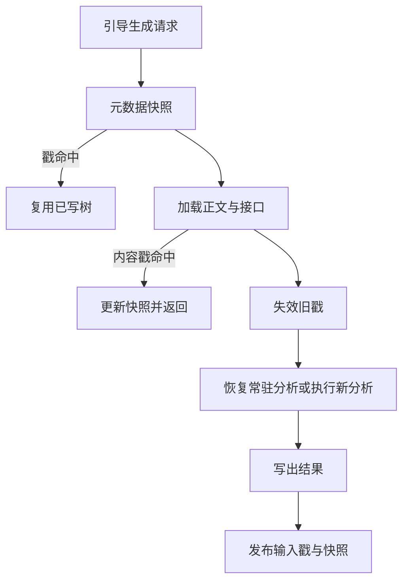

# 引导生成请求流程自举

## Intent

把引导生成请求的两级输入戳判定、常驻分析复用、新分析和写回顺序
迁入 RX。相同请求可以跳过读取和分析，仍能在文件变化或失败后恢复。

## Data

批首 `c77ec0a08`。正式引导工具与初始 seed 共用 Zig 请求入口。
文件元数据可在读正文前命中输入戳。加载后的内容摘要提供第二次命中机会。
原生接口读取错误会使内容戳和常驻分析无法复用，但模板诊断有优先权。

## Edges

保留种子引导和原生文件操作。模板准备、模块准备、原生接口错误与
开始分析维持原次序。生成失败后戳仍无效且不能提前写回。只分析的
请求无须读写戳。快照保存将内存耗尽向上交付，其他快照 I/O 错误沿用
缓存的既有降级行为。戳比较复用固定缓冲。

## Answer

复用引导清单和常驻夹具，验收元数据及内容命中、历史复用、失败修复
和只分析入口。对照输出、诊断、CPU、墙钟和峰值内存。

正式引导工具链接 RX 请求流程。它安排元数据候选、内容候选、失效旧
戳、常驻恢复或新生成，以及最后的戳和快照写回。ZX 用借用的固定
缓冲比较戳宽和内容，原生层读写文件、取得摘要及执行已选定的分析
操作。初始 seed 通过原生顺序调用同一组操作。保持原生接口不可读
时仍先处理模板和模块准备。

Zig 0.17.0、ReleaseSmall。初始 seed 与 Source 工具构建通过，39 项
RX 测试通过。配对核验只分析时不创建输出树、随后的写请求直接恢复
常驻分析、元数据戳命中、缺少快照时的内容戳命中及重新落盘、快照目录
被普通文件占据时的缓存降级、原生接口缺失后旧戳失效与恢复。平铺和 16 分区
的输出、工作线程写出故障后的恢复、常驻精简和复原也一致。

两条引导路径五组清单的 17,892 个产物逐字节一致。十次常驻编辑请求
的产物、复用和失败诊断一致。

### 性能

在同一台机器上，用 Zig 0.17.0 ReleaseSmall 的三套 Source 引导器，
按原来的 705 个入口、16 个分区和固定输入交错运行三轮。9,894 个
文件及所有权 memo 内容逐字节一致。下表为墙钟 / CPU 的中位数。

| 场景   | 批首           | 本批           | 固定基线       |
| ------ | -------------- | -------------- | -------------- |
| 冷生成 | 1.93 / 9.44 秒 | 2.03 / 9.46 秒 | 2.05 / 8.95 秒 |
| 热缓存 | 1.43 / 6.23 秒 | 1.43 / 6.23 秒 | 1.62 / 6.37 秒 |
| 无更改 | 0.03 / 0.03 秒 | 0.03 / 0.03 秒 | 0.03 / 0.03 秒 |

冷生成的进程树峰值 RSS 为 524.5 MB，较批首下降 0.3 MB。单进程峰值
547.5 MB，增加 2.9 MB。较固定基线，冷生成墙钟下降 0.02 秒、CPU
增加 0.51 秒，两项峰值分别下降 214.0 MB、241.3 MB。
