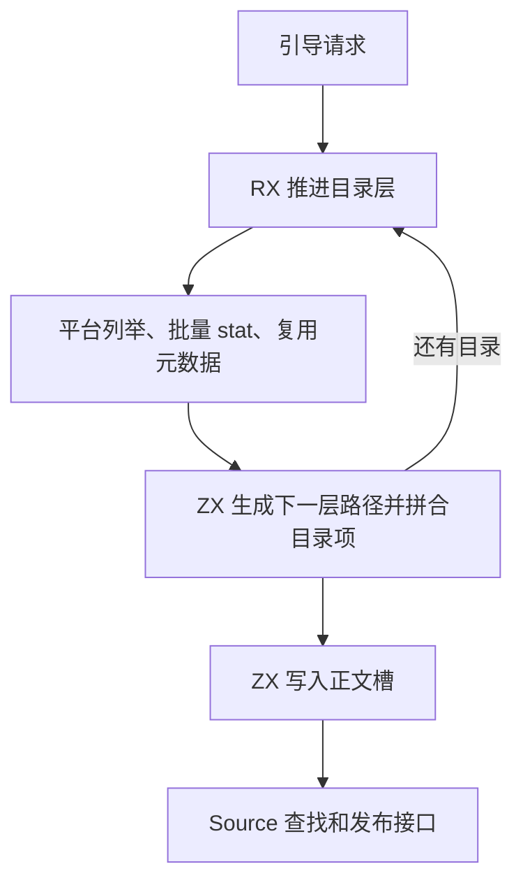
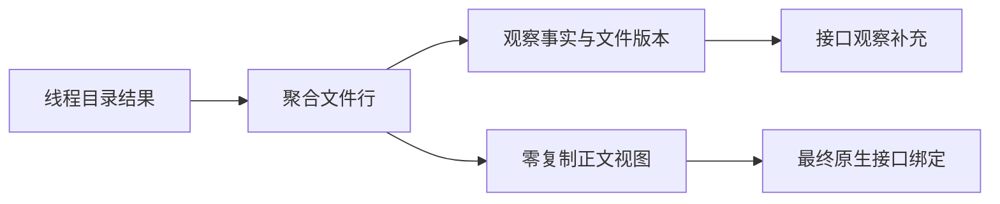

# 引导目录扫描与接口登记自举

## Intent · 迁移引导输入的目录和接口处理

从 `120638dde` 的 Source 引导器继续。目录按深度登记，保留物理扫描、
路径寿命和首个失败顺序。目录项组织、文件复用判定和接口登记由
RX/ZX 执行。写入和只分析请求使用同一实现。

## Data · 批首的正式路径

`Generation.observe` 与 `Generation.load` 通过 `source_collection`
读取物理目录。旧 Zig 路径推进目录层级并分别调用生成的调度和拼合入口，
然后在 Zig 按行选择并写入正文。观察接口和语义接口各生成一批
匹配记录，Zig 再消费这些行、补读外部接口和写入最终绑定。

[目录与正文](../../packages/compiler/build/source_collection.zig) ·
[观察快照](../../packages/compiler/build/input_snapshot.zig) ·
[语义接口](../../packages/compiler/build/interface_inputs.zig)

## Edges · 变更后的正式路径

RX 逐层执行并行物理枚举、目录计数、下一层路径构建、预留目标、
合并结果和释放旧层缓冲。临时路径和下一层路径各使用原有 arena。
两层轮换由 RX 的迭代状态推进，Zig 按索引提供对应的实际分配器。

ZX 直接读取目录项的缓存正文及相对路径，按需读取文件，并写入已
预留的正文槽。正文和已可复用的文件数据继续借用已有缓冲。

接口观察和登记共用 ZX 查找。观察时借用已扫描的事实前缀，并按旧规则
在首个不可观察的外部接口处放弃快照。登记时在同一轮中选择已读正文
或补读物理文件，外部与内部接口分别按原序写入各自区间。
宿主继续处理外部 I/O 的首个错误与跨请求文本的实际保留。

正式路径退出旧 Zig 目录层循环和正文行遍历，移除旧目录调度和拼合
入口、接口匹配和登记暂存表，以及对应的原生适配模块。初始 seed
保留自己的输入算法。平台目录句柄、工作线程、缓冲预留、物理 I/O、
根清单及根内文件观察事实的整理仍有 Zig 依赖。

小清单验证了生成，深层目录实测随后暴露了下一层路径分配时的崩溃。
将分配器选择绑定到持有两个 arena 的同一个扫描对象后，深目录和
正式清单通过。最终连同首错顺序、缓存命中以及观察事实一并核对。

## Answer · 验收

- Zig 0.17.0、ReleaseSmall、16 分区。由批首 Source 和初始 seed
  各构建候选引导器。两条路径使用候选的正式 Source 实现，五组清单
  共 17,887 个生成文件逐字节一致。39 项 RX 测试通过。
- 7,698 条快照记录逐项核对路径、inode、大小、修改及状态变化时间。
  快照载荷长度、写入上下文和输出戳一致。十次常驻请求、只分析、
  元数据命中、内容命中、快照 I/O 异常和接口缺失后的恢复均通过。
- 固定 705 入口清单交错三轮，比较 9,894 个生成产物及所有权 memo
  有效载荷。表中的内存单位为十进制 MB。

| 固定清单指标           | 批首 Source | 候选 Source | 固定 Source 基线 |
| ---------------------- | ----------: | ----------: | ---------------: |
| 冷生成墙钟（秒）       |        1.93 |        1.98 |             2.05 |
| 冷生成 CPU（秒）       |        9.50 |        9.44 |             8.96 |
| 冷生成进程树峰值（MB） |       524.0 |       529.1 |            737.6 |
| 冷生成单进程峰值（MB） |       546.4 |       553.3 |            770.8 |
| 热生成墙钟（秒）       |        1.44 |        1.44 |             1.65 |
| 热生成 CPU（秒）       |        6.26 |        6.28 |             6.41 |
| 无改动墙钟／CPU（秒）  | 0.03 / 0.03 | 0.03 / 0.03 |      0.04 / 0.03 |

冷生成墙钟较批首增加 0.05 秒，CPU 减少 0.06 秒。较固定基线
墙钟减少 0.07 秒、CPU 增加 0.48 秒。本批进程树峰值增加 5.2 MB，
单进程峰值增加 6.8 MB，继续在同一组输入跟踪两项内存指标。

全仓新增的 Zig 集中在平台资源作用域和借用视图绑定。非 seed 包源码
已移除两组生成转接，整体净减 107 行。后续优先合并实际执行的专用
宿主边界，避免每个新入口各保留一套视图绑定。验收日志和产物哈希
保存在 `.zig-cache/verification-tmp/generation-discovery/`。
