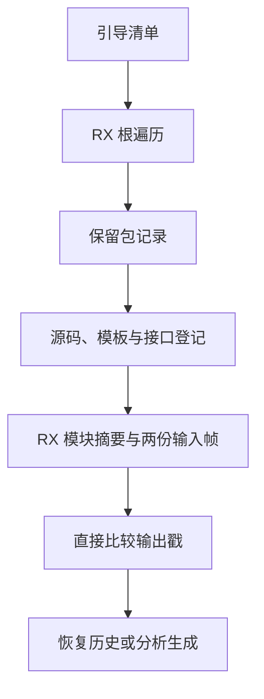
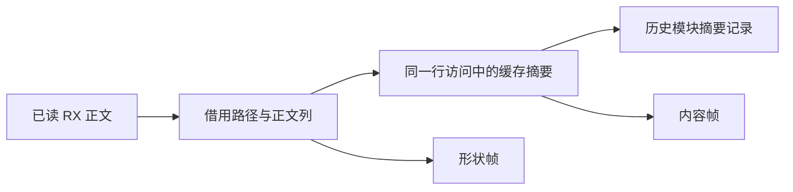

# 引导输入准备与借用绑定自举

## Intent · 迁移根清单、包记录与输入指纹准备

从 `4dd4643f0` 接续。让正式 Source 引导器遍历根清单，选择目录加载
路径，按顺序准备包、源目录和接口。将 RX 模块摘要登记和帧散列合到
同一次遍历，合并不同阶段重复的原生列绑定。

## Data · 批首调用链

`Generation.load` 决定使用已观察目录还是重新扫描，Zig 两条路径
分别遍历根清单。`Generation.prepare` 用 Zig 从清单保留包描述，
分组源码、加载原生接口，逐项求 RX 模块摘要后再交给 Source 写帧。
对照已有输出戳时，Source 还需回到 Zig 生成完整的十六进制比较串。

[引导入口](../../packages/compiler/build/generate_parser.zig) ·
[上一批验收](引导目录扫描与接口登记自举.md)

## Edges · 保留数据布局和写入顺序

RX 推进根目录游标、选择观察过的目录及输入准备各阶段。循环只借用
当前输入。包记录由 ZX 写入最终存储，常驻请求继续保留跨请求文本，
一次性请求直接借用清单文本。

ZX 在访问每个 RX 模块时共用已加载的正文和缓存摘要，写入历史摘要表
及两份散列帧。公开接口和模板仍按原顺序参与计算。输出戳比较逐字节
检查小写十六进制，复用读入的文本和已有摘要。

输入加载、目录元数据、快照读取、摘要和产物发布共用按字段借列的
编译期绑定。该绑定依赖已有的行字段类型和列描述符，只有最后一个
生成调用借用描述符地址。绑定沿用已有文件文本、记录载荷和拥有区。

初始 seed 保持原有实现和摘要字节次序。物理目录与文件 I/O、存储
预留、散列状态和历史拥有区仍由 Zig 提供。原 native 输入遍历、
按批摘要重扫、输出戳格式化回调与多套列描述符转接退出正式路径。

开发中先验证 Source 入口，再由正式构建发现原生视图的只读指针约束
和 Zig 声明重名。保留原有借用契约，由调用方把完整描述符交给
生成入口。

## Answer · 验收

- Zig 0.17.0、ReleaseSmall、16 分区。编译器包 372 项测试通过，
  初始 seed 构建通过。两条引导路径的五组清单共 17,889 个生成产物
  逐字节一致。
- 7,702 条快照记录核对通过，十次常驻请求结果和历史编辑行为一致。
  只分析、元数据命中、内容戳命中、缺失接口恢复及快照 I/O 异常
  都通过。大写输出戳被拒绝，原小写戳重新写回。
- 固定 705 入口清单交错三轮。9,894 个生成产物及所有权 memo
  有效载荷一致。表中的内存单位为十进制 MB。

| 固定清单指标           | 批首 Source | 候选 Source | 固定 Source 基线 |
| ---------------------- | ----------: | ----------: | ---------------: |
| 冷生成墙钟（秒）       |        1.96 |        1.96 |             2.10 |
| 冷生成 CPU（秒）       |        9.52 |        9.52 |             9.06 |
| 冷生成进程树峰值（MB） |       522.7 |       528.5 |            737.3 |
| 冷生成单进程峰值（MB） |       549.2 |       557.1 |            765.0 |
| 热生成墙钟（秒）       |        1.45 |        1.45 |             1.64 |
| 热生成 CPU（秒）       |        6.29 |        6.28 |             6.45 |
| 无改动墙钟／CPU（秒）  | 0.03 / 0.03 | 0.03 / 0.03 |      0.04 / 0.03 |

首轮候选的单进程峰值较批首增加 14.9 MB。一次性请求此前在发射
arena 释放前启动缓存写入。本批改为由现有服务出口释放发射区后
冲刷缓存，常驻请求继续使用后台写入。重测后单进程峰值仍较批首
增加 7.8 MB，进程树峰值增加 5.8 MB。两侧单进程峰值样本区间
重叠，保留该指标继续跟踪。冷生成墙钟与 CPU 较批首持平，较固定
基线墙钟减少 0.14 秒、CPU 增加 0.46 秒。

本批移除了根目录遍历、包记录保留、RX 模块摘要登记的正式 Zig
循环及重复的借用绑定。编译期借用绑定与物理资源仍计入全仓。
原始日志、峰值优化前后结果和产物哈希保存在
`.zig-cache/verification-tmp/generation-preparation/`。
