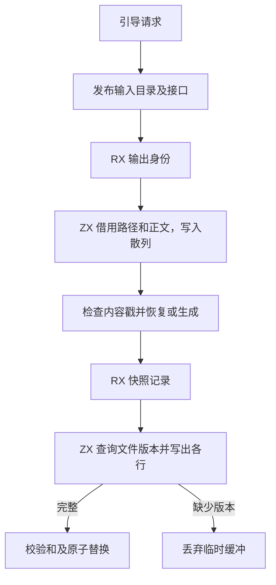

# 引导输入指纹与快照发布自举

## Intent · 迁移输入身份的生成与记录

从 `a13a44abd` 的正式引导请求继续，将源码和模板的输出指纹遍历、
快照行写出及缺失版本时的放弃规则交给 RX/ZX。输出戳仍在事务成功后生效，
快照仍按原格式和原子替换约定发布。

## Data · 正式路径与待退出代码

批首的 `Generation.prepare` 在发布输入目录后用 `outputDigest` 和
`writeDigests` 按块填充 Blake3 缓冲，再交给生成代码写路径和散列。
`InputSnapshot.save` 同样先用 Zig 逐块构造 `Stored`，再调用
`records.header` 和 `records.writeRows`。源码和模板的路径顺序、
头部字段、缓存键以及快照行格式已固定。

[请求入口](../../packages/compiler/build/generate_parser.zig) ·
[快照入口](../../packages/compiler/build/input_snapshot.zig)

## Edges · 实现边界

`output.rx` 按头部、ZX 源码、模板顺序写入摘要。两个文件来源共用
同一个 ZX 循环，通过列视图读取原始路径和内容，单项查询复用常驻文件
的摘要缓存。每项散列只借用到该项写完。

`write.rx` 在精确容量的固定 Writer 中先写头部，再由 ZX 逐行借用
观察路径、查询文件版本并写出字段。缺少任意版本即放弃这份临时快照。
读写时间继续保存原有高低位顺序，校验和与原子替换由宿主执行。

正式引导工具移除了旧分块循环、临时行类型和逐块生成接口。
初始 seed 保留自身的指纹规则及快照格式。文件数据库的版本查找、
当前帧的 RX 模块摘要登记、目录观察和接口文本载入仍由原生层执行。
版本字段的高低位投影保留在平台时间适配处，Source 直接消费结果。

## Answer · 验收

- Zig 0.17.0、ReleaseSmall、16 分区。通过初始 seed 和批首 Source
  分别构建候选引导器，正式运行均使用迁移后的 Source 路径。五组
  清单共 17,884 个生成文件逐字节一致，39 项 RX 测试通过。
- 十次常驻请求与批首一致。只分析、快照与内容两级命中、快照
  目录 I/O 失败及接口丢失后恢复均通过。独立重算 SHA256/Blake3
  指纹，核对了源码先于模板、各集合内部的文件顺序和输出戳。
- 对照完整执行清单的 7,691 条快照记录。路径、inode、大小、
  修改及状态变化时间逐条一致。分别核对记录读取时间、文件头、
  上下文、输出戳和精确载荷长度。
- 固定 705 入口清单交错三轮。9,894 个生成产物和所有权 memo
  的有效载荷一致。表中内存单位为十进制 MB。

| 清单指标               | 批首 Source | 候选 Source | 固定 Source 基线 |
| ---------------------- | ----------: | ----------: | ---------------: |
| 冷生成墙钟（秒）       |        1.96 |        1.97 |             2.13 |
| 冷生成 CPU（秒）       |        9.49 |        9.54 |             9.08 |
| 冷生成进程树峰值（MB） |       529.9 |       526.5 |            738.5 |
| 冷生成单进程峰值（MB） |       550.1 |       541.8 |            761.3 |
| 热生成墙钟（秒）       |        1.46 |        1.47 |             1.64 |
| 热生成 CPU（秒）       |        6.30 |        6.32 |             6.44 |
| 无改动墙钟／CPU（秒）  | 0.03 / 0.03 | 0.03 / 0.03 |      0.04 / 0.03 |

冷生成 CPU 较本轮固定基线增加 0.46 秒，墙钟减少 0.16 秒。

本批相对批首的冷、热路径变化均在单批容差内。原始记录与比较
清单在 `.zig-cache/verification-tmp/generation-inputs/`，保留两条
引导路径的构建摘要、对照结果及散列清单。

小清单首先证明了新增入口可以生成。全清单随后发现读取类型
传递依赖了写入宿主，已将写入和读取类型分开。下一批将目录观察、
已观察文件载入和接口登记放在同一调用链核对，通用物理读写继续
沿用，优先移除仍执行的逐级循环和 Zig 状态交接。
