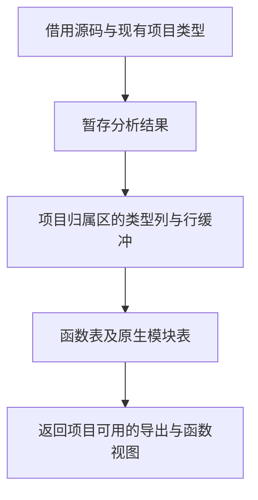

# 无缓存原生声明加载与发布自举

## Intent

从普通项目的原生导入入口一次完成接口分析、类型发布、成员签名和
模块登记。源文件只解析一次，冷缓存入口和普通入口共用解析与分析。

## Data

批首的普通入口 `loadFreshProjectNative` 先通过 `native/interface.zig`
调用接口分析和项目发布，再经 `finalizeNative` 重借导出行以登记
原生模块。抽出的三段生成入口绑定各自不同的描述符。

## Edges

维持已有项目归属区和原生类型所有者，发布类型后才发布签名。原生
函数长度在签名列准备完成后一次提交。导出名只复制一次，
项目侧导出行与原生模块名称列共用字符串。没有函数的接口仍发布
命名空间。保留初始 seed 及原位置错误报告。

## Answer

核对无缓存正式路径、缓存入口仍可工作、错误诊断和失败时资源回收。
比较初始 seed 与 Source 生成结果，再对照固定清单和同一原生模块的
实际无缓存编译耗时与峰值内存。

`native/delivery/run.rx` 在分析结束后选择项目分配区，调用共用类型
列发布，并把导出写入行缓冲和模块列。普通入口与缓存入口共用名义来源
构造。删除 `native/interface.zig`、`finalizeNative` 以及分析和
终结的独立生成入口。正式 Zig 边界负责借用物理列、诊断定位与返回
已有视图。未缓存路径的 seed 实现继续用于初始引导。

- 正式 Source 工具构建通过，39 项 RX 回归通过。
- 初始 seed 的引导工具与解析器构建通过，两种引导工具的五组
  清单共 17,846 个生成文件逐字节一致。
- 正式 ReleaseSmall 工具六组回归通过，构建报告为 137/137 步、
  122/122 项测试。涵盖原生声明、原生模块与联结、项目 CLI、
  库导入，以及原生接口跨缓存使用、重排和执行。
- ReleaseSafe 原生声明的 4 项回归通过，包含原始诊断位置及成功、
  失败路径的逐次分配失败检查。
- 实际无缓存原生接口用同一项目做 21 组交错配对，生成 Zig 与
  ABI 逐字节一致。墙钟中位数从 4.893 增至 4.944 毫秒，CPU 从
  4.699 增至 4.714 毫秒，单进程峰值 RSS 持平，为 8.32 MB。
- 固定 705 入口清单的 9,894 个输出和相邻工具的 memo 载荷一致。
  前后都是由上一代 Source 引导器构建的 Source 工具。Zig 0.17.0、
  ReleaseSmall、16 分区，三组交错运行取中位数。

| 固定清单冷生成     | 上一批 |  候选 | 固定基线 |
| ------------------ | -----: | ----: | -------: |
| 墙钟，秒           |   1.96 |  2.00 |     2.09 |
| CPU，秒            |   9.51 |  9.58 |     9.07 |
| 进程树峰值 RSS，MB |  529.5 | 525.1 |    738.5 |
| 单进程峰值 RSS，MB |  553.7 | 550.1 |    782.3 |
