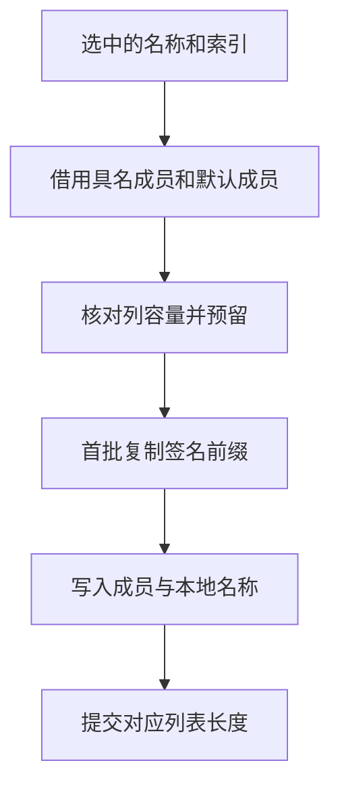

# 混合项目函数导入发布自举

## Intent

让索引化 ZX 正文的源码导入、编译库导入和再导出共用 Source 发布流程。
移除宿主的预留、签名前缀搬运和逐行追加回调。

## Data

批首 `1db8755f8`。顺序编译与并行预取共用 `Preparation.bind`。它先借用
该模块在依赖图中的边，用现有 Source 选择器取得名称和索引，再由 Zig
扩容、补签名前缀、复制名称并逐行更新两个结果列表。收集为空时直接借用
签名列表。最终列表和名称均归属调用者的绑定分配区。

## Edges

源码与编译库都使用真实函数表的签名。纯类型和原生依赖保持原有处理。
每个结果列表首次有正文成员时复制一次签名前缀，保留成员命名空间与原
诊断顺序。源列表及签名前缀只借用；写入新结果行时复制成员的固定记录
并持有本地名称。容量增长保留 Zig 列表的增长公式与溢出处理。

## Answer

Source 按源码顺序读导入，选择普通列表或再导出列表，并在原归属区扩容
和写入。Zig 的两种发布回调退出正式路径。宿主继续加载依赖并为现有
Source 选择器提供视图。非索引化实现保留给 seed 和原有兼容入口。

第一版生成代码会为 RX 循环的游标分配临时对象。最终将单个集合的遍历
留在 ZX，循环只推进标量行号，通过原请求借用只读上下文。在定向生成中
核对调用链，临时游标和捕获元组的分配均已退出。仍有原需的结果容量和
本地名称分配。空结果继续直接借用签名列表。

正式 Source 引导构建通过 30 步和 39 项 RX 回归。用同一候选通过十次
常驻请求对照，覆盖依赖映射变化、后缀复用、错误与恢复。候选引导器
SHA-256 为 `570ccaaffe4bf8f5f30b98490e68b8546671e5c82085226ce47bf54738dcdba1`。
独立初始 seed 构建通过 52 步。两条引导路径的五份清单共 17,805 个生成
文件逐字节一致。

ReleaseSmall 通过 123 个构建步骤和 164 项 Zig 测试。六组独立编译库
执行、14 个 ZX 导入路径场景、磁盘项目、`watch`、原生与编译库 Store、
权限边界及 46 项应用入口检查通过。剥离符号的 ReleaseSafe 单独通过
138 项 RX 推导测试，包含原编号越界、分配失败和对象寿命用例。

### 性能

沿用固定清单、16 分区和单次生成模式，交错运行三轮取中位数。候选由
正文结果发布阶段的 Source 引导器生成，批首对照由 Store 槽登记阶段的
Source 引导器生成。固定基线采用声明准备阶段的工具，三者均启用 Source。

| 版本     |  冷墙钟 |  冷 CPU | 冷进程树峰值 RSS |  暖墙钟 |  暖 CPU |
| -------- | ------: | ------: | ---------------: | ------: | ------: |
| 固定基线 | 2.10 秒 | 9.05 秒 |         737.8 MB | 1.65 秒 | 6.45 秒 |
| 批首对照 | 1.95 秒 | 9.53 秒 |         523.8 MB | 1.45 秒 | 6.26 秒 |
| 候选     | 1.96 秒 | 9.50 秒 |         529.3 MB | 1.45 秒 | 6.29 秒 |

较批首，冷墙钟增加 0.01 秒，CPU 减少 0.03 秒，进程树峰值中位数增加
5.5 MB，单进程峰值中位数增加 4.7 MB。两组进程树峰值样本范围重叠。
较固定基线，冷墙钟减少 0.14 秒，CPU 增加 0.45 秒，进程树峰值减少
208.5 MB。候选与批首的 9,894 个生成文件及所有权 memo 载荷一致。
