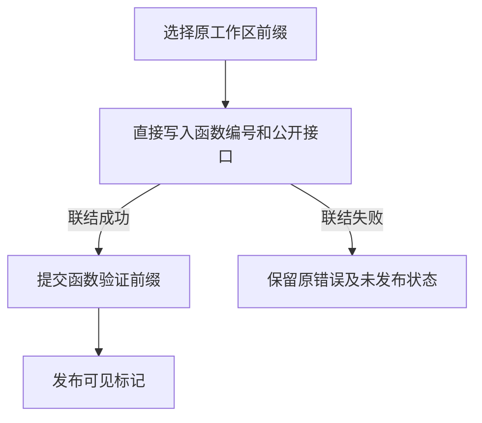

# 混合项目正文结果发布自举

## Intent

让顺序编译和并行准备的 ZX、RX 正文在联结时直接写入项目结果槽。
Source 在联结成功后提交已验证函数前缀和结果可见标记。依赖绑定、
入口、公开导出和历史比较继续读取同一份结果。

## Data

批首 `cd2b2adfb`。正式混合编译的 `mixed/run.rx` 先选择正文，再由
`body/link/apply.rx` 对齐共享工作区并联结。原路径经多个 Zig 值返回
传递默认函数和公开接口，最后由 `Finished.set` 二次写入。剥离符号的
ReleaseSafe 推导曾在绑定导入时拿到越界默认函数编号。将联结出口改成
调用者提供的地址后，原独立推导套件 138 项通过。最终候选沿用同一
剥离符号的 ReleaseSafe 配置，138 项全部通过，覆盖原先失败的 Store
合同寿命、分配失败和权限用例。

## Edges

保留共享函数表、结果列的布局和缓存历史的可见标记。授权 setter 独立
联结，不得改写普通模块结果。默认成员的签名从共享函数表的当前行读取。
物理列、短期工作区和 seed 路径仍由宿主提供。借用描述符不延长输入区寿命。

## Answer

顺序 ZX、顺序 RX、已准备的 ZX 和已准备的 RX 都直接写入共享结果槽。
移除了 `Finished.set` 对公开接口的二次组装，以及原生的确认回调。
Source 在成功后写入验证前缀与可见标记。导入、入口、导出与历史比较
直接借用原槽，其中源码导入不再构造一个临时的编译库导出记录。
授权 setter 继续单独返回函数编号，保留对共享函数前缀的更新。

正式 Source 引导构建通过 30 步和 39 项 RX 回归。独立初始 seed 构建
通过 52 步。两条引导路径的五份清单共 17,795 个生成文件逐字节一致。
候选 Source 引导器 SHA-256 为
`c3e0b42652b0ef1e5451899bedc528984278d1169b012984ecfecd0b22c37461`。

10 次常驻请求对照通过，覆盖工作区映射变化、后缀复用、重复注册诊断
和恢复后的产物。另一个常驻场景的 6 次依赖重定向均与同输入的冷生成
一致，缺失依赖返回原诊断，恢复初始输入后产物也恢复原样。

ReleaseSmall 通过 94 个构建步骤及 138 项推导测试。46 项应用入口、8 项
原生 Store、17 项编译库 Store、8 项权限边界、9 个磁盘项目场景与 `watch`
回归通过，统一库的混合 RX 与 ZX 入口通过执行对照。

### 性能

沿用固定清单、16 分区和单次生成模式，交错运行三轮取中位数。候选由
Store 槽登记阶段的 Source 引导器生成，批首对照由表达式列提交阶段的
Source 引导器生成。固定基线采用声明准备阶段的工具；三者均启用 Source。

| 版本     |  冷墙钟 |  冷 CPU | 冷进程树峰值 RSS |  暖墙钟 |  暖 CPU |
| -------- | ------: | ------: | ---------------: | ------: | ------: |
| 固定基线 | 2.12 秒 | 9.04 秒 |         738.0 MB | 1.64 秒 | 6.42 秒 |
| 批首对照 | 1.95 秒 | 9.53 秒 |         524.5 MB | 1.44 秒 | 6.26 秒 |
| 候选     | 1.98 秒 | 9.49 秒 |         528.5 MB | 1.44 秒 | 6.25 秒 |

较批首，冷墙钟增加 0.03 秒，CPU 减少 0.04 秒，进程树峰值增加 4.0 MB，
单进程峰值增加 4.4 MB。较固定基线，冷墙钟减少 0.14 秒，CPU 增加
0.45 秒，进程树峰值减少 209.5 MB。候选与批首的 9,894 个生成文件及
所有权 memo 载荷一致。
