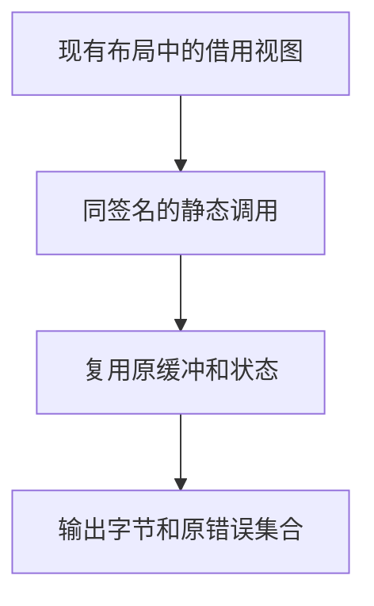

# 生成与产物发布原生绑定自举

## Intent

生成缓存、函数产物、引导树、库入口、应用初始化、Gateway、State
和 Verilog 的 Source 流程直接链接各职责的定义，删除编译器根模块
为这些流程维护的逐函数转发。

## Data

批首是远端 `bfba9d3c6`。上述入口已由 Source 编排。四个原生接口
仍逐函数读取编译器根模块的 Zig 转发，原定义与转发必须同步维护。
验证和硬件流程已经使用 Source 生成的编译期定义绑定。

## Edges

四个接口采用同一编译期绑定机制。保留原函数签名、错误集合、内存
归属、线程调度和调用顺序。引导器继续静态链接；函数识别、缓存访问、
生成线程和平台 I/O 的实际原生实现仍留在各自模块。

## Answer

四个接口切换后删除 45 个逐函数转发。非 seed 包源码 Zig 新增 12 行、
删除 55 行，净减 43 行。全仓新增 16 行、删除 59 行，净减 43 行。

- Zig 0.17.0，ReleaseSmall。以初始 seed 和上一批 Source 引导器分别
  构建，五组清单产出的 17,875 个文件逐字节一致。
- 39 项 RX 测试与 76 项生成、缓存、库导入、Gateway 和硬件回归通过。
  常驻生成的 10 次请求保留原产物、复用计数和失败诊断。
- 固定 705 入口清单使用 16 个生成分区，对 Source 构建的工具交错运行，
  记录冷生成、热缓存及无更改请求。

| 场景   | 上一批墙钟 / CPU | 本批墙钟 / CPU | 固定基线墙钟 / CPU |
| ------ | ---------------- | -------------- | ------------------ |
| 冷生成 | 1.92 / 9.46 秒   | 1.97 / 9.52 秒 | 2.05 / 8.92 秒     |
| 热缓存 | 1.42 / 6.21 秒   | 1.46 / 6.18 秒 | 1.63 / 6.40 秒     |
| 无更改 | 0.03 / 0.03 秒   | 0.03 / 0.03 秒 | 0.03 / 0.03 秒     |

冷生成进程树峰值从 525.1 MB 降到 524.8 MB，单进程峰值从 540.1 MB
升到 547.7 MB。固定基线两项分别为 737.9 MB 和 783.9 MB。相对
固定基线，冷生成墙钟减少 0.08 秒，CPU 增加 0.60 秒。各场景的
时间变化均在验收容差内。固定清单的 9,894 个生成文件及所有权 memo
载荷一致。
