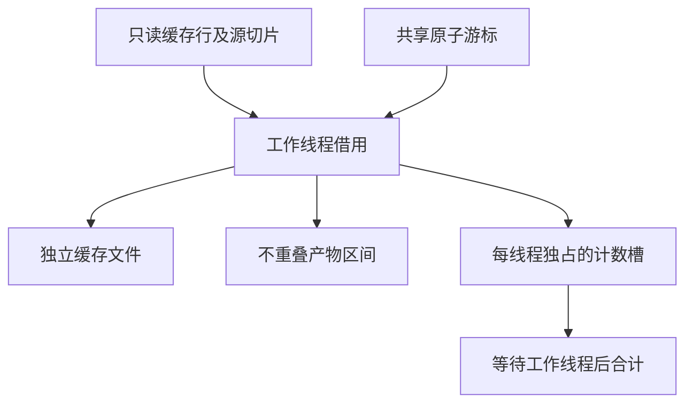

# 生成缓存与产物复制工作线程自举

## Intent

将生成缓存写入和函数产物分块复制的逐项领取、退出判断和结果交付
迁入 Source。沿缓存首次写入、热读取和函数正文重新生成验证这两条
正式调用链。

## Data

批首 `f64298f18`。缓存写者在 Zig 中从原子游标逐条领取，逐个写文件，
按工作线程保存成功与错误总数。函数产物复制每次在 Zig 中领取 16 条，
再调用 Source 写入这一段。两个入口均使用现有的共享线程池。

## Edges

保持线程数量和领取粒度。缓存写错一个文件后继续后续任务，失败次数
计入上一层，最后保存的错误交由 Zig 转换为原生错误。遇到不产生文件的
记录只跳过。函数产物复制在共享错误槽出现非零值后停止继续领取，并且
只写各线程领取的不重叠目标区间。工作循环借用队列和目标，分配器与
操作系统线程由原生接口提供。

## Answer

正式缓存写入和产物复制的两个工作循环由 Source 推进。缓存写入计数
直接写入上一层指定的槽，删除逐分块的正式 Zig 探测和旧生成复制入口。
一个缓存文件的实际写入与线程启动仍由 Zig 执行。集中验证磁盘恢复、
真实错误、函数源复用与发布、常驻编辑以及固定生成清单。

- 正式 Source 工具的 39 项 RX 回归通过。十次常驻请求的产物与复用
  统计一致。
- 同一 ReleaseSafe 队列负载分别运行正常写盘与目录错误。正常场景
  33 条全部写入并读回，内容一致。用普通文件作为目录祖先时，33 条
  都被处理，成功数为零、失败数为 33，最后错误为 `NotDir`。两次
  本地调试分配器均正常退出。
- 初始 seed 的引导工具与解析器构建通过。seed 与 Source 在五组
  清单的 17,875 个生成文件逐字节一致。
- 正式 ReleaseSmall 工具四组回归通过，共 113 个构建步骤、23 项
  测试。覆盖缓存写入和恢复、函数产物复用与复制、库导入和项目 CLI。
- 固定 705 入口清单的 9,894 个输出与 memo 载荷一致。对照和候选
  均由上一代 Source 引导器构建，并使用 Source 分析及生成。
  Zig 0.17.0、ReleaseSmall、16 分区，三组交错运行取中位数。

| 固定清单冷生成     | 上一批 |  候选 | 固定基线 |
| ------------------ | -----: | ----: | -------: |
| 墙钟，秒           |   1.91 |  1.99 |     2.07 |
| CPU，秒            |   9.40 |  9.53 |     8.97 |
| 进程树峰值 RSS，MB |  529.0 | 524.5 |    737.9 |
| 单进程峰值 RSS，MB |  546.2 | 553.0 |    760.1 |

热生成墙钟从 1.40 增至 1.44 秒，CPU 从 6.16 增至 6.21 秒。
