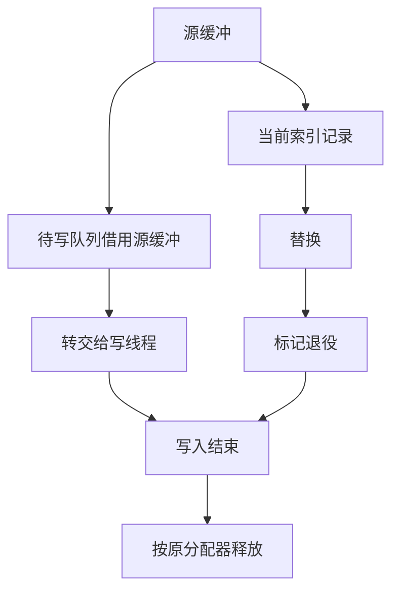

# 生成缓存替换与写队列发布自举

## Intent

沿生成结果和磁盘命中共同进入的缓存写入请求，迁移替换、待写队列
发布、写入计数和退役源释放。后台写入继续重叠，命中和替换保留原
内容及所有权契约。

## Data

批首 `388a1c10c`。替换判断与退役行查找已有 ZX 实现，Zig 仍预留
待写队列、决定写入和标记的执行顺序，并在写线程完成后循环释放。
缓存中的源可能来自元数据分配器或共享分配器。

## Edges

计划必须在预留可能移动队列之前读取旧源，退役标记要在预留后借用
最新的列地址。旧源仍在待写队列时只标记退役，等写入结束再由原分配器
释放。先预留待写行，再完成上一批写入，最后提交索引记录及待写行。
具体线程启动、等待、文件操作和记录行的原生类型绑定由宿主完成。

## Answer

Source 直接预留队列、刷新退役字段视图、设置标记、发布新行以及
累计写入结果并释放退役源。原独立替换计划入口及重复的退役行查找
入口退出。保留一个具体索引行交付边界，负责将已定的待写位置和
记录交给共用路径索引。集中验证磁盘恢复、缓存替换与分配失败、
常驻编辑、引导产物及固定清单性能。

- 正式 Source 工具通过 39 项 RX 回归，初始 seed 的引导工具和解析器
  构建通过。两个正式工具在十次常驻请求的产物和复用统计一致。
- ReleaseSafe 负载在同一条索引上连续提交 32 个版本，交替使用本地与
  共享缓冲，经历待写队列扩容，调用后台写入入口后再替换一次。33 条记录
  均落盘并重新打开，内容一致，I/O 错误为零，本地调试分配器正常退出。
- seed 与 Source 各生成的五组清单共 17,866 个文件逐字节一致。
- 正式 ReleaseSmall 工具四组回归通过，共 113 个构建步骤、23 项
  测试。覆盖生成缓存替换、失败后重试、磁盘缓存恢复、库交付与
  项目 CLI。拆分应用在冷编译、热命中、源码变更和禁用缓存下均
  执行通过。
- 固定 705 入口清单的 9,894 个输出与 memo 载荷一致。对照和候选
  都由上一代 Source 引导器构建，并使用 Source 分析及生成。
  Zig 0.17.0、ReleaseSmall、16 分区，三组交错运行取中位数。

| 固定清单冷生成     | 上一批 |  候选 | 固定基线 |
| ------------------ | -----: | ----: | -------: |
| 墙钟，秒           |   1.95 |  2.00 |     2.06 |
| CPU，秒            |   9.45 |  9.51 |     8.97 |
| 进程树峰值 RSS，MB |  526.3 | 528.6 |    738.1 |
| 单进程峰值 RSS，MB |  534.9 | 545.6 |    760.7 |

热生成墙钟从 1.47 增至 1.48 秒，CPU 从 6.30 降至 6.23 秒。
