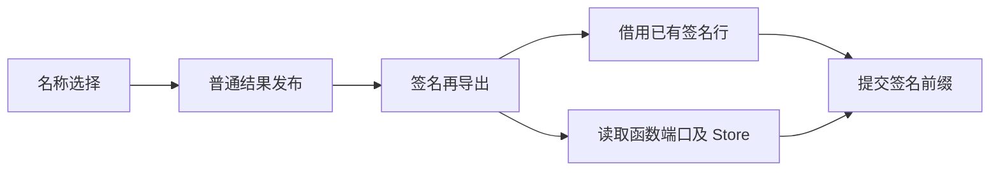
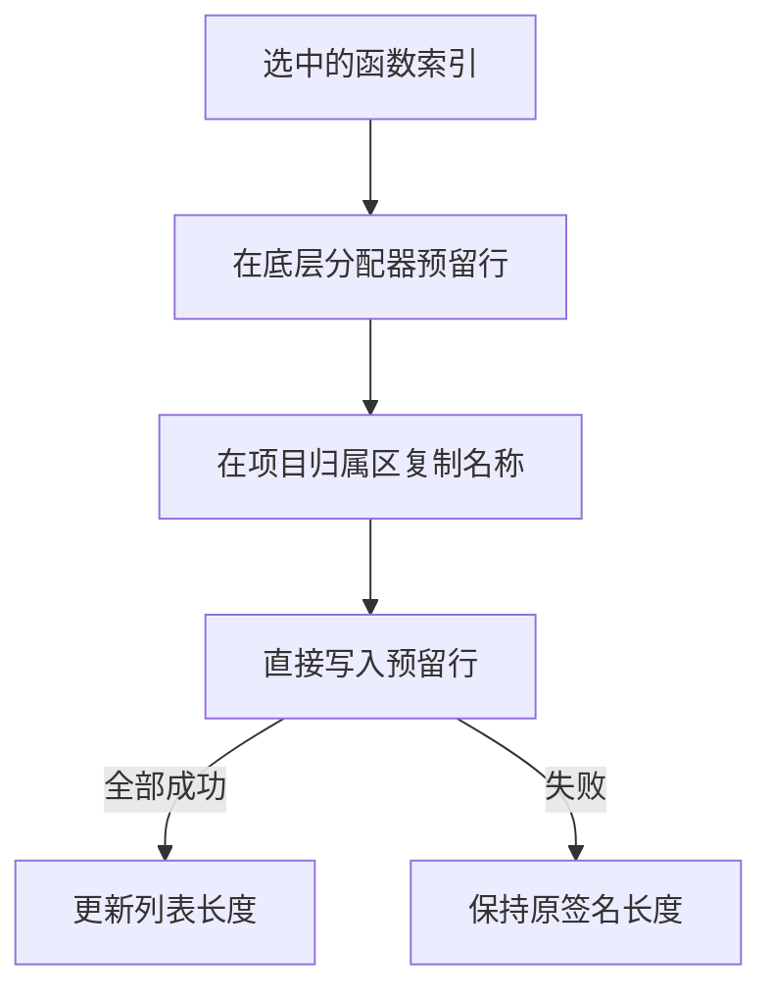

# 签名再导出与导入统一发布自举

## Intent

将签名再导出接在同一次 Source 导入交付上，使已经选择的成员直接写入
签名列表。删除专用 Zig 回调和独立生成入口。

## Data

批首 `255616474`。普通选择和结果写入已合并，签名再导出仍由外层 RX
另行调用 Zig。宿主保存选中的函数，预留签名列表，再运行独立的 Source
写入器。从已有声明转发时借用成员行，从已联结函数生成时读取端口与 Store。

## Edges

先发布类型、常量及函数，再处理签名。签名列表用项目 arena 的底层分配器
预留，别名文本仍归属项目结果。复制已有声明保留暂缓来源和 Store 标记。
根据函数构造签名沿用现有端口、内置函数与 Store 判断。只有整个再导出批
成功才提交签名列表长度，失败时保留原先可见的行。

## Answer

正式 Source 引导构建通过 30 步和 39 项 RX 回归，初始 seed 构建通过
52 步。两套引导器分别按正式 Source 配置生成五份清单，共 17,811 个文件
逐字节一致。10 次常驻请求对照一致，覆盖修改、失效诊断和恢复。ReleaseSafe
通过 138 项 RX 推导测试。

ReleaseSmall 的 122 个构建步骤与 159 项 Zig 回归全部通过。独立 ZX 导入、
目录再导出、混合项目正文、编译库 Store、磁盘项目与 `watch` 的集成检查
通过。候选引导器 SHA-256 为
`96863a93a0cf7145033f07cdcda5522a00ca7e7b90732d50484d6deb2bccc738`。

性能对照使用 705 项固定清单、16 分区及 `ReleaseSmall` 正式 Source
引导器。候选本体由批首 Source 引导器生成，三轮交错运行，关闭常驻生成器。
固定清单的 9,894 个生成文件与所有权 memo 载荷一致。

| 版本     | 冷墙钟 | 冷 CPU | 冷进程树峰值 RSS | 冷单进程峰值 RSS | 暖墙钟 | 暖 CPU |
| -------- | -----: | -----: | ---------------: | ---------------: | -----: | -----: |
| 固定基线 | 2.11 s | 8.96 s |         738.3 MB |         760.7 MB | 1.63 s | 6.34 s |
| 批首     | 1.95 s | 9.49 s |         522.3 MB |         549.4 MB | 1.41 s | 6.18 s |
| 候选     | 1.95 s | 9.44 s |         524.5 MB |         543.9 MB | 1.44 s | 6.22 s |

较批首，冷生成墙钟持平、CPU 减少 0.05 秒，进程树峰值增加 2.2 MB、
单进程峰值减少 5.5 MB。较固定基线，墙钟减少 0.16 秒、CPU 增加 0.48 秒、
进程树峰值减少 213.8 MB。无改动的暖入口墙钟中位数为 0.03 秒，与批首持平。

源码已退出 `publishProjectReexports` 和独立生成入口，导入帧无需传递
选中的函数列表。仍保留 Zig 行存储借用、底层分配器与结果表的物理绑定。
按 Git 完整行差比较，本批非 seed 包源码 Zig 新增 146 行、删除 111 行，
全仓 Zig 新增 146 行、删除 112 行。增量已计入主线累计。
