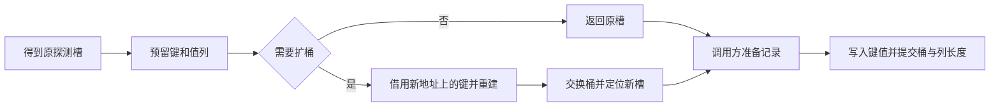
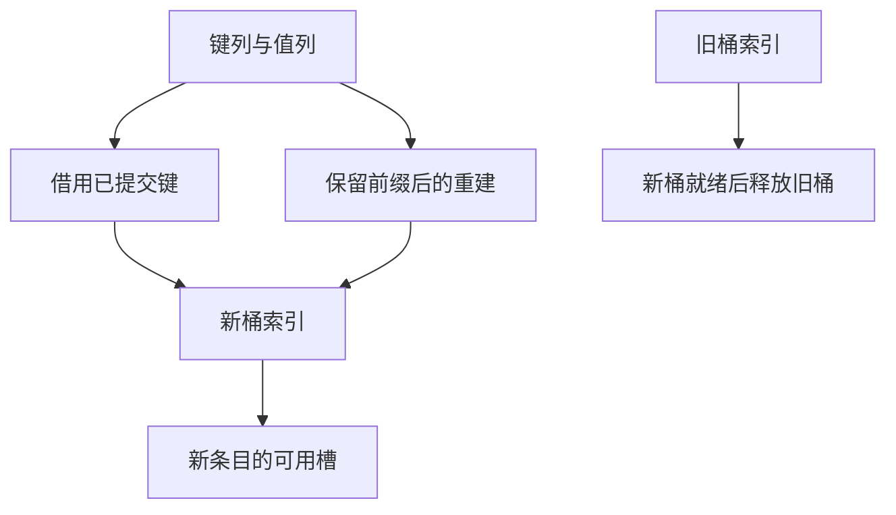

# 缓存共用路径索引自举

## Intent

解析缓存、语义工件缓存、生成缓存和常驻文件索引共用路径索引的
预留及发布。新条目的桶扩容、重建和重定位由一条 RX 流程执行，
解析缓存收缩后复用同一套桶重建算法。

## Data

批首 `38589a683`。四个调用方各自在 Zig 中处理桶增长后的再次查找。
共享索引宿主负责预留键和值列、建立新桶、重建及切换桶，容量达标
和桶探测来自分散的生成入口。提交分别写入键和值、桶和两列长度。

## Edges

维持原初始容量、装载率、倍增规则、分配顺序及原地保留索引槽。
预留键列后重新借用切片，因为扩容可能改变地址。新桶完成重建前
保留旧桶，成功后只交换切片描述符，并释放旧桶。键和值先写入预留
位置，再登记桶和提交两列长度。Zig 保留实际值类型和物理槽绑定，
各缓存继续管理自己记录与路径的生命周期。

## Answer

正式索引共用一个预留入口和一个发布入口，删除分别调用容量选择与
桶重建的生成入口，以及四处增长后重探测。通用内存层提供借用列表
视图和交换、释放 U64 缓冲，Source 决定调用顺序。补齐标量缓冲合同
时按职责拆出其声明，保留既有函数的签名。集中验证四类索引、分配
失败、常驻编辑恢复以及固定清单的性能。

- 正式 Source 工具通过 39 项 RX 回归，初始 seed 的引导工具和解析器
  构建通过。两个引导工具的五组清单共 17,861 个生成文件逐字节一致。
- 两个正式工具在十次常驻编辑和恢复请求得到相同生成文件及复用统计，
  覆盖请求重复、映射变化、后缀复用、重复路径诊断和恢复原输入。
- ReleaseSafe 下两项解析缓存资源回归通过，覆盖插入、替换、拒绝、
  修复及依赖变化时的逐次分配失败。
- 正式 ReleaseSmall 工具六组回归通过，共 106 个构建步骤、44 项测试。
  覆盖解析、语义及磁盘缓存、生成缓存和项目 CLI。生成缓存的现有
  集成场景实际执行了生成程序并验证恢复。
- 固定 705 入口清单的 9,894 个生成文件与 memo 载荷一致。对照和
  候选均由上一代 Source 引导器构建，使用 Source 分析及生成。
  Zig 0.17.0、ReleaseSmall、16 分区，三组交错运行取中位数。

| 固定清单冷生成     | 上一批 |  候选 | 固定基线 |
| ------------------ | -----: | ----: | -------: |
| 墙钟，秒           |   1.99 |  1.98 |     2.10 |
| CPU，秒            |   9.54 |  9.48 |     9.03 |
| 进程树峰值 RSS，MB |  529.5 | 524.9 |    737.9 |
| 单进程峰值 RSS，MB |  547.0 | 553.6 |    760.3 |

热生成墙钟均为 1.46 秒，CPU 从 6.30 增至 6.31 秒。
