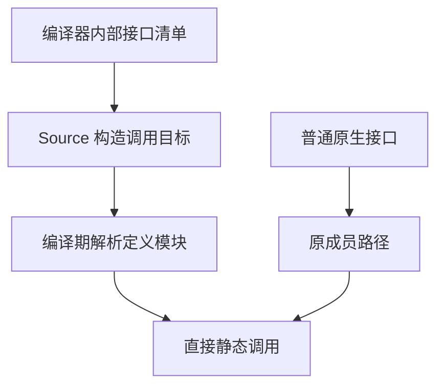
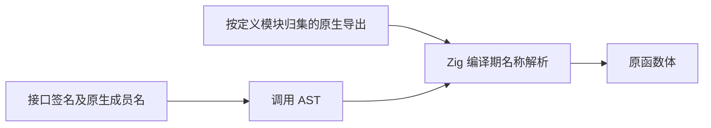

# 编译器内部原生绑定自举

## Intent

让 RX 图、项目分析、genz 降低及所有权入口的生成调用直接解析到 Zig 原生
函数的定义位置。移除包根按函数重复声明的转发，保留静态链接。

## Data

批首为 `363c0d9dc`。四份内部接口和对应根模块的转发使用相同函数名，
能以原定义所在模块归集。现有原生成员路径已随接口进入 IR，并参与缓存
来源核对。genz 以结构化 AST 构造普通原生调用。

## Edges

仅由编译器构建清单显式启用内部绑定。常规原生接口保持现有成员路径。
保留函数类型、参数、错误集和模块身份。在 Zig 编译期选择函数定义，
由同一条静态调用执行。编译期名称缺失或歧义应直接报错。

## Answer

先构建能识别两种调用目标的 Source 工具，再启用四个内部接口并删除旧转发。
从初始 seed 及 Source 分别核对构建，运行现有原生联结、别名、生成及 RX
回归。比较固定输入、受影响的生成路径与主线两端快照。

### 迁移结果

四份内部接口采用同一套静态解析。Source 通过结构化 AST 发出调用目标，
Zig 编译期从显式登记的定义模块取得原函数。正式生成文件中核对到
766 个调用，各自对应一个已退出的逐函数转发。原有根模块定义优先；
其余定义缺失或歧义会在构建时报错。应用原生模块声明同名命名空间时，
生成的编译期检查保留其真实成员路径。

先使用批首 Source 工具构建支持旧成员路径和新绑定的中间工具，再用它
构建正式候选，27 个引导构建步骤通过。从默认初始 seed 构建第二份候选，
55 个构建步骤和 39 项回归通过。两份候选均走 Source 后端生成，五份清单的
17,669 个文件逐字节一致。引导器 SHA-256 分别为
`a4d9f32c8512ed6ef9c5b0832505e9f899af91e9cb79f221506d7575a605b022` 和
`cebd2479cbd34c94b61108783d89d3650d5a1400b1031268a53d47ae84e4491c`。

RX 推导、原生联结、声明、别名、生成和名义类型来源共 227 项 Zig 回归、
11 项 CLI 用例通过。将现有原生调用样例的命名空间改为 `$zray` 后用批首和
候选 CLI 分别构建执行，结果逐字节一致。

### 性能

固定 705 个入口、16 分区，关闭常驻生成器。三版工具由 Source 生成并
执行 Source。同机交错三轮取中位数。9,894 个生成文件与所有权 memo
逐字节一致，10 项常驻编辑结果一致。

| 版本     |  冷墙钟 |  冷 CPU | 冷进程树峰值 RSS |  热墙钟 |  热 CPU |
| -------- | ------: | ------: | ---------------: | ------: | ------: |
| 固定基线 | 2.09 秒 | 9.01 秒 |         738.6 MB | 1.64 秒 | 6.43 秒 |
| 批首     | 1.97 秒 | 9.49 秒 |         526.0 MB | 1.44 秒 | 6.26 秒 |
| 候选     | 2.10 秒 | 9.48 秒 |         524.3 MB | 1.44 秒 | 6.25 秒 |

较批首，冷墙钟增加 0.13 秒、CPU 减少 0.01 秒，采样进程树峰值减少
1.8 MB，单进程峰值增加 10.0 MB。较固定基线，冷墙钟增加 0.01 秒，
CPU 增加 0.47 秒，采样进程树峰值减少 214.3 MB。无改动路径为
0.03～0.04 秒。

同一份受影响的 execution 清单，开启四个内部接口的绑定后，冷生成墙钟
同为 0.80 秒，CPU 同为 3.93 秒，单进程峰值由 375.5 MB 变为
375.7 MB。计时范围为 Source 生成，覆盖本批改变的调用目标构造。

以正式候选 Source 工具为共同引导器，分别从批首与候选的干净源码快照
进行一次冷 `bootstrap-stage` 配对。两侧均使用 Zig 0.17.0、ReleaseSmall、
16 分区、12 个并行作业，关闭常驻生成器，复用工具链全局缓存。两侧均通过
27 个步骤，Zig 的引导器编译步骤均报告 30 秒。整次冷构建墙钟由
70.63 秒变为 71.58 秒，CPU 由 165.47 秒变为 166.42 秒，单进程峰值
RSS 由 1,999.2 MB 变为 2,003.6 MB。

### 净变化

本批非 seed 包源码 Zig 新增 150 行、删除 862 行，净减 **712** 行。
全仓 Zig 新增 181 行、删除 872 行，净减 **691** 行。固定起点
`4c11902b6` 到收口提交，非 seed 包源码新增 5,236 行、删除 5,754 行，
累计净减 **518** 行。全仓 Zig 新增 5,778 行、删除 5,869 行，累计净减
**91** 行。以两端完整 Git 快照计算，包含同期其他提交。
