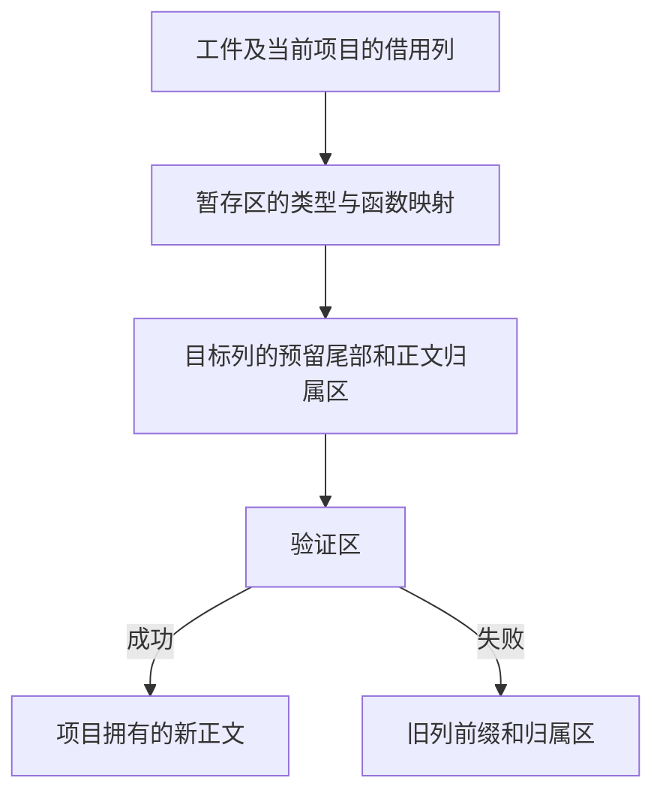

# 语义缓存恢复事务自举

## Intent

让正文缓存的校验、映射、检查点及发布在同一条 Source 调用链执行。
将共享列和内存失效的时机留给一次事务处理。

## Data

批首 `d8023c736`。项目命中后，Zig 驱动被拆成独立生成入口的重绑定、
列快照和正文物化。失败时再调用 Source 回滚，把已经追加的类型、来源
与函数可见前缀恢复后，释放工件归属区的新分配。

## Edges

映射规划只借输入并写暂存区。规划成功才准备检查点，物化成功并验证
后才更新验证前缀。保留解码工件与内存工件各自的校验顺序。RX 当前
没有异常捕获，宿主错误返回触发既有 Source 回滚及平台内存释放。

## Answer

正式入口 `semantic_restore` 依次校验旧工件、预留映射、重绑定、
保存检查点，然后物化并验证正文。退出原来三个独立主路径入口
`semantic_restore_transaction`、`semantic_restore_snapshot` 和
`semantic_restore_publication`。

检查点计数直接写在借用槽上。正文与公开导出共用同一份类型映射，
函数映射、原生模块映射及入口编号也直接写入借用视图。恢复入口
保留在原有主生成组，复用现成的校验和生成函数。早期将恢复移入
执行组的候选使引导器增大约 7%。最终候选比批首小 512 字节。

宿主提供物理视图、归属区和错误出口。在失败且检查点有效时，
回滚仍先释放未提交导出并恢复可见列，再回退正文归属区。结果的
验证前缀在验证完成后写入。

Source 引导构建通过 30 步和 39 项 RX 回归。独立 seed 构建通过
52 步。两条引导路径使用 Source 后端生成五份清单，17,780 个文件
逐字节一致。10 次常驻编辑、映射变化、重复路径诊断及恢复一致。
候选 Source 引导器 SHA-256 为
`58dad2c901bbfbe899896010b59091327d8a3bd6cb0b4e8daed036cda5a5796a`。

ReleaseSmall 通过 126 步、74 项回归，覆盖语义和磁盘缓存、缓存
编码、项目记录、联结、原生运行和库消费。沿用逐模块关闭调试信息
的配置，五项 ReleaseSafe 项目缓存回归及两项分配失败回收通过。

### 性能

固定清单使用 705 个入口、16 个分区和 ReleaseSmall。三个工具均
由 Source 生成并运行 Source 后端，关闭常驻生成器并交错测三轮。
9,894 个生成文件一致，候选与批首的所有权 memo 相同。

| 版本     | 冷墙钟 | 冷 CPU | 冷进程树峰值 RSS | 冷单进程峰值 RSS | 暖墙钟 | 暖 CPU |
| -------- | -----: | -----: | ---------------: | ---------------: | -----: | -----: |
| 固定基线 | 2.06 s | 8.96 s |         737.6 MB |         761.5 MB | 1.63 s | 6.37 s |
| 批首     | 1.96 s | 9.50 s |         523.9 MB |         541.0 MB | 1.46 s | 6.32 s |
| 候选     | 1.98 s | 9.42 s |         522.5 MB |         543.6 MB | 1.49 s | 6.22 s |

较批首，冷墙钟增加 0.02 秒、CPU 减少 0.08 秒，进程树峰值减少
1.4 MB，单进程峰值增加 2.6 MB。较固定基线，冷墙钟减少 0.08 秒、
CPU 增加 0.46 秒，进程树峰值减少 215.1 MB。候选无改动路径为
0.03 秒。

在双模块磁盘缓存与 65 模块输入上分别预热后交错测 11 对。每对
包含冷写入、热命中和修改单个函数。生成 Zig 与缓存计数逐项一致。
65 模块全热恢复墙钟从 29.86 降到 29.71 毫秒，CPU 从 31.07
降到 30.99 毫秒，峰值 RSS 从 16.48 降到 16.45 MB。修改后命中
64 个模块并重新分析 1 个。双模块的热命中墙钟减少 0.01 毫秒，
CPU 增加 0.05 毫秒，峰值持平。

### 接续范围

继续沿原生声明的缓存工件创建、验证和命中恢复，审计准备及发布
宿主共用的类型、成员与原生模块列，收口仍有独立入口的事务交接。
