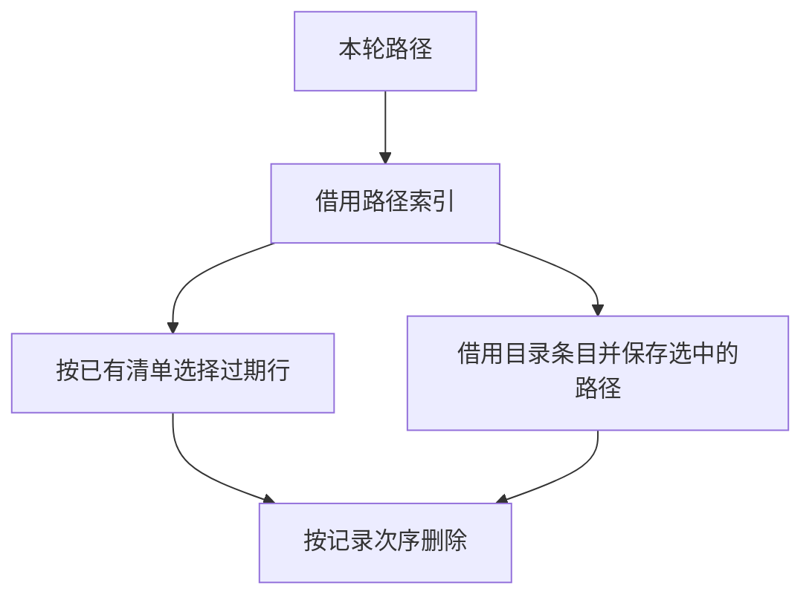

# 镜像目录与过期文件回收自举

## Intent

将生成镜像的父目录创建、两条过期文件回收路径以及清单提交顺序放入
正式 Source 流程。原生接口提供单次文件系统操作和目录迭代。

## Data

批首 `3c64d887f`。镜像比较已记录本轮文件、变化行和旧清单。Zig
在三个独立的生成入口间交接父目录、过期行和目录条目。无清单时，
目录迭代器借出的路径只在下一次推进前有效，现有实现先收集再删除。

## Edges

保留变化行首次出现的父目录次序、旧清单次序和目录读取次序。收集
失败时保留过期文件，删除期间允许文件已经消失。无清单恢复保留
输入戳，只处理普通文件。发布清单仍在写出与回收完成后。

## Answer

复用平铺、分区、无清单恢复、故障重试和常驻编辑夹具，并对照固定清单的
冷暖生成、内存与引导产物。

RX 显式安排哈希、比较、父目录创建、变化文件写入、过期检查和清单
提交。旧的父目录与回收批次回调及三个生成登记退出。Source 直接借用
比较结果和路径列，复用原索引算法。无清单时逐条借用目录路径，只复制
将被删除的路径，读取完目录后才开始删除。原生层提供单次创建、迭代、
删除和提交，并释放目录句柄。初始 seed 保留原镜像规则。

Zig 0.17.0、ReleaseSmall。seed 解析器与 Source 工具构建通过，39 项
RX 测试通过。两代工具在平铺和 16 分区场景分别产出 36 和 108 个相同
文件。核对了无更改时间戳、删除清单中的旧文件时遇到缺失行、无清单
时移除多个不同长度的路径并保留符号链接与目录、写入返回 `IsDir` 后
恢复和父目录冲突后的重试。常驻进程交替执行完整和精简清单，产物与
独立生成一致，最终无更改请求直接复用。

两条引导路径的五组清单产出 17,872 个逐字节一致的文件。额外核验
十次常驻编辑请求，产物、复用计数、冲突诊断和修复后的结果一致。

### 性能

同机 Zig 0.17.0、ReleaseSmall，原有 705 入口、16 分区的固定清单。
三套 Source 工具交错运行三轮。固定清单的 9,894 个输出与所有权
memo 载荷一致。

| 场景   | 批首墙钟 / CPU | 本批墙钟 / CPU | 固定基线墙钟 / CPU |
| ------ | -------------- | -------------- | ------------------ |
| 冷生成 | 2.04 / 9.53 秒 | 1.99 / 9.52 秒 | 2.09 / 9.01 秒     |
| 热缓存 | 1.46 / 6.29 秒 | 1.46 / 6.29 秒 | 1.65 / 6.43 秒     |
| 无更改 | 0.03 / 0.03 秒 | 0.03 / 0.03 秒 | 0.03 / 0.03 秒     |

冷生成进程树峰值 531.1 MB，较批首增加 3.1 MB，单进程峰值
541.6 MB，下降 9.5 MB。较固定基线冷生成墙钟减少 0.10 秒，CPU
增加 0.51 秒，两项峰值分别下降 207.4 MB 与 219.3 MB。
