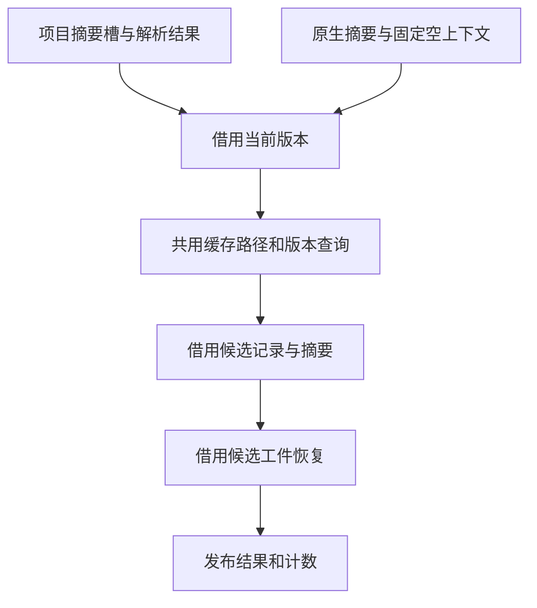

# 项目与原生缓存命中恢复自举

## Intent

项目正文和原生声明共用 Source 的缓存路径与版本判定。RX 明确连接
命中后的恢复、计数、源分析及缓存安装。

## Data

批首 `e45f9fb5a`。项目正文由 `body_input.zx` 调用 Zig 的
`restoreProjectBody`，其中选择摘要、查缓存并调用恢复。原生声明在
`restoreNativeCacheHit` 重复查找，并用临时槽保留命中的记录。两条路径
均通过独立生成入口比较版本。

## Edges

保持按路径查找后比较来源与上下文摘要。项目根使用实际上下文，
依赖按项目复用空上下文摘要。恢复无法映射的候选继续回退，分配失败
按原错误传播。只有恢复成功才累计命中、承认原生接口并复用正文。
路径索引、摘要字节和恢复输入均保持借用。

## Answer

项目正文和原生声明直接调用同一份 Source 查找。路径索引提供候选，
Source 比较两份摘要，再由 RX 选择恢复、命中登记及回退。旧的独立
版本比较入口、缓存计数回调和原生请求的临时命中槽已退出正式路径。

项目摘要存在项目的固定槽内。先按需填入摘要，再把原有视图传给
查找。计数由 Source 选定槽后直接写入借用列。定点生成确认两条
缓存读取入口均无需新建堆对象，可继续使用原生路径的零容量分配器。

Source 引导构建通过 30 步及 39 项 RX 回归。独立 seed 构建通过
52 步。两套引导器以 Source 后端生成五份清单，17,782 个文件
逐字节一致。10 次常驻请求的编辑、映射变化、重复路径诊断和
恢复结果一致。

ReleaseSmall 通过 147 步和 98 项回归。测试覆盖磁盘缓存、原生
声明缓存、资源清理、项目记录、联结及实际原生对象 ABI 执行。
按前一批的配置逐模块关闭调试信息，ReleaseSafe 的五项项目缓存
回归和两项资源错误回收回归均通过。
候选 Source 引导器 SHA-256 为
`f71a6f98a105e0331c9c1ba25828567cfc5de22982fe4f0b6a12f61387b52d9f`。

### 性能

固定清单使用 705 个入口、16 个分区及 ReleaseSmall。三个工具均
由 Source 生成并运行 Source 后端，关闭常驻生成器，交错测三轮取
中位数。9,894 个生成文件一致，候选与批首的所有权 memo 一致。

| 版本     | 冷墙钟 | 冷 CPU | 冷进程树峰值 RSS | 冷单进程峰值 RSS | 暖墙钟 | 暖 CPU |
| -------- | -----: | -----: | ---------------: | ---------------: | -----: | -----: |
| 固定基线 | 2.16 s | 9.07 s |         737.5 MB |         760.1 MB | 1.67 s | 6.49 s |
| 批首     | 2.02 s | 9.52 s |         523.8 MB |         542.2 MB | 1.46 s | 6.31 s |
| 候选     | 1.95 s | 9.49 s |         522.0 MB |         549.2 MB | 1.46 s | 6.31 s |

较批首，冷墙钟减少 0.07 秒、CPU 减少 0.03 秒、进程树峰值减少
1.8 MB、单进程峰值增加 7.0 MB。较固定基线，冷墙钟减少
0.21 秒、CPU 增加 0.42 秒、进程树峰值减少 215.5 MB。
无改动路径为 0.03 秒。

另外复用普通磁盘缓存和原生声明运行的现有输入，预热后各交错运行
11 对。冷写入、热命中和编辑后的生成 Zig、原生 ABI 及缓存计数均一致。
普通项目的墙钟差异为 −0.05 至 +0.04 毫秒，原生项目为 −0.10 至
+0.03 毫秒。两组的单进程峰值均持平或下降。

### 接续范围

下一批沿缓存正文恢复的正式入口，连接重绑定、列检查点、正文物化
和失败回滚。现有 `restoring/run.zig` 与 `checkpoint.zig` 分别
连接这些阶段与资源，用同一次事务核对保存和失败恢复的顺序。
