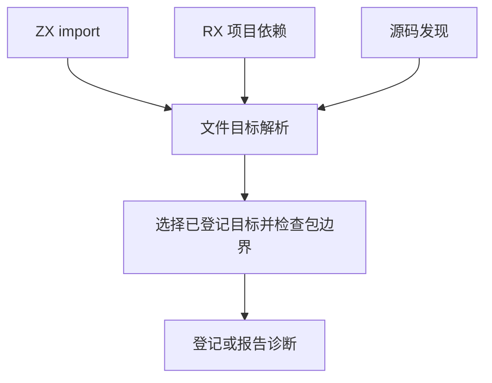

# 项目依赖目标解析与登记自举

## Intent · 收拢 RX 和 ZX 共用的项目依赖解析

从 `afd15d2c2` 起，沿正式项目入口、源码发现和依赖图，收口文件
目标从路径解析到候选选择、包边界核验和登记的调用链。移除按阶段
重复进入 Source 的 Zig 适配。

## Data · 现有路径

正式文件依赖先由 Source 生成候选路径，返回 Zig，再进入另一
个 Source 调用选出目录入口并核对包边界。依赖图随后用同一
份源索引登记目标。初始 seed 自行完成这些步骤。

## Edges · 边界

维持本地路径、目录入口、包边界、原生接口以及编译产物导入的现有
顺序与诊断。派生路径保留已有分配器与释放顺序，复用借用索引。

## Answer · 验收标准

固定清单与上一批对照，覆盖 RX、ZX 依赖解析和缓存恢复。源代码
净变化同时从本批开始与固定起点计算，核对远端 `master`。

实现将文件解析与候选选择合并为一个生成入口。依赖图借用路径列，
Source 直接解析、登记并查找入口与附加根。找不到根时，诊断取得
已分配的规范化路径。原生解析、物理存储和边写入维持原有边界。

CLI 构建发现列视图的类型包含了映射值。映射用于建立视图，建立后
只需保留字段形状，因此把类型参数改为映射的形状。验收期间旧缓存
清理影响到仍被 seed 构建使用的选项文件，随后恢复构建，并补充了
活动构建缓存的清理约定。

- 两种引导器在五组生成清单上产生的 17,885 个文件逐字节一致。
  常驻生成覆盖增量恢复、重复入口诊断和顺序变更。7,714 条文件
  快照通过版本与时间范围对照。
- 编译器 372 项测试和 RX 推导、合成模块图、ZX 导入路径共
  10,595 项 Zig 回归通过。包路径、目录入口、后缀诊断和循环的
  14 项 CLI 场景通过。
- 本批非 seed 包源码 Zig 新增 62 行、删除 70 行，净减 8 行。
  全仓新增 70 行、删除 75 行，净减 5 行。

候选工具由 `afd15d2c2` 的 Source 引导器生成。固定的 705 入口
清单在 16 分区下交错测量三轮，各工具都使用 Source 后端。批首
与候选的 9,894 个生成文件和所有权 memo 内容一致。

| 工具             | 冷墙钟（秒） | 冷 CPU（秒） | 进程树峰值 RSS（MB） | 单进程峰值 RSS（MB） | 热墙钟 / CPU（秒） |
| ---------------- | -----------: | -----------: | -------------------: | -------------------: | -----------------: |
| 固定基线         |         2.13 |         9.08 |                738.0 |                760.4 |        1.64 / 6.45 |
| 批首 `afd15d2c2` |         1.98 |         9.53 |                525.2 |                543.6 |        1.46 / 6.30 |
| 本批候选         |         1.96 |         9.44 |                524.4 |                554.0 |        1.46 / 6.27 |

较批首，冷生成墙钟减少 0.02 秒、CPU 减少 0.09 秒、进程树
峰值减少 0.8 MB，单进程峰值增加 10.4 MB。较固定基线，冷生成
墙钟减少 0.17 秒、CPU 增加 0.36 秒，两个内存峰值分别减少
213.6 MB、206.4 MB。未变输入继续跳过生成。
