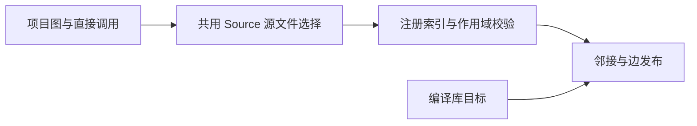
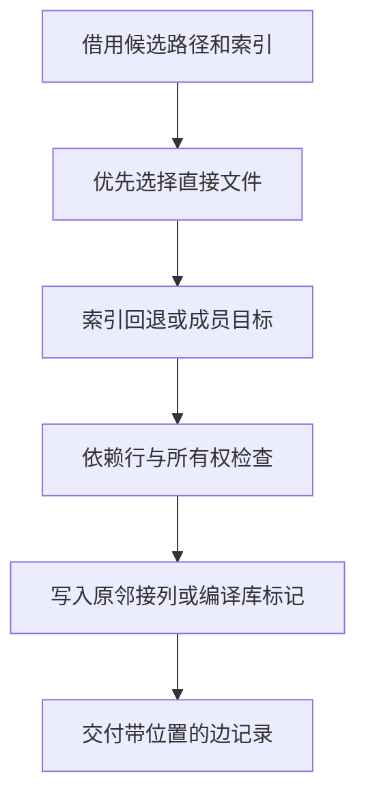

# 项目依赖目标选择与边发布自举

## Intent

让项目图中的普通函数、命名函数和 Store 依赖共用 Source 的目标选择
和边发布。复用函数直接调用的索引查询，移除独立的 Zig 查找适配。

## Data

批首为 `6820dfdd5`。项目图原先通过两个独立生成入口选择同名文件
与命名成员，交给注册检查后再次从宿主发布邻接和编译库标记。

## Edges

命名调用先查完整文件名，再查索引回退，其后才按模块名选择成员。
命中其他索引时，继续按实际注册表确定最终行号。Store 先检查目标
种类，再检查作用域。原生层提供平台路径绝对化、借用的列表和带
原位置的诊断。初始 seed 保留入口。

## Answer

移除独立命名和别名生成入口与两个专用边写入回调。共用 Source
选择器决定实际目标行，直接写入邻接与编译库标记，原生层交付
带位置和角色的最终边记录。核对索引回退、命名调用、Store 诊断、
编译库及两条引导路径的行为和性能。

- 433 项 Zig、39 项 RX、11 个 RX CLI 场景和 `watch` 回归通过。
  初始 seed 与批首 Source 引导器生成的五组清单共 17,794 个文件一致。
  固定清单的 9,894 个输出及所有权 memo 保持一致。
- 固定清单冷生成用时 1.97 秒、CPU 9.49 秒，进程树峰值 529.0 MB。
  较批首墙钟增加 0.03 秒、CPU 增加 0.01 秒、进程树峰值增加 2.6 MB。
  较固定基线墙钟减少 0.13 秒、CPU 增加 0.47 秒、进程树峰值减少
  208.7 MB。暖生成墙钟不变，CPU 减少 0.02 秒。
- 1,200 个 RX 模块的入口检查输出相同，两边的墙钟与 CPU 中位数
  都为 0.22 秒，单进程峰值都是 73.6 MB。
