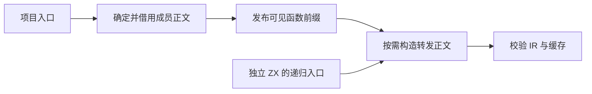
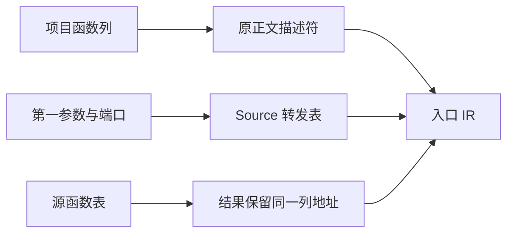

# 项目入口正文与递归转发自举

## Intent

让项目入口直接借用被选函数，写入正文并限制可见函数数。项目与独立
ZX 的递归入口由 RX 直接构造转发，保留已有 IR 验证和缓存顺序。

## Data

批首 `2e7c9490e`。项目入口分别回调 Zig 安装正文、截取函数表和
转发原生或递归函数。库入口已有可复用的函数体列选择，工件联结也
已有可复用的递归参数投影及转发模块。

## Edges

项目入口保留当前文件名，库入口按成员或初始化器规则交付文件和
Store。普通递归使用原参数的名称、跨度和所有权，原生入口使用
既有合成参数。函数表截取只变更结果的视图长度。控制表继续在结果
分配区取得地址，底层列不复制。

## Answer

检查正式入口退出的专用调用，并集中比较独立 ZX、项目、编译库、
引导产物、缓存和固定清单的性能。

项目和库入口共用函数列读取。Source 在选中成员时交付正文，普通项目
路径直接检查递归并截取结果视图。项目和独立 ZX 入口复用工件联结的
递归参数投影与转发模块，源码联结和库的原有消费者继续共用同一布局。
移除正文安装、可见前缀、两种项目转发与独立分析转发的五个宿主回调。
宿主只写入最终 IR 描述符并分配结果所持有的控制表。

最小 RX 入口一度少了公开执行声明。定点生成显示，将库入口返回的
值描述符直接换成原生记录，会在固定空分配器里创建临时对象。共享
读取保留值描述符，仅项目的原生写入边界使用原生记录。修正后，库入口
和普通项目分支的生成 Zig 都无临时对象分配。

正式 Source 引导构建通过 30 步和 39 项 RX 回归，初始 seed 构建
通过 52 步。两份工具运行正式 Source 后端，在五份清单上的 17,831
个生成文件逐字节一致。最小 RX 入口与批首的 7 份产物一致，10 次
常驻编辑、映射变化、诊断及恢复结果也一致。

ReleaseSmall 的 129 个构建步骤和 184 项回归通过。覆盖项目推导、
导入、联结失败、模块记录、语义及磁盘缓存、编译库、磁盘项目和
`watch`。7 项 ReleaseSafe 项目导入回归通过。候选 Source 引导器
的 SHA-256 为 `0e48e50448cc3e2d70eec32b07edaddbfd4ab8f02f2e0896fc6abd1082617718`。

性能对照用相同的 705 个入口、16 分区和 ReleaseSmall 配置，
关闭常驻生成器。三种工具都由 Source 生成并运行 Source 后端。
三轮交错采样取中位数，9,894 个生成文件及所有权 memo 一致。

| 版本     | 冷墙钟 | 冷 CPU | 冷进程树峰值 RSS | 冷单进程峰值 RSS | 暖墙钟 | 暖 CPU |
| -------- | -----: | -----: | ---------------: | ---------------: | -----: | -----: |
| 固定基线 | 2.07 s | 8.93 s |         738.2 MB |         760.3 MB | 1.61 s | 6.36 s |
| 批首     | 1.94 s | 9.38 s |         524.7 MB |         547.3 MB | 1.41 s | 6.16 s |
| 候选     | 1.94 s | 9.43 s |         522.4 MB |         548.8 MB | 1.41 s | 6.13 s |

较批首，冷生成墙钟持平，CPU 增加 0.05 秒，进程树峰值减少
2.3 MB，单进程峰值增加 1.5 MB。较固定基线，冷生成墙钟减少
0.13 秒、CPU 增加 0.50 秒、进程树峰值减少 215.8 MB。
无改动时两版均为 0.03 秒。

剩余的混合项目原生入口和编译库 Call 包装继续从宿主驱动转发生成。
项目缓存写回还由宿主调用工件提取并映射失败状态。
