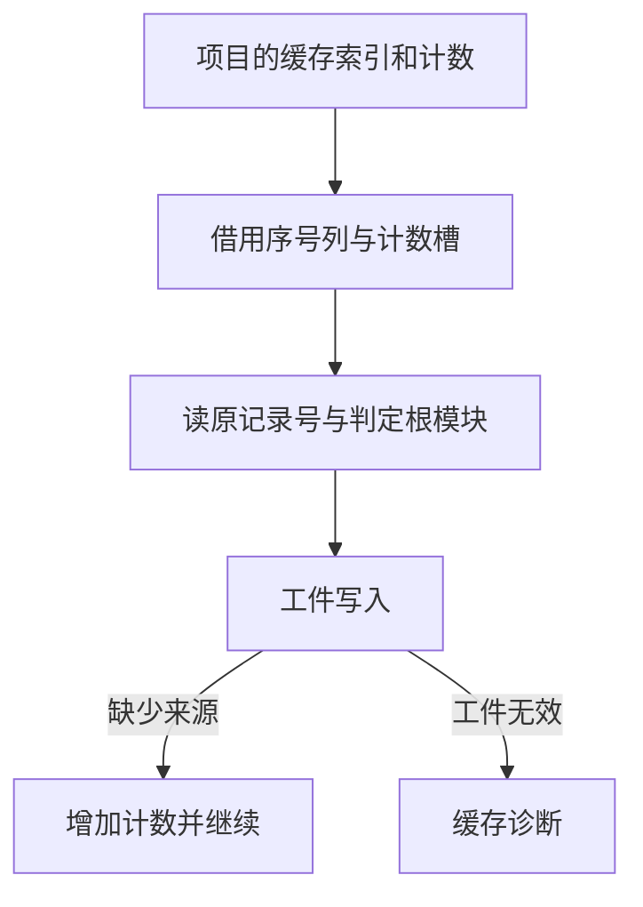

# 项目入口视图与缓存读取自举

## Intent

让 Source 直接读取语义缓存记录并提交项目验证所用的函数前缀。项目
原生接口使用生成的编译期定义查找，移除前端逐函数转发。

## Data

批首 `973ff2e4d`。`project_execute_entry` 由 Source 计算入口及递归
转发方案，再由 Zig 写入已验证函数前缀。缓存循环逐行调用宿主取序号，
并通过另一个回调累计缺少来源的记录。项目接口同一批生成覆盖解析缓存、
导入、签名发布、正文联结及编译库。

## Edges

验证前缀取原值与可见数量的较小者。按原登记顺序处理缓存，遇到
无效记录停止，缺少来源计数后继续。缓存行与计数从项目直接借用。
正文装配、入口转发、IR 验证和缓存工件物化仍使用原有宿主边界。
初始 seed 继续独立执行。

## Answer

Source 入口移除 `projectCacheRecord` 和 `recordMissingOrigin`，复用
通用列读写。验证回调直接读已发布前缀。项目原生接口改用已有的
编译期查找，从定义位置直接链接，移除 99 个逐函数别名。

正式 Source 引导构建通过 30 步及 39 项 RX 回归，初始 seed 构建通过
52 步。两份工具分别走正式 Source 生成五份清单，17,825 个文件逐字节
一致。10 次常驻编辑、引用变化、重复路径诊断和恢复结果一致。
ReleaseSafe 的 5 项语义缓存回归通过。

ReleaseSmall 项目回归通过 122 步及 166 项测试，覆盖 RX 推导、模块记录、
语义缓存与磁盘缓存恢复、ZX 导入、编译库和 RX 磁盘项目及 `watch`。
候选 Source 引导器的 SHA-256 为
`546b3dec8f7775daa45b534e099bd16758b80675cff2402c23584afab5567130`。

非 seed 包源码 Zig 新增 42 行、删除 130 行，全仓 Zig 新增 43 行、
删除 131 行。两项均净减 88 行。

用固定的 705 个入口、16 分区和 ReleaseSmall 正式 Source 工具交错
测三轮，关闭常驻生成器。9,894 个生成文件与所有权 memo 一致。
候选工具本体由批首 Source 引导器生成。

| 版本     | 冷墙钟 | 冷 CPU | 冷进程树峰值 RSS | 冷单进程峰值 RSS | 暖墙钟 | 暖 CPU |
| -------- | -----: | -----: | ---------------: | ---------------: | -----: | -----: |
| 固定基线 | 2.11 s | 9.02 s |         737.5 MB |         760.3 MB | 1.67 s | 6.45 s |
| 批首     | 1.99 s | 9.54 s |         528.7 MB |         541.3 MB | 1.45 s | 6.28 s |
| 候选     | 2.03 s | 9.50 s |         524.3 MB |         548.7 MB | 1.47 s | 6.27 s |

较批首冷墙钟增加 0.04 秒，CPU 减少 0.04 秒，进程树峰值减少
4.5 MB，单进程峰值增加 7.4 MB。较固定基线，冷墙钟减少 0.08 秒，
CPU 增加 0.48 秒，进程树峰值减少 213.2 MB。无改动的候选为 0.03 秒。
