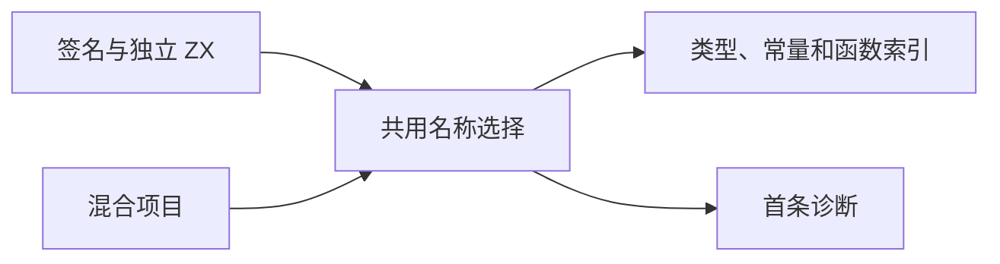
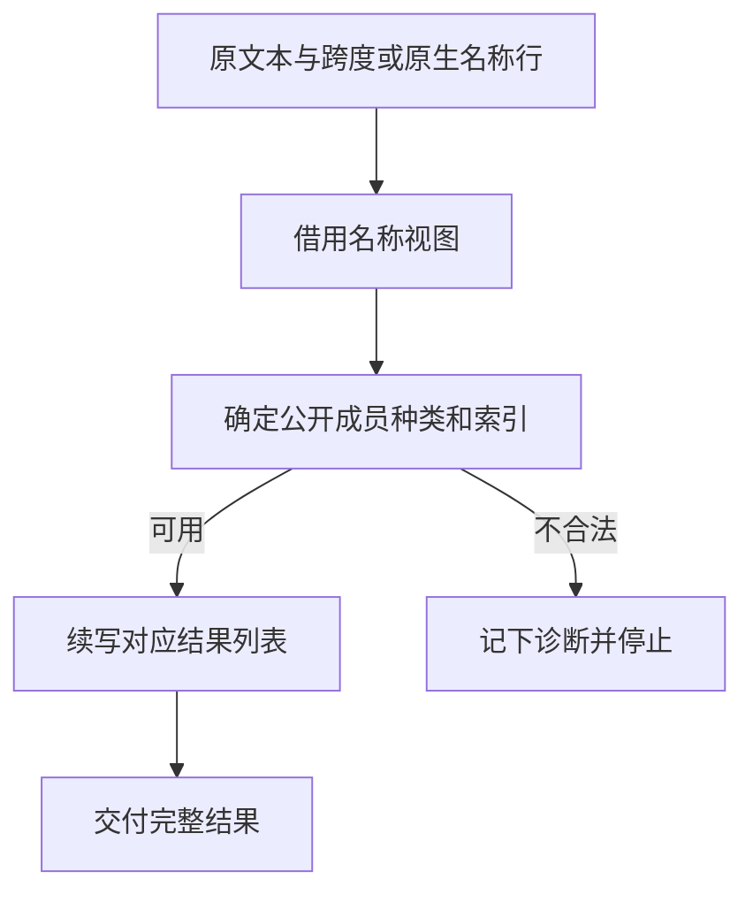

# 项目导入名称视图与选择自举

## Intent

让签名、独立 ZX 和混合项目共用借来的导入名称及选择结果。移除旧解析
表示的名称材料化，以及选择每个名称时生成的临时结果对象。

## Data

批首 `6a9ebe523`。三个入口共用 `binding/bind.rx`。索引解析器已经借用
原文本及名称跨度。原生解析表示先分配名称、别名和跨度数组，再由 Zig
逐项填入。当前生成代码会在接受一个名称时重建对应的结果对象，混合
项目在诊断交付时还会重复复制同一消息。

## Edges

保留默认、别名、通配及类型导入的优先顺序，以及原生名称的跨度来源。
签名优先使用签名公开成员，正文使用已联结成员。选择所需的列表继续
归属调用者的暂存区，诊断消息在交付最终报告时取得归属。初始 seed 沿
现有 Zig 路径调用。

## Answer

索引化请求借用源文本和名称跨度。兼容旧解析表示的请求直接借用原生
名称、原名和位置列，撤出容器分配与逐项搬运。选择循环独立推进六份
名称和编号列表，并记住首个失败的消息及跨度。定向检查生成的选择
函数，旧的逐项结果对象分配已退出，保留相同的列表增长方式。

混合项目先借用选择器的诊断消息，再由项目报告复制到结果归属区。
签名和独立 ZX 继续在报告边界取得消息归属。普通名称缺失、原生枚举
限制与默认函数无效沿原来的分支和位置报告。

候选 Source 引导器通过 30 步及 39 项 RX 回归，SHA-256 为
`8d7116ed6e4d0ec1499e581d4a04c67bb958f59eede7400f0e88627daeed2364`。
初始 seed 构建通过 52 步。两条引导路径的五份清单共 17,823 个文件
逐字节一致。十次常驻请求的依赖映射、后缀复用、错误及恢复与批首一致。
独立 ReleaseSafe 通过 138 项 RX 推导测试。

ReleaseSmall 通过 130 个构建步骤和 219 项 Zig 测试。模块记录、解析
缓存、ZX 导入路径、编译库、混合项目和 `watch` 回归全部通过。另外
复用解析缓存的既有项目夹具，先把相同的两个模块存为原生 AST，再从
正式项目入口分析，确认复用预热解析结果，生成 Zig 与索引解析一致。

### 性能

沿用固定清单、16 分区和单次生成，交错运行三轮，取中位数。候选由
混合项目函数导入阶段的 Source 引导器生成，批首对照由正文结果发布
阶段的 Source 引导器生成。固定基线仍采用声明准备阶段的工具，三者
均启用 Source。

| 版本     |  冷墙钟 |  冷 CPU | 冷进程树峰值 RSS |  暖墙钟 |  暖 CPU |
| -------- | ------: | ------: | ---------------: | ------: | ------: |
| 固定基线 | 2.09 秒 | 9.02 秒 |         737.8 MB | 1.67 秒 | 6.48 秒 |
| 批首对照 | 1.97 秒 | 9.53 秒 |         530.0 MB | 1.46 秒 | 6.30 秒 |
| 候选     | 2.00 秒 | 9.52 秒 |         523.6 MB | 1.45 秒 | 6.26 秒 |

较批首，冷墙钟增加 0.03 秒，CPU 减少 0.01 秒。进程树和单进程峰值
分别减少 6.3 MB 和 13.0 MB。较固定基线，冷墙钟减少 0.09 秒，CPU
增加 0.50 秒，进程树峰值减少 214.2 MB。固定输入的 9,894 个生成
文件与所有权 memo 载荷一致。
