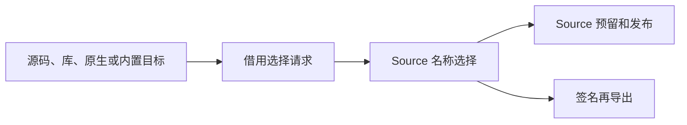
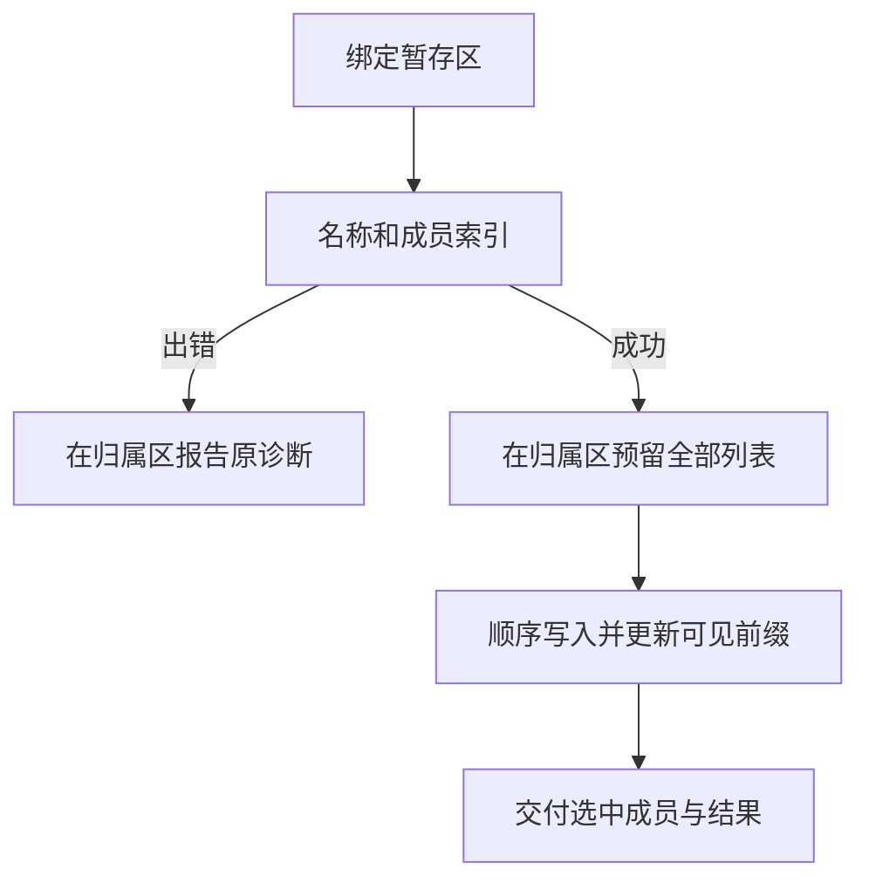

# 项目导入选择与发布交接自举

## Intent

让项目导入、再导出、原生接口和内置函数从名称选择直接进入 Source
发布流程。撤出 Zig 的两次生成调用调度以及类型、常量和函数结果的
预留顺序，将分配和写入边界一并迁移。

## Data

批首 `cd90691d6`。项目导入流程先调用 Zig 选择回调，再调用发布回调。
前者用绑定暂存区运行独立生成入口并保存选择结果，后者在归属区依次
预留三个列表，再调用另一个生成入口。签名再导出随后读取选中函数。

声明接口只能直接声明导出，不能从 Source 模型导入类型。定向生成已
确认此边界。使用现有的通用行缓冲和分配器作用域把两个阶段放到同一个
类型明确的 Source 入口，继续复用原成员选择语义。

## Edges

选择列表由绑定暂存区持有，最终名称、常量和成员归属项目结果。先完成
全部所需预留，再按类型、常量、函数的顺序逐行写入。失败时保留已经成功
写入的行前缀，未写入部分仅占预留容量。签名再导出随后使用同一批选中
函数，初始 seed 和既有错误位置均保留原样。

## Answer

源码、编译库、原生接口和内置函数共用 `binding/delivery/run.rx`。
完整选择成功后切换作用域，Source 预留三类最终列表，再顺序写入。
复用通用行缓冲刷新列视图，按每次成功写入更新可见长度。Zig 提供
现有数组的物理借用，返回时接回容量和长度。

旧选择与发布回调、单独的发布生成入口和原生转发模块已退出正式
路径。普通发布无需在宿主保存中间选择结果，签名再导出仅保留所选
函数的名称和索引。定向检查生成代码，未发现新引入的临时记录分配。

Source 引导构建通过 30 步和 39 项 RX 回归。候选 SHA-256 为
`518bab019310e8843b665d5632f903078b77f8a11a6c0ff834fa1863520d75f0`。
10 次常驻请求对照通过，覆盖映射变化、后缀复用、重复依赖诊断与恢复。
初始 seed 构建通过 52 步。两条引导路径五份清单的 17,859 个生成文件
逐字节一致。候选的原生成员分配失败与迟发签名错误回归全部通过。

ReleaseSmall 通过 130 个构建步骤和 219 项 Zig 测试。模块记录、解析
缓存、库联结、编译库 Store 及权限、磁盘项目、导入路径和 `watch`
全部通过。剥离符号的 ReleaseSafe 通过 138 项 RX 推导测试。

### 性能

固定清单沿用 16 分区与单次生成配置，交错运行三轮，取中位数。候选由
名称选择阶段的 Source 引导器生成，批首对照由混合项目函数导入阶段
的 Source 引导器生成。固定基线仍用声明准备阶段的工具，三者均启用
Source。

| 版本     |  冷墙钟 |  冷 CPU | 冷进程树峰值 RSS |  暖墙钟 |  暖 CPU |
| -------- | ------: | ------: | ---------------: | ------: | ------: |
| 固定基线 | 2.10 秒 | 9.02 秒 |         737.2 MB | 1.64 秒 | 6.44 秒 |
| 批首对照 | 1.99 秒 | 9.52 秒 |         526.4 MB | 1.48 秒 | 6.26 秒 |
| 候选     | 1.97 秒 | 9.50 秒 |         528.6 MB | 1.45 秒 | 6.26 秒 |

较批首，冷墙钟和 CPU 各减少 0.02 秒，进程树峰值增加 2.2 MB，单进程
峰值增加 8.4 MB。较固定基线，冷墙钟减少 0.13 秒，CPU 增加 0.48 秒，
进程树峰值减少 208.6 MB。固定清单的 9,894 个生成文件及所有权 memo
载荷一致。
