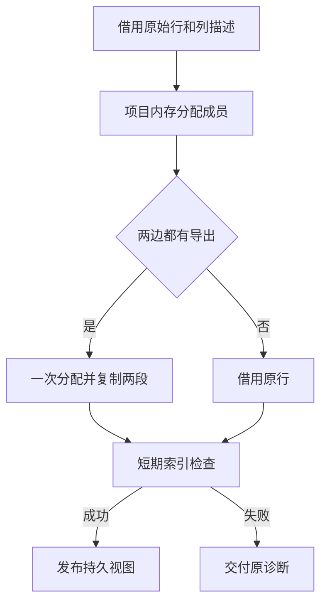

# 项目最终签名发布自举

## Intent

让正式项目路径在一个 Source 流程内构造成员、合并导出、校验公开名称并决定默认签名。移除四个专用调度回调和独立成员生成入口。

## Data

批首 `bf34aaa13`。正式入口 `Project.finishSignature` 已解析本地声明和导入绑定，旧 Source 入口依次将成员安装、导出合并、入口选择及绑定发布交给 Zig。成员构造和公开名称探测已有 ZX 实现。

## Edges

成员顺序为本地声明、转发签名、原生函数。类型和常量仅在两边均非空时合并到新行，单边直接借用。名称校验在成员及导出构造之后，保留类型、常量、成员的校验顺序和默认入口行为。索引桶属于校验临时区，发布数组仍由项目持有。初始 seed 保留独立实现。

## Answer

正式路径退出 `installProjectSignatureMembers`、`mergeProjectSignatureExports`、
`selectProjectSignatureEntry` 和 `publishProjectSignatureBindings` 四个回调，
移除独立成员生成入口。默认端口、Store 标志、暂缓来源和类型模块判定由
Source 一并决定。Zig 绑定物理行、交付结果和诊断，并管理短期校验区。

初次正式生成发现默认成员种类失真。绑定入口改用编译期枚举常量，所有
借用描述由调用方保留到执行结束。原失败的核心清单和 CLI 工具链清单现
可生成。核心入口的 10 个产物与批首一致，10 次常驻编辑与恢复结果一致。

初始 seed 构建通过 52 步，正式 Source 引导构建通过 30 步和 39 项 RX
回归。两套引导器分别用正式 Source 配置生成五份清单，17,827 个文件
逐字节一致。候选引导器 SHA-256 为
`26a0a54817d2a7100a46a8d3d533da52c40b5f01e66125bd9dd8c32f14a674ee`。

ReleaseSmall 通过 122 个构建步骤和 159 项 Zig 回归，覆盖独立导入、
目录再导出、编译库 Store、磁盘项目与 `watch`。ReleaseSafe 通过
138 项 RX 推导。

性能对照沿用 705 项固定输入、16 分区和 ReleaseSmall 正式 Source
引导器。候选本体由批首 Source 引导器生成，三轮交错采样，关闭常驻
生成器。9,894 个生成文件和所有权 memo 载荷与批首一致。

| 版本     | 冷墙钟 | 冷 CPU | 冷进程树峰值 RSS | 冷单进程峰值 RSS | 暖墙钟 | 暖 CPU |
| -------- | -----: | -----: | ---------------: | ---------------: | -----: | -----: |
| 固定基线 | 2.10 s | 9.03 s |         737.7 MB |         764.8 MB | 1.63 s | 6.43 s |
| 批首     | 1.99 s | 9.48 s |         522.3 MB |         547.6 MB | 1.46 s | 6.28 s |
| 候选     | 1.96 s | 9.49 s |         523.2 MB |         543.6 MB | 1.44 s | 6.25 s |

较批首，冷生成墙钟减少 0.03 秒、CPU 增加 0.01 秒，进程树峰值增加
0.9 MB、单进程峰值减少 3.9 MB。较固定基线，冷生成墙钟减少 0.14 秒，
CPU 增加 0.46 秒，进程树峰值减少 214.6 MB。无改动的暖入口仍为 0.03 秒。

正文联结仍调用 `publishProjectExports`，其合并和入口选择继续列在下一批。
