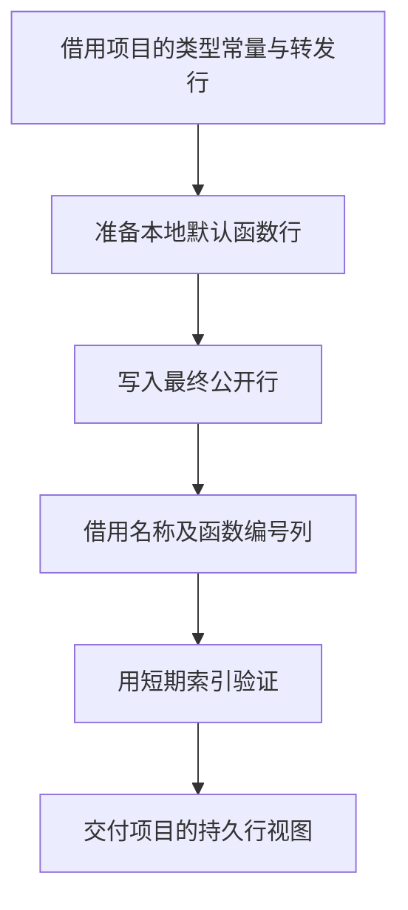

# 项目正文导出发布自举

## Intent

将正文的公开类型、常量、函数成员和默认入口选择迁入 Source。普通编译与语义缓存恢复共用该流程，同批移除旧的 Zig 导出回调。

## Data

批首 `f6a61253f`。正式入口 `project_execute_body` 在函数安装和所有权检查后调用 `publishProjectExports`。签名阶段已用 Source 合并原始行、校验公开名称及选择默认入口，正文需保留 `FunctionImport` 的运行期编号和原生标记。

## Edges

类型与常量单边可借用，两边有值时只分配一次。函数发布保留本地默认成员在首位，无本地成员时借用转发列表。重复名称按类型、常量、函数顺序报告，先于缓存登记和模块提交。签名与正文共用合并和索引准备，结果继续在项目寿命内有效。初始 seed 保留原路径。

## Answer

正式路径移除 `publishProjectExports` 回调和 `body_record.zx`。RX 先处理
公开名称诊断，再登记缓存并提交模块。正文与签名共用 `merge_rows`、
`merge_exports` 和索引准备。函数默认行在项目区保留，空侧继续复用已有行。
Zig 提供借用和物理记录提交，初始 seed 的独立实现保持可运行。

正式 Source 引导构建通过 30 步和 39 项 RX 回归，初始 seed 构建通过
52 步。两套引导器分别用正式 Source 配置生成五份清单，17,828 个文件
逐字节一致。10 次常驻编辑与恢复结果一致。候选引导器 SHA-256 为
`bae41b25e210660e2abb98cf0bec3f1888732780a678c7da22ea0c2743a732ad`。

ReleaseSmall 通过 127 个构建步骤及 166 项 Zig 回归。跨进程缓存的 5 个
场景通过，覆盖命中、编辑复用、损坏修复、关闭缓存和路径归属。库导入、
Store 发布、磁盘项目和 `watch` 通过。ReleaseSafe 的 5 项语义缓存回归
通过，其中包含来源重排、失效恢复和结果跨缓存寿命。

性能对照沿用 705 项固定输入、16 分区和 ReleaseSmall 正式 Source 引导器。
候选由批首 Source 引导器生成，交错采样三轮，关闭常驻生成器。9,894 个生成
文件和所有权 memo 载荷与批首一致。

| 版本     | 冷墙钟 | 冷 CPU | 冷进程树峰值 RSS | 冷单进程峰值 RSS | 暖墙钟 | 暖 CPU |
| -------- | -----: | -----: | ---------------: | ---------------: | -----: | -----: |
| 固定基线 | 2.10 s | 9.04 s |         737.4 MB |         759.7 MB | 1.64 s | 6.42 s |
| 批首     | 1.95 s | 9.50 s |         527.8 MB |         551.6 MB | 1.44 s | 6.26 s |
| 候选     | 1.93 s | 9.50 s |         521.8 MB |         554.7 MB | 1.45 s | 6.26 s |

较批首，冷生成墙钟减少 0.02 秒、CPU 持平，进程树峰值减少 6.0 MB，
单进程峰值增加 3.1 MB。较固定基线，冷生成墙钟减少 0.17 秒，CPU 增加
0.46 秒，进程树峰值减少 215.5 MB。无改动的暖入口仍为 0.03 秒。

正文 IR 的物理安装、缓存根登记和模块记录写入仍由 Zig 执行，沿同一职责
接续迁移。
