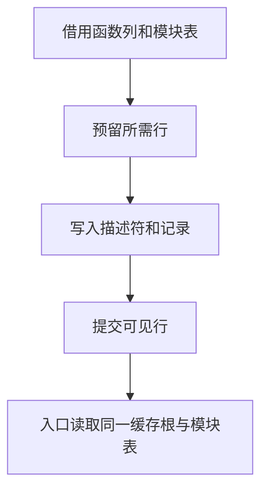

# 项目正文记录与函数安装自举

## Intent

让正式正文 RX 直接执行函数安装计划、函数列写入、缓存登记和模块记录追加。退出当前仍通过 Zig 回调执行的安装与提交步骤。

## Data

批首 `a293a1577`。`project_execute_body` 在分析或恢复后执行 `installProjectFunction`。该回调另行执行 Source 安装计划，再由 Zig 追加函数、设置单元编号并装配导出视图。公开名称验证后，Zig 追加缓存下标、记录和入口正文。共享列写入、行缓冲与安装计划已经有可复用实现。

## Edges

保留已恢复递归编号，预留函数列后才拥有正文描述，成功写入后才校验所有权。重复导出先于缓存或模块登记。缓存记录继续使用父分配器，模块记录直接初始化到项目分配器中的最终槽。缓存根随入口记录成功发布。入口正文只搬移一次，初始 seed 保留旧路径。

## Answer

正式路径移除旧的函数安装、缓存登记和模块提交回调，也退出独立安装
计划生成入口。Source 决定容量、编号、记录类别和可见长度，Zig 绑定列、
分配正文描述并初始化最终的类型化记录。

最初的内联计划把聚合类型参数传给布局接口，正文生成回退到包含临时
对象分配的调用。改为借用编译期列布局与列增长描述，聚焦生成保留
`executeValue`，正文入口中没有临时对象分配。

正式 Source 构建通过 30 步及 39 项 RX 回归，初始 seed 构建通过 52 步。
两套引导器用正式配置生成五份清单，17,826 个文件逐字节一致，10 次
常驻编辑与恢复结果一致。候选 SHA-256 为
`213dd8fe75551daa02209ff5380cfed6faa99143baf862ba0c48cc5d0f2e5df6`。

ReleaseSmall 通过 137 个构建步骤和 189 项 Zig 回归，覆盖模块记录、生成
缓存、语义缓存、跨进程恢复、独立导入、编译库 Store 和磁盘项目。
ReleaseSafe 的 5 项语义缓存回归通过。

性能对照沿用 705 项固定输入、16 分区及 ReleaseSmall 正式 Source 引导器。
候选本体由批首 Source 引导器生成，交错测量三轮，关闭常驻生成器。
9,894 个生成文件及所有权 memo 载荷与批首一致。

| 版本     | 冷墙钟 | 冷 CPU | 冷进程树峰值 RSS | 冷单进程峰值 RSS | 暖墙钟 | 暖 CPU |
| -------- | -----: | -----: | ---------------: | ---------------: | -----: | -----: |
| 固定基线 | 2.09 s | 9.04 s |         737.8 MB |         760.4 MB | 1.65 s | 6.41 s |
| 批首     | 1.95 s | 9.50 s |         524.6 MB |         548.0 MB | 1.45 s | 6.25 s |
| 候选     | 1.96 s | 9.46 s |         528.3 MB |         553.4 MB | 1.44 s | 6.27 s |

较批首，冷生成墙钟增加 0.01 秒、CPU 减少 0.04 秒，进程树峰值增加
3.7 MB、单进程峰值增加 5.4 MB。较固定基线，冷生成墙钟减少 0.13 秒、
CPU 增加 0.42 秒，进程树峰值减少 209.4 MB。无改动的暖入口仍为 0.03 秒。

后续沿 `project_execute_entry` 迁移入口函数安装、可见前缀更新和缓存行读取。
