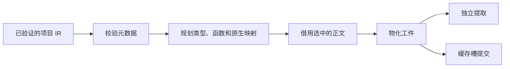
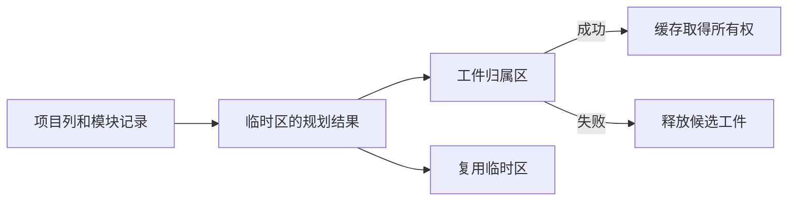

# 项目缓存工件提取与写回自举

## Intent

让独立工件提取和项目语义缓存共用 Source 的校验、规划与物化。
项目缓存由 RX 决定保存、忽略缺少来源或发布诊断，直接复用缓存槽提交。

## Data

批首 `c1526677b`。原生提取入口分别调用两个 Source 生成入口，
在它们之间选择函数行或入口正文。项目缓存由宿主提取工件、选择
摘要并间接调用缓存槽；缓存槽的定位、预留和提交已在 Source。

## Edges

共享输入的列和函数体保持借用。规划使用临时区，物化使用工件
归属区。缺少名义来源只计数并继续，不合法的工件停止写回。槽位
提交前的申请失败须释放工件和预留槽，成功后由缓存持有工件。
初始 seed 使用独立路径。

## Answer

原来的 `artifact_prepare`、`artifact_materialize` 两个独立生成入口
合并为 `artifact_extract`。Source 在校验和规划完成后绑定物化视图，
再切换到工件归属区生成有效载荷。编译器借用相同的类型和原生模块列，
生成的调用直接传递物化视图。Zig 负责绑定实体列及交付归属区。

项目缓存退出 `storeProjectRecord` 与间接缓存安装。RX 按原记录顺序
选择摘要、处理提取结果，再调用现有的插入或替换流程。提交后立即清空
候选槽的所有权，失败时释放未提交工件与预留槽。初始 seed 保留原算法。

Source 引导构建通过 30 步及 39 项 RX 测试。独立 seed 构建通过 52 步。
两种工具用 Source 后端生成五份自举清单，17,783 个产物逐字节一致。
10 次常驻请求的编辑、映射变化、重复路径诊断及恢复一致。
ReleaseSmall 通过 173 步和 296 项回归，覆盖工件、缓存槽、语义和磁盘
缓存、失效恢复、项目导入、联结与库消费。
保留调试信息编译 ReleaseSafe 测试时，Zig 0.17.0 编译进程收到
SIGSEGV。逐模块关闭调试信息后，ReleaseSafe 的两项语义缓存
和两项工件提取资源测试均通过，覆盖逐次分配失败与回收。

### 性能

固定清单使用 705 个入口、16 个分区及 ReleaseSmall。三个工具均由
Source 生成并运行 Source 后端，关闭常驻生成器，交错测三轮取中位数。
9,894 个生成文件一致。候选与批首的所有权 memo 字节相同。

| 版本     | 冷墙钟 | 冷 CPU | 冷进程树峰值 RSS | 冷单进程峰值 RSS | 暖墙钟 | 暖 CPU |
| -------- | -----: | -----: | ---------------: | ---------------: | -----: | -----: |
| 固定基线 | 2.09 s | 9.06 s |         738.5 MB |         760.7 MB | 1.66 s | 6.47 s |
| 批首     | 1.97 s | 9.54 s |         523.1 MB |         554.8 MB | 1.46 s | 6.28 s |
| 候选     | 1.95 s | 9.45 s |         523.0 MB |         546.2 MB | 1.46 s | 6.27 s |

较批首，冷墙钟减少 0.02 秒、CPU 减少 0.09 秒、单进程峰值减少
8.7 MB。较固定基线，冷墙钟减少 0.14 秒，CPU 增加 0.39 秒，
进程树峰值减少 215.5 MB。候选无改动路径为 0.03 秒。

实际项目缓存另用磁盘缓存回归的双模块输入，先预热，再交错运行
11 对。冷写入、热命中和改单文件后的输出与缓存计数完全相同。
三种负载的墙钟变化分别为 +0.07、+0.01、−0.02 毫秒，
CPU 变化分别为 +0.04、+0.00、−0.02 毫秒，峰值 RSS 最多增加
0.15 MB。候选 Source 引导器 SHA-256 为
`753402b468dbf1412aac4987c1128d9859ddf2f73adab9806bae55024014fddf`。

### 接续范围

查找缓存时的首次摘要准备、命中恢复入口和计数写回仍由 Zig 连接。
接续将这些步骤接入项目正文现有的 Source 编排。
