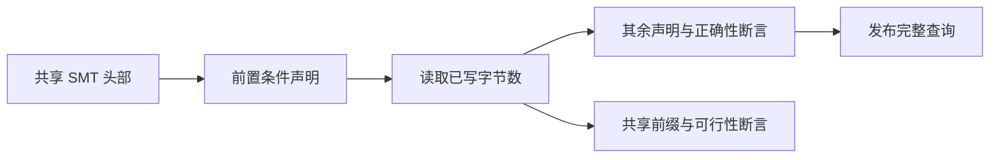
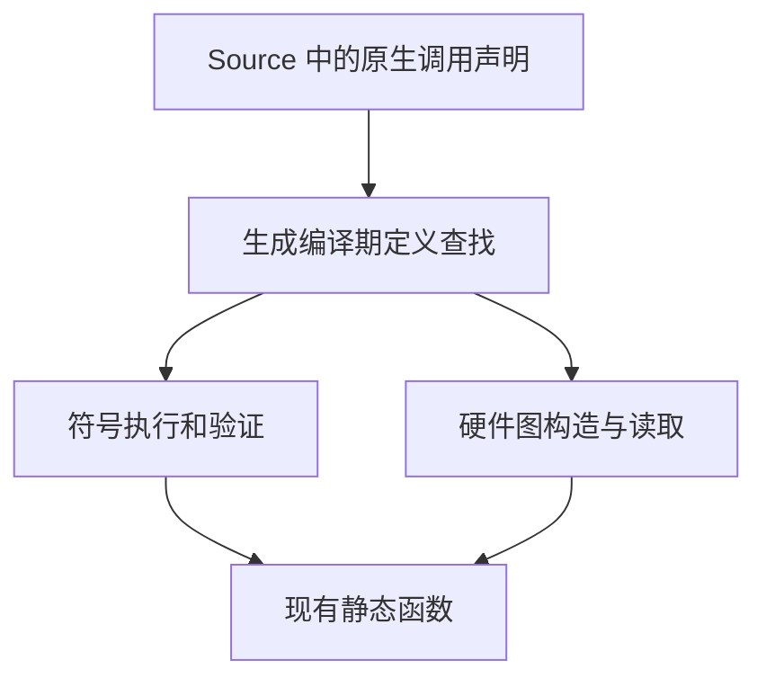

# 验证查询与硬件原生绑定自举

## Intent

让正式 Source 查询流程直接写入 SMT 文本并读出可行性查询的共享前缀。
验证和硬件流程的内部原生调用从各自的定义直接链接，去掉逐函数转发。

## Data

批首 `fa559ecd6`。现有 Source 查询依次请求 Zig 预留缓冲、写文本、
追加声明和读已写长度。生成的符号执行、查询和硬件图依赖编译器根模块的
逐函数别名。项目原生接口已采用可复用的静态定义查找。

## Edges

维持原缓冲容量和 SMT 字节顺序。可行性查询保留头部及前置条件声明，
正确性查询包含完整声明。两份查询的分配归属和失败释放顺序保持原约定。
Zig 提供标准写入器、物理声明列与最终缓冲所有权交付。

## Answer

集中验证实际 SMT 查询字节、求解结果、硬件图、资源失败回收、引导
产物和固定性能对照。提交后回查两批和固定起点至远端的净变化。

Source 直接借用标准写入器与其已写长度，移除 `reserveQueryBuffer`、
`appendQueryText` 和 `queryWrittenLength` 三个专用回调。缓冲预留仍
使用原容量，Zig 的物理分配移到构造时。写入失败按旧语义交付内存错误，
持有的正确性查询仍在后续失败时释放。验证与硬件的五个内部命名空间从
定义处直接链接，移除 118 个逐函数别名。

正式 Source 引导构建通过 30 步与 39 项 RX 测试，独立 seed 构建通过
52 步。两种引导工具分别用正式 Source 生成五份清单，17,822 个文件
逐字节一致。10 次常驻编辑、失效及恢复结果一致。候选与批首
`zxc-bootstrap` 二进制逐字节相同，SHA-256 为
`546b3dec8f7775daa45b534e099bd16758b80675cff2402c23584afab5567130`。
固定编译清单的工具保持相同，本批计时集中在实际使用新调用路径的
正式 CLI 求解流程。

ReleaseSmall 通过 87 个构建步骤、8 项验证及硬件资源测试，还有
74 项枚举求解和 8 项公开入口 CLI 用例。沿同一个现有硬件样例复验
组合及带时钟 RTL，两组 Verilog 和端口图清单逐字节一致。

使用同一份小型、嵌套和契约输入，批首和候选 CLI 都用各自的 Source
构建并执行 Source 验证。关闭语义缓存，第一轮预热，其后九轮交错取
中位数。实际 Z3 三组和隔离求解器一组，每组的七份查询及证据文件均相同。

| 负载              |   墙钟 批首 → 候选 |    CPU 批首 → 候选 | 峰值 RSS 批首 → 候选 |
| ----------------- | -----------------: | -----------------: | -------------------: |
| 小型 / Z3         |   11.24 → 11.32 ms |   10.38 → 10.41 ms |     25.12 → 25.12 MB |
| 嵌套 / Z3         | 157.15 → 156.93 ms | 156.11 → 155.93 ms |     31.92 → 31.93 MB |
| 契约 / Z3         | 157.60 → 157.51 ms | 156.57 → 156.50 ms |     31.92 → 31.93 MB |
| 嵌套 / 隔离求解器 | 148.82 → 148.57 ms | 147.52 → 147.25 ms |     22.33 → 22.33 MB |

非 seed 包源码 Zig 新增 36 行、删除 150 行，净减 114 行。全仓新增
41 行、删除 154 行，净减 113 行。硬件功能回归和直接产物比较覆盖
实际生成，RTL 仿真沿用独立的 Yosys 测试入口。
