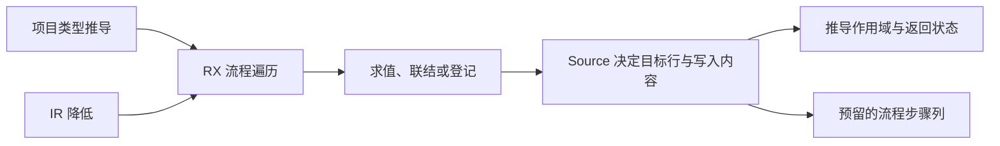

# RX 流程效果和步骤写回自举

## Intent

在同一批迁移类型推导与 IR 降低的 RX 流程效果。由 Source 计算流程步骤
的目标和数据，移除 Zig 调用、返回和任务中的专用步骤写回。

## Data

批首为 `03724eb0e`。`constraints/traversal.zig` 和 `flow_compile/traversal.zig`
共用 `project/flow/traversal/run.rx`。共用宿主按目标动态分派，持有调用与任务
临时结果。降低宿主直接建设 `program/flow.zig` 的步骤行，推导宿主写回返回与
任务局部状态。

## Edges

保留已有帧清理和类型图原子操作。参数求值退出后清理 getter 绑定，再公开结果。
并行 Task 先确定返回类型、登记输出位置，再恢复父返回状态。普通 Task 在缩回
作用域之前完成自己的输出计算。步骤按原布局直接写入已预留的列。

## Answer

从两个正式入口核对调用顺序、恢复和步骤写回，运行现有 RX 推导、Task、
Parallel、库和 Store 用例。对照引导产物及固定基线，并更新正式路径的剩余依赖。

### 当前实现

调用在 RX 中按普通行和并行边界分流。返回和普通 Task 共用步骤写入，ZX
为 Task 选择无输出、求值或绑定。并行 Task 的父返回编号和标志通过所借用的
字段恢复。原生宿主保留 `MultiArrayList` 的物理写入、表达式求值和图约束调用。

旧 `rx_flow_result` 独立入口退出。普通调用、普通 Task 和并行 Task 在 RX
指定领取结果的时机，ZX 直接推进所借用的绑定游标。可见性根据返回类型在
当轮决定。原生绑定复用原结果名称和类型列，省去了单独执行生成入口和临时
结果对象。并行 Task 的调用编号通过 RX 直接返回。

最小清单同时覆盖 `rx_traverse_flow` 与 `rx_compile_parallel_task`。两条生成
路径直接借用调用帧、游标和标量结果，交接描述在栈上构造。完整 execution
清单中两条入口的传递生成代码也没有为交接描述分配堆内存。候选工具的 SHA-256 为
`351577f3874f9dd4f44476df14720f90f5e1602a88b01ff58efa068ba21d6a5f`。

最终 Source 编译器回归 372 项、初始 seed 回归 39 项、应用回归 325 项和 CLI
集成 49 项通过，覆盖普通及并行 Task、Store、编译库联结和真实项目恢复。五份
同输入清单的 17,712 个生成文件逐字节一致。Switch 选择、分支发布和 Parallel
汇合仍有原生边界，由下一批推进。

### 性能回测

候选由批首 `03724eb0e` 的 Source 引导器构建。批首、候选和固定基线都执行
Source 生成路径，使用 Zig 0.17.0、ReleaseSmall 和 16 分区。三组交错测量
取中位数，同一份冻结清单另有 9,894 个生成文件逐字节一致。

| 指标                      |      批首 |      候选 |  固定基线 |
| ------------------------- | --------: | --------: | --------: |
| 冷生成墙钟                |   1.91 秒 |   1.92 秒 |   2.06 秒 |
| 冷生成 CPU                |   9.37 秒 |   9.39 秒 |   8.96 秒 |
| 冷生成进程树 RSS 采样峰值 | 522.11 MB | 523.65 MB | 738.08 MB |
| 冷生成系统单进程峰值      | 545.21 MB | 546.05 MB | 759.69 MB |
| 热生成墙钟                |   1.40 秒 |   1.40 秒 |   1.62 秒 |
| 热生成 CPU                |   6.10 秒 |   6.19 秒 |   6.40 秒 |
| 无修改生成墙钟            |   0.03 秒 |   0.03 秒 |   0.04 秒 |

常驻正文编辑的墙钟中位数从 149.77 降至 148.53 毫秒，CPU 持平于 0.345 秒，
采样进程树峰值从 631.29 降至 628.73 MB。两次编辑均重分析 2 个模块并复用
4,091 个模块，恢复输出与各自冷生成一致。

核验原始记录在 `.zig-cache/verification-tmp/rx-flow-publication/`，包括
`source-stage-verified.log`、`seed-verified.log`、`app-verified.log`、
`verified-generation.log`、`frozen-perf.log` 和 `resident-edits.log`。
