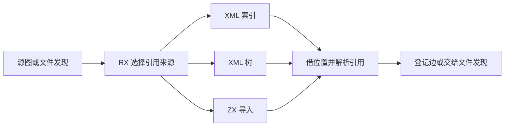
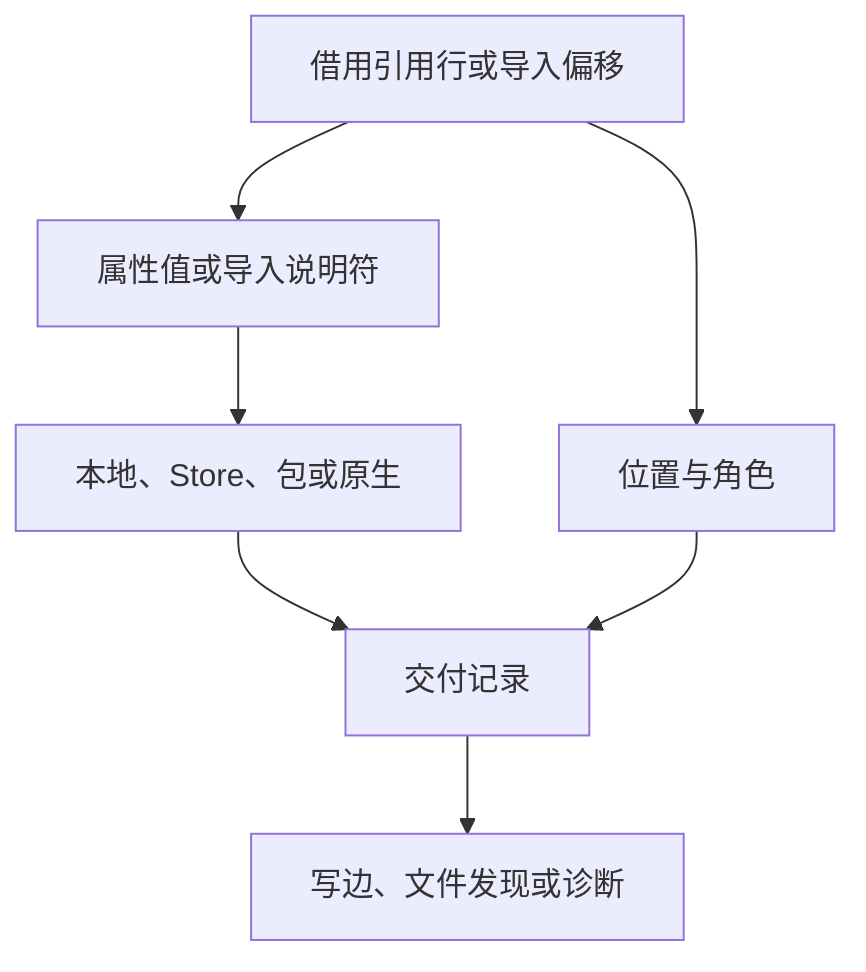

# RX 项目引用扫描与交付自举

## Intent

从 `c7f65844f` 接续，贯通正式源图与磁盘项目发现共享的引用扫描。选取索引、XML 树及 ZX 导入，保留原来的扫描顺序、文件名优先规则、依赖种类和诊断位置，将引用的定位和交付决策交给 Source。

## Data

正式源图从 `source_graph/scan.zig` 调用引用扫描，CLI 从 `collection/documents.zig` 消费同一规则。现有 Zig 为三套生成入口分别绑定参数，暂存 XML 树游标发出的引用，并在每次交付时取回 XML 属性或 ZX 偏移。命名函数分派仍经 `rx_edges.zig`。已迁移的包查找、路径规范化和登记边规则继续使用。

## Edges

继续借用现有索引和 XML 语法树。仅在路径缓冲不足时扩容。保留外层项目图错误和磁盘发现的原始错误，不改变失败时读过的引用前缀。保留实体的边表、诊断写入和 I/O。初始 seed 维持原来的语法兼容分支。

## Answer

取消三条独立的扫描入口和 Zig 树引用绑定、位置回查及命名分派。沿正式源图、磁盘项目和 watch 核对可达性、导入、Store 及错误恢复。与批首的生成结果对照，并用同一 Source 基线测量冷、热生成。

正式入口通过一个 RX 编排选择三种引用来源。索引和 XML 树共用属性读取与位置借用，直接将位置及角色随引用交给本地路径、Store、导入或诊断。ZX 导入继续传字节偏移，项目分析与文件发现沿用各自原来的行列语义。命名函数复用已有成员名规则和原生路径基名，保留完整文件名及目录索引优先。

删除旧的树引用绑定、位置回查、两套不同的交付分派及三条独立生成入口。Zig 从已有实体行借原生视图，最终写入边、查找内部注册接口或调用文件发现。文件发现仍需要桥接调用者的 I/O 和错误集合。阶段交付的引用位置与路径只在同步调用期间借用，跨阶段保存的路径继续由原调用者持有。

首轮生成发现，原生接口直接接收嵌套记录时会切到普通指针调用，扫描的空分配器暴露了临时堆分配。ZX 继续以结构化记录组装交付数据，在原生边界展开为标量和借用切片，使调用链继续走已有的值调用。单入口生成核对了从公开入口可达的函数，编译器未为这些调用生成临时分配。原有路径工作区仅在确实需要扩容时请求分配。

后续沿混合正文的导入结果、函数与类型前缀、初始化器和工件追加推进。导入选择与链接入口当前各自持有一份 Zig 帧，优先把链接准备与写回合并到正式 Source 入口，退出帧内的编译器规则。

### 行为与引导验证

- 以上一批 Source 工具构建候选。正式引导的 35 个构建步骤和 372 项编译器测试通过，初始 seed 的 53 个构建步骤与 39 项 RX 测试通过。
- 候选及批首工具在五份同输入清单下的 17,733 个生成文件逐字节一致。候选引导器 SHA-256 为 `7604c4ef8df29aef6ff76984f7246447f37cb20b9475184a19fc3cf2b9255914`。
- 159 项应用测试与 2,055 项 CLI 集成通过，覆盖 RX 推导、解析和语义缓存、磁盘项目、Store 路径、包引用、缺失依赖、循环诊断和 watch 恢复。

### 性能

三套工具均由 Source 引导器生成，运行各自的 Source 分析与生成。沿用固定输入、16 个分区和关闭常驻生成器的配置，三轮交错取中位数。冻结清单的可达扫描经过本批迁移。候选和批首的 9,894 个生成文件及所有权 memo 一致，各工具的冷、热生成结果分别一致。

| 对照     | 冷生成墙钟 | 冷生成 CPU | 冷进程树峰值 RSS | 冷系统单进程峰值 RSS | 热生成墙钟 | 热生成 CPU |
| -------- | ---------: | ---------: | ---------------: | -------------------: | ---------: | ---------: |
| 固定基线 |     2.08 s |     9.02 s |        737.25 MB |            769.36 MB |     1.67 s |     6.46 s |
| 批首     |     1.94 s |     9.43 s |        522.73 MB |            542.74 MB |     1.44 s |     6.27 s |
| 本批     |     1.94 s |     9.43 s |        517.64 MB |            545.83 MB |     1.45 s |     6.26 s |

较批首，冷墙钟与 CPU 持平，采样进程树峰值减少 5.10 MB，系统单进程峰值增加 3.10 MB。热墙钟增加 0.01 秒，CPU 减少 0.01 秒。无修改生成墙钟同为 0.03 秒。较固定基线，冷墙钟减少 0.14 秒，CPU 增加 0.41 秒，采样进程树峰值减少 219.61 MB。本次回测覆盖引导生成阶段。
