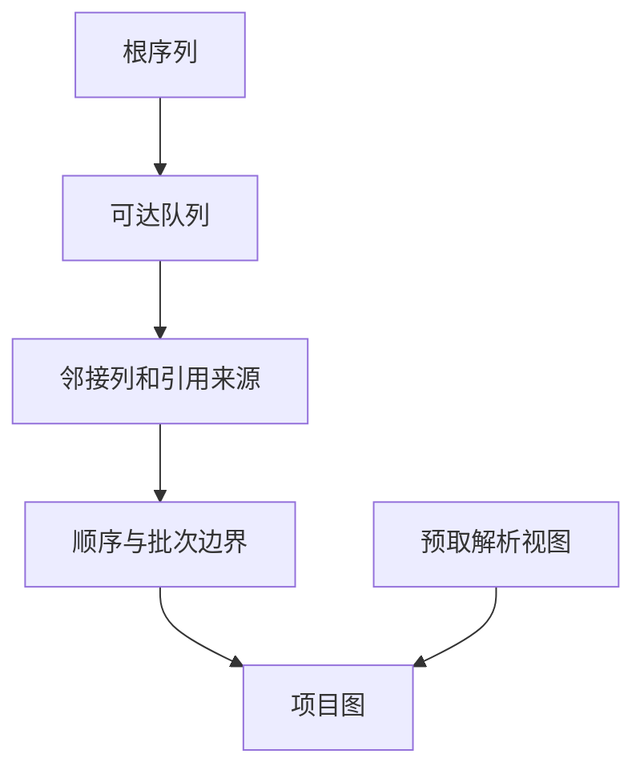

# RX 项目源图构造与交付自举

## Intent

将项目源图的注册、根选择、可达扫描、顺序计算和结果交付贯通于正式 Source 入口，移除 Zig 的整阶段回调。

## Data

批首 `5e3a14119`。当前 Source 执行注册与根选择，经 Zig 构造状态再进入 Source 扫描和排序。邻接列、可达队列、排序缓冲与预取解析结果的生命周期由不同 Zig 调用持有。

沿用 11 月 22 日 06:10（美东时间）的两日比较起点 `c1726aca3`。到批首，RX 项目分析中的 Zig 净增 1,715 行。`c00597a74` 的源图迁移在该目录净增 189 行，先把注册与根选择接进 RX，扫描、排序及预取交付仍经 Zig 阶段回调。`806f2a6ba` 的混合正文联结在该目录净增 260 行，增量主要是正文准备、导入及联结状态。优先收口这些已进正式路径的过渡逻辑。core 同期净增 913 行，包含函数表与类型表的列视图和交付适配。

## Edges

保留输入路径、根顺序、诊断位置、预取计数和命中行为。排序临时区和解析缓存保持各自生命周期。原生边界提供路径解析、缓存操作以及公开 Zig 图结构的视图交付。

## Answer

核对项目联结的正式输入与被调用的 Source 图，集中验证直接入口、缓存复用、依赖顺序和诊断。使用固定可比基线对照冷、热生成并记录净减。

构造 RX 直接连接根选择、列预留、可达扫描、拓扑排序和结果返回，移除 `scanSourceGraph`、`orderSourceGraph`、`publishSourceGraphParses` 和 `publishSourceGraph`。扫描和排序由同一构造入口组合，取消两个独立生成入口，删除 `order.zig`。

扫描结束即释放队列、访问列、边收集临时区和本地解析缓存。外部缓存的预取视图仅在请求保留时继续持有，图转换成功后交付给调用方。有效路径由持久分配器直接构造，根查找与排序的临时结果随暂存区释放。原生层继续借用实体缓存与图列，提交解析统计，转换公开索引类型，并将循环报告定位到原有边。

接续从正式构造和项目发现两条入口追踪引用扫描。两者共用索引引用、XML 树引用和 ZX 导入三路遍历。选择引用类型、到项目索引写边及登记错误的顺序已有共用 Source 规则，下一步要同时处理扫描持有的引用位置与边交付，保留两类调用者的原始错误及物理列。

### 行为与引导验证

- 以上一批 Source 工具构建候选。正式引导的 35 个构建步骤和 372 项编译器测试通过。初始 seed 的 53 个构建步骤和 39 项 RX 测试通过。
- 159 项应用测试通过，覆盖 RX 项目推导、解析缓存及语义缓存。另有 9 项磁盘项目 CLI 检查和 1 项 watch 检查通过，覆盖缺失依赖、环诊断、传递依赖修改及失败恢复。
- 候选及批首工具在五份同输入清单下的 17,736 个生成文件逐字节一致。候选引导器 SHA-256 为 `2293404ddaec61448feee7b1c86421d0e2950bf8860a9ece58bfa68b35ae2a6c`。

### 性能

三套工具均由 Source 引导器生成，运行各自的 Source 分析与生成。同一冻结输入、16 个分区，关闭常驻生成器，三轮交错取中位数。冻结清单的可达模块选择走本批迁移的源图入口。候选和批首的 9,894 个生成文件及所有权 memo 一致，各工具冷、热输出各自一致。

| 对照     | 冷生成墙钟 | 冷生成 CPU | 冷进程树峰值 RSS | 冷系统单进程峰值 RSS | 热生成墙钟 | 热生成 CPU |
| -------- | ---------: | ---------: | ---------------: | -------------------: | ---------: | ---------: |
| 固定基线 |     2.14 s |     9.01 s |        738.07 MB |            759.97 MB |     1.65 s |     6.42 s |
| 批首     |     1.91 s |     9.33 s |        516.78 MB |            541.34 MB |     1.42 s |     6.21 s |
| 本批     |     1.94 s |     9.38 s |        517.37 MB |            539.84 MB |     1.41 s |     6.16 s |

较批首，冷墙钟增加 0.03 秒、CPU 增加 0.05 秒、采样进程树 RSS 增加 0.59 MB、系统单进程峰值减少 1.51 MB。较固定基线，冷墙钟减少 0.20 秒、CPU 增加 0.37 秒、采样进程树 RSS 减少 220.69 MB。指标在阶段容差内。无修改生成与批首同为 0.03 秒。本次性能对照覆盖引导生成，完整冷构建耗时继续沿用原有单独基线。
