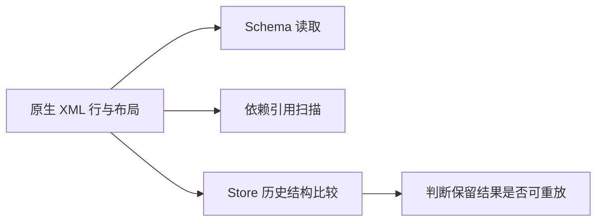
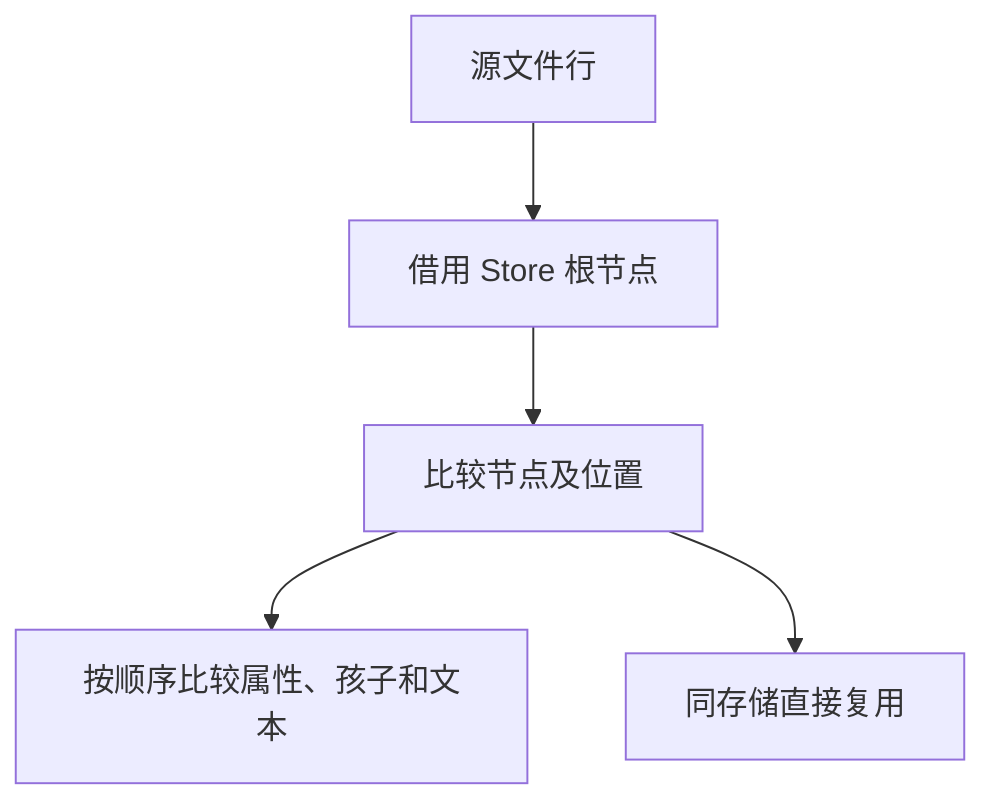

# Store 历史 XML 借用视图自举

## Intent

从 `239d165b6` 接续，退出 Store 重放判断专用的 Zig XML 访问器。Schema、依赖引用和 Store 历史比较共享借用行与原生布局声明。

## Data

正式混合编译通过 `history/prefix/probe.zx` 判断是否可重放。Store 文档未共享时，旧流程经 `store_view.zig` 逐项访问节点、属性、文本和位置。相邻的 Schema 树遍历、依赖引用游标已从原生行借用字节与切片描述符，各自维护重叠的原生布局。

## Edges

复用既有树存储，保留同一行的快速判定。不同树逐项比较节点名、位置、属性、子节点、文本及属性原文。原生布局由真实类型静态计算。初始 seed 仍使用通用结构比较。

## Answer

删除 `store_view.zig` 与专用宿主声明，收敛三处重叠布局。集中检查 Schema、依赖图、Store 与重放的行为及性能，记录剩余原生边界。

## 实现与验证

Schema、依赖引用游标、已索引的引用扫描和 Store 历史比较使用同一套 XML 布局。原生边界静态绑定字段偏移与原生行大小。重放输入借用保留与当前的源模块行，ZX 提取根节点，按原顺序比较节点和叶子；相同存储直接返回。通用字节视图为现有借用字段读取补齐可空文本和存储身份判断。树与文本负载沿用原有存储。

使用现有 `state.store.rx` 和读取函数，通过编译器 `project.infer` 实际触发重放。将相同 Store 内容独立解析为两棵树后，重分析 1 个模块、重用 2 个。只修改字段初始值后，重分析 2 个、重用 1 个。该场景经过正式生成的混合项目流程，两次推导均成功。

Source 372 项、seed 39 项、应用与库 209 项、CLI 与 Store 33 项通过。五份同输入清单的 17,699 个生成文件逐字节一致，比较跳过输入快照戳。

使用 `239d165b6` 的 Source 引导器生成候选，由候选运行 Source 分析和生成。Zig 0.17.0、ReleaseSmall、16 分区，固定清单三轮交错中位数。较批首，冷生成墙钟从 1.92 秒降至 1.91 秒、CPU 从 9.36 秒降至 9.33 秒，进程树采样峰值减少 1.6 MB、单进程峰值减少 11.9 MB。热生成墙钟从 1.44 秒降至 1.40 秒，CPU 从 6.25 秒降至 6.14 秒。较固定基线，冷墙钟减少 0.16 秒、CPU 增加 0.37 秒、进程树采样峰值减少 220.1 MB。固定清单的 9,894 个生成文件一致。

本批全仓和非 seed 包源码均新增 67 行 Zig、删除 157 行，净减 **90 行**。固定起点 `4c11902b6` 至本批，全仓与非 seed 分别净减 **2,028 / 3,430 行**。两日比较起点 `c1726aca3` 至本批仍分别净增 **2,348 / 771 行**。候选引导器 SHA-256 为 `eeab4be033aba1adc3fd3420a3061086e57fa4dcbe3dde03ac13cd1a10746b21`。
