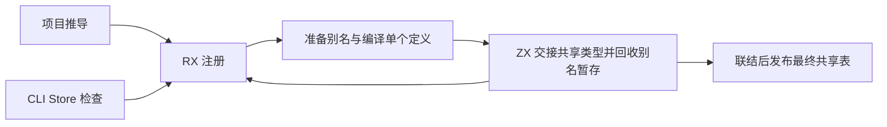
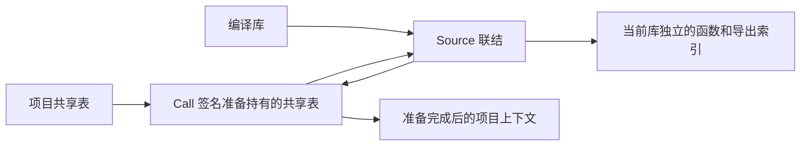
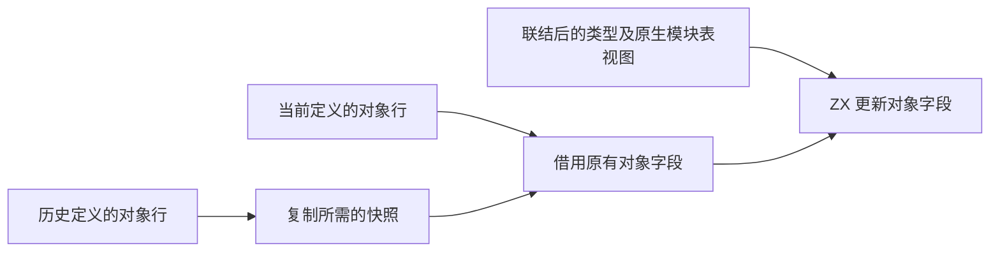

# Store 注册与共享表发布自举

## Intent

将 Store 定义间的类型表交接、注册规则和最终发布迁入 RX/ZX。项目推导和
CLI 使用同一个注册入口，编译库沿同一批次接续初值选择及 RX Call 签名联结。

## Data

批首为 `4e6f33416`。项目的 `derive/host.zig` 和 CLI 的
`store_types.zig` 通过 `registry.loadSignaturesIn` 或 `loadSignatures`
进入同一遍历。旧循环同时持有别名暂存区和已更新的类型表。无签名的注册入口
没有调用方，正式入口在项目图注册时校验 Store 路径冲突。`registry.publish`
在成功联结后同样以 Zig 遍历定义和对象。
`prepare/invocation/host.zig` 通过 `call/library_bindings.zig` 装载每个新库，
旧入口每次都复制已联结的类型、名义来源和原生模块三张表。

## Edges

保持注册顺序与首次诊断。逐定义收回别名暂存区，保留定义结果所需的类型、
名称及对象存储。已有历史定义沿用快照复制，当前定义直接写回对象原字段。
初始化器选择保持原定义及对象顺序，沿用栈上的索引页和结果数组的增长规则。
输出继续借用原对象中的初始化器 IR。
RX Call 的签名装载只对本次准备持有一份可扩展的共享表。每个库继续持有独立
函数编号与导出索引。任一装载错误都会终止本次准备，返回成功结果时才交付
最终共享表。首次校验基础名义来源，此后沿用由编译库联结验证的前缀。

## Answer

项目和 CLI 共用 RX 定义遍历。ZX 将新类型表视图写回注册上下文，然后回收
该定义的别名暂存。联结后逐对象写回共享视图，库发布时由 ZX 选择、分页并
写入借用的初始化器。Zig 接入层提供原存储视图和需要保留的历史快照。

Call 签名联结复用一份可扩展的共享表。删除每库重新建表的内部入口，以及被
Source 接口发布取代的初值适配器和独立生成入口。编译库接口、依赖扫描、源码
发布及缓存恢复复用通用列借用。导出与初值发布直接借用校验阶段的 ABI 视图，
无需再次组装同一组描述符。缓存命中、成员选择和本地验证登记仍由
`library_bindings.zig` 持有。

### 验证与源码变化

候选编译器由批首 Source 引导器生成，使用 Zig 0.17.0、ReleaseSmall 和
16 分区。372 项编译器、306 项应用、26 项库初值、39 项 seed 和 24 项
CLI 回归通过。
应用回归覆盖同库多别名和两个库实例分别持有 Store。五份清单的 17,754 个
生成文件逐字节一致。CLI 覆盖 Store 路径、应用内状态与进程重启后的初值。

以 `4e6f33416` 为批首，按实际提交格式化计算，非 seed 包源码 Zig 增加
394 行、删除 441 行，净减 47 行。全仓 Zig 增加 397 行、删除 443 行，
净减 46 行。自固定起点 `4c11902b6` 起，两项分别累计净减 3,511 和 2,164 行。

### 固定清单生成回测

批首、候选与固定基线各使用自身的 Source 分析与生成实现。沿用相同冻结
输入、缓存边界及 16 分区。三者交错运行三轮，取中位数。候选和批首的
9,894 个冻结产物及所有权缓存载荷一致。无修改生成仍为 0.03 秒。

| 指标                      |      候选 |      批首 |  固定基线 |
| ------------------------- | --------: | --------: | --------: |
| 冷生成墙钟                |   1.89 秒 |   1.87 秒 |   2.03 秒 |
| 冷生成 CPU                |   9.29 秒 |   9.27 秒 |   8.91 秒 |
| 冷生成进程树 RSS 采样峰值 | 522.96 MB | 520.99 MB | 737.51 MB |
| 冷生成系统单进程峰值      | 545.41 MB | 538.51 MB | 759.68 MB |
| 热生成墙钟                |   1.40 秒 |   1.41 秒 |   1.60 秒 |
| 热生成 CPU                |   6.17 秒 |   6.13 秒 |   6.29 秒 |

冷生成墙钟和 CPU 较批首各增加 0.02 秒，进程树和单进程峰值分别增加
1.97 MB 和 6.90 MB。相对固定基线，冷墙钟减少 0.14 秒，CPU 累计增加
0.38 秒，进程树峰值下降 214.55 MB。回测范围为固定清单的引导生成。
