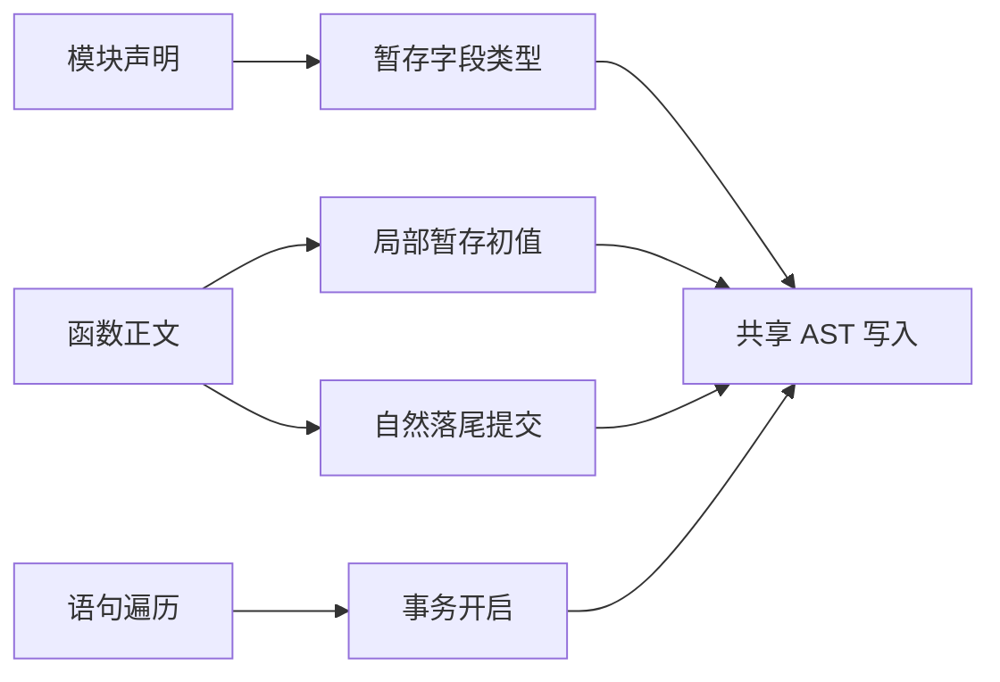
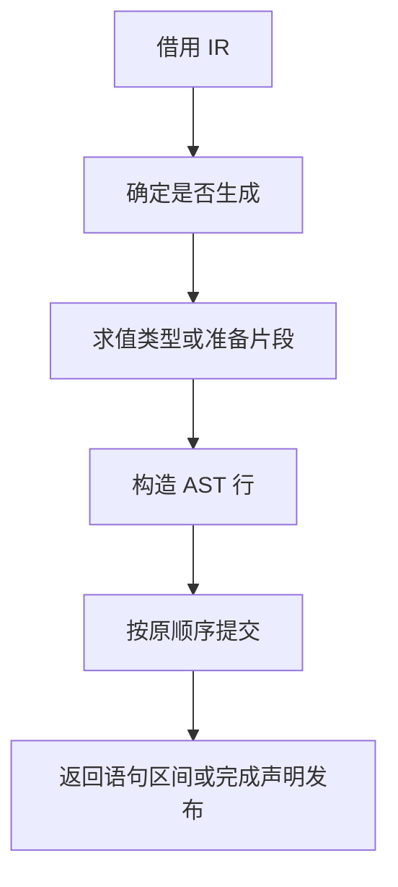

# genz Store 事务发射自举

## Intent

迁移 genz 事务开启、暂存类型与局部初值、自然落尾提交。Store 生成策略由 Source 执行，原生边界继续借用 IR 和 AST 存储。

## Data

批首为 `ac6c67d5c`。普通函数正文调用事务初值和落尾提交，语句遍历调用事务开启，模块声明物化暂存字段类型。原生入口当前从生成结果读取行，设置上下文标记并提交 AST。事务适配器处理跨模块调用的独立职责。

## Edges

保持字段类型的求值顺序和快照时点。继续沿用各片段的文本所有权、语句起点和自然落尾条件，并保持 seed 路径原有行为。

## Answer

从模块声明、函数正文和语句遍历核对正式路径上的 Zig 职责。集中运行 Store 回归、五份活跃自举清单的产物对照、固定清单性能测量，再记录 Zig 净变化。

事务开启在 RX 中选择目标 Store 槽、取得 AST 游标并启用上下文。暂存类型由 ZX 按原顺序逐项求值，RX 在求值完成后读取当前表长度，再发布表达式、字段和声明。中间类型索引使用一份定长缓冲，声明发布完成即释放。

局部暂存初值和自然落尾提交由 RX 检查条件、生成片段并依序写入 AST。原生函数退出暂存类型遍历、上下文启用决策和片段拼接，剩余原生调用借用引导器的存储并写入通用 AST 表。

首次产物对照发现部分函数的正文为空。小清单复现显示语句已经生成，但交付正文时读到的语句区间为空。函数正文改用语句遍历已使用的可变帧引用传递方式后，最小清单的 7 个产物与批首工具逐字节一致。

运行 Store 应用回归时，暂存类型入口返回的 `OutOfMemory` 实际来自索引越界。写入操作读到了零长度的缓冲描述符。暂存索引现借用宿主预先分配的定长缓冲，ZX 保留类型求值、索引写入与产物的顺序，求值后的视图无需复制。

最终 Source 阶段由 `ac6c67d5c` 的 Source 工具以 ReleaseSmall 和 16 个主分区生成。35 个构建与测试步骤全部通过，覆盖 372 项编译器测试。主清单、执行清单、宿主清单、集合和增长清单的 17,696 个产物与批首工具逐字节一致，比较排除缓存索引 `.zxc-inputs`。

Store 应用回归 142 个构建和执行步骤全部通过。353 项 Zig 测试及 Node 驱动的集成检查通过，覆盖事务写入和失败、Store I/O、共享值寿命、区域回收、所有权证据与库重新发布。

### 固定清单生成性能

固定基线为声明准备阶段的 Source 工具。批首工具由 `57d60f8fb` 生成，候选工具由 `ac6c67d5c` 生成，三者均启用各自的 Source 分析与生成实现。交错测量三轮并取中位数，时长单位为秒，内存为十进制 MB。

| 场景   | 工具     | 墙钟 |  CPU | 采样进程树 RSS | 系统单进程峰值 |
| ------ | -------- | ---: | ---: | -------------: | -------------: |
| 冷生成 | 固定基线 | 2.08 | 8.95 |         737.84 |         764.74 |
| 冷生成 | 批首     | 1.93 | 9.39 |         522.99 |         545.87 |
| 冷生成 | 候选     | 1.92 | 9.35 |         517.19 |         536.12 |
| 热生成 | 固定基线 | 1.61 | 6.39 |         706.79 |         730.07 |
| 热生成 | 批首     | 1.39 | 6.12 |         502.28 |         502.32 |
| 热生成 | 候选     | 1.42 | 6.18 |         502.50 |         502.55 |

冷生成较批首墙钟减少 0.01 秒，CPU 减少 0.04 秒。采样进程树 RSS 减少 5.80 MB，系统单进程峰值减少 9.75 MB。较固定基线冷墙钟减少 0.16 秒，CPU 累计增加 0.40 秒，采样进程树 RSS 减少 220.64 MB。未修改输入的重复生成耗时 0.03 秒。固定清单的 9,894 个产物在批首与候选之间以及候选冷暖之间逐字节一致。
