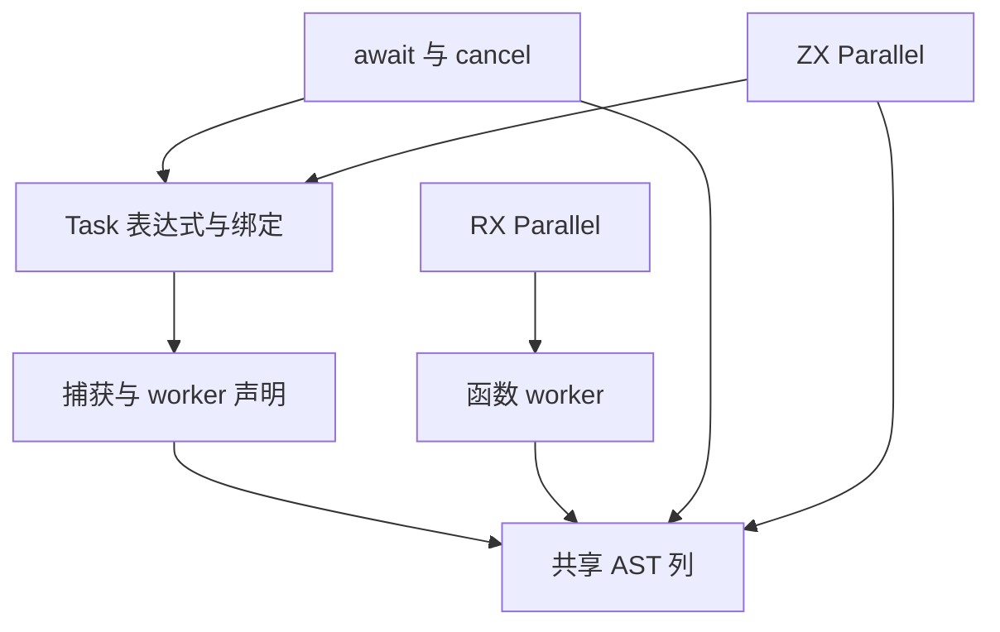

# genz 任务与并行发射自举

## Intent

将正式 Task 的 worker 捕获、启动、等待、取消及两条 Parallel 入口的发射和发布迁入 RX/ZX。沿同一调用链删除任务专用 Zig 发射桥，保留运行顺序、可观察错误和 AST 布局。

## Data

批首为 `ea1b109df`。表达式和绑定都调用 `zx/tasks/root.zig`。其中 worker 按顺序预留辅助声明、读捕获、求值、发射丢弃和引用，再发布声明。Parallel 任务表达式复用任务绑定，RX 并行语句另用函数 worker。两者共用语句表、结果包装和错误边界。排序批次已验收实体 AST 列、辅助声明槽及语句区间接口。

## Edges

保持先登记占位再递归、捕获声明顺序、名称在成功和失败出口的恢复、先启动后收集、错误作用域和每条分支的结果布局。只借用仍在有效期内的输入列。原生路径继续提供实际递归求值、Zig 资源和存储操作，seed 独立保存。阶段产物和性能使用排序阶段的引导器、清单和流程。

## Answer

由正式任务与并行入口检查旧 Zig 职责是否退出，集中执行现有任务、并行、库和分配回归，比较各 Source 清单及冷暖性能。更新净减计划并核对远端主线。

Task 的 RX 入口串联 worker 捕获、正文求值、辅助声明发布和启动语句。等待与取消共用结果入口，按是否已有任务决定是否生成内联启动和结果块。ZX Parallel 先启动全部任务再收集结果。RX Parallel 逐分支准备函数 worker 和调用参数，再发布汇合语句和结果对象。

两份任务专用 Zig 发射文件和十二个独立生成入口退出。六条执行路径统一经 RX 进入，其中一条沿用原入口名称。原生层提供实际递归求值、实体 AST 列写入及临时资源和捕获名称的失败恢复。区间编码沿用起点在高位、长度在低位的 packed 表示，新旧接入共用同一个原生解码操作。

### 行为验收

- 候选由批首 `ea1b109df` 的 Source 引导器生成，采用 `ReleaseSmall` 和 16 个主生成分区。35 个构建步骤及 372 项编译器测试通过。候选引导器 SHA-256 为 `5fb2c4bd7f45b39d3ffe1abf95c114e7e9fbff96e57ab432dfc522f63ccf191c`。
- 批首和候选工具执行 main、execution、host、collections、growth 五份相同清单。除编译器身份输入戳外，17,725 个文件逐字节一致。Task 生命周期的八个用例各比较程序和 ABI 产物，16 个文件一致。
- Task 生命周期、Parallel 的源码、归档、消费和二次发布、并行推导，以及 Task 输出的 CLI 回归通过。Zig 应用测试共 981 项，另有 32 项 Task 输出的 CLI 测试通过。
- 浮点测试的旧消费矩阵仍将 ZX 导入 RX 当作合法路径，首轮出现 16 个拒绝诊断。按现有语言契约保留直接执行、归档、RX 消费和 RX 二次发布。非法导入继续由现有编译包、Store 和初始化器用例覆盖。顺带将浮点 RX 目录生成器的排版对齐已签入的样例，恢复该目录的一致性检查。
- 修正后两套浮点目标均通过，Parallel 共有 28 组、12,656 项测试，Task 与 Switch 共有 14 组、10,584 项测试。两套矩阵都涵盖在 RX 中消费和二次发布编译库。

### 性能验收

候选由 `ea1b109df` 的 Source 引导器生成，批首由 `f00df2762` 的 Source 引导器生成。固定基线沿用之前验收的 `declaration-preparation` Source 工具。三者都启用 Source 分析与生成。使用同一份冻结兼容清单，关闭常驻生成，保留 16 个分区，交错测量各三次。以下为生成阶段的中位数，冷生成清空输出和缓存，热生成沿用缓存重建输出。

| 场景与版本        | 墙钟（秒） | CPU（秒） | 采样进程树峰值 RSS（MB） | 系统单进程峰值 RSS（MB） |
| ----------------- | ---------: | --------: | -----------------------: | -----------------------: |
| 冷生成 · 固定基线 |       2.04 |      8.91 |                   738.38 |                   761.09 |
| 冷生成 · 批首     |       1.87 |      9.27 |                   517.75 |                   548.96 |
| 冷生成 · 候选     |       1.89 |      9.32 |                   523.19 |                   541.18 |
| 热生成 · 固定基线 |       1.62 |      6.37 |                   705.71 |                   730.02 |
| 热生成 · 批首     |       1.45 |      6.24 |                   502.12 |                   502.15 |
| 热生成 · 候选     |       1.44 |      6.22 |                   502.30 |                   502.33 |
| 无修改 · 固定基线 |       0.04 |      0.03 |                     0.52 |                    17.96 |
| 无修改 · 批首     |       0.03 |      0.03 |                     0.41 |                    15.89 |
| 无修改 · 候选     |       0.03 |      0.03 |                     0.41 |                    15.94 |

较批首，冷生成墙钟增加 0.02 秒，CPU 增加 0.05 秒。进程树 RSS 采样峰值增加 5.44 MB，系统单进程峰值减少 7.78 MB，采样物理占用峰值减少 1.45 MB。热生成墙钟减少 0.01 秒，CPU 减少 0.02 秒。较固定基线，冷生成墙钟减少 0.15 秒，CPU 增加 0.41 秒，进程树 RSS 采样峰值减少 215.19 MB。候选与批首的冻结清单产物及候选的冷暖产物各有 9,894 个文件逐字节一致。
