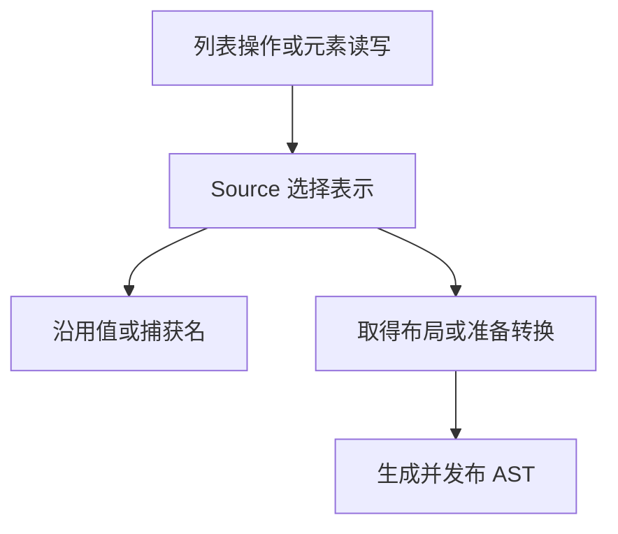

# genz 列表与元素表示自举

## Intent

从 `99ef2923a` 接续，将列表值沿用、类型布局与元素读取、写入和捕获的
选择交给 Source。列表与元素共用列借用，pop 复用元素转换的资源准备。

## Data

列表入口先问是否能沿用已有 AST，必要时构造布局，然后发布表达式和
字段。元素入口使用同一份表示分析，原生层分别处理直接返回、捕获、
布局查找和转换。pop 重复构造元素转换所需的列视图和资源。

## Edges

保持直接沿用时的轻量路径。生成布局后重新借用可能增长的列；
无需布局时沿用原来的视图。保留文本持有及捕获名称的生命期。
编译器宿主继续提供布局句柄、实体列写入和临时区释放。

## Answer

核对列表与元素正式入口和 pop 调用。验证生成产物一致、元素转换
与捕获行为、现有分配失败检查和固定清单的冷暖开销。

- RX 选择沿用列表表达式或执行布局与生成。沿用直接返回，通常生成
  路径继续借用原 AST 列，只有布局可能追加行时重新借用。
- 元素读取、写入与捕获由 Source 选择沿用或转换，输出编号和名称
  均使用直接 ABI。共用资源准备覆盖 pop，捕获名在应用临时片段后
  按原方式持有。
- 列表字段和表达式共用已验收的 AST 发布流程，保留借用文本。
  列表和元素的 seed 接口在编译期选择。
- 以批首 `99ef2923a` 的 Source 引导器构建 ReleaseSmall 候选，
  主清单使用 16 个分区。372 项编译器测试通过。
- 五份相同引导清单除输入戳外，17,891 个文件逐字节一致。
- 默认初始 seed 的 `bootstrap-lexer` 通过 22 个构建步骤。
- 八组应用回归通过，共 313 个构建步骤、928 项测试。覆盖嵌套
  列表、所有权和缓冲复用、pop、元素捕获与谓词回调，以及普通与编译库
  的不可变操作。

对照的三个工具均由 Source 生成。测量使用 Source 分析与生成、
同一冻结清单、Zig 0.17.0 和 16 个分区，关闭常驻生成。取三次
交错运行的冷生成中位数。

| 引导器                             |   墙钟 |    CPU | 采样进程树峰值 RSS | 单进程峰值 RSS |
| ---------------------------------- | -----: | -----: | -----------------: | -------------: |
| 固定基线 `declaration-preparation` | 2.11 s | 9.08 s |          737.95 MB |      761.22 MB |
| 批首 `99ef2923a`                   | 2.00 s | 9.56 s |          519.52 MB |      538.66 MB |
| 候选                               | 1.99 s | 9.56 s |          524.09 MB |      548.45 MB |

较批首，冷生成墙钟减少 0.01 秒，CPU 持平，进程树峰值增加
4.57 MB，单进程峰值增加 9.80 MB。较固定基线，墙钟减少
0.12 秒，CPU 增加 0.48 秒，进程树峰值减少 213.86 MB。
热生成墙钟减少 0.01 秒、CPU 持平，无修改生成墙钟保持 0.03 秒。
冻结清单冷暖及批首对照的 9,894 个文件逐字节一致。
