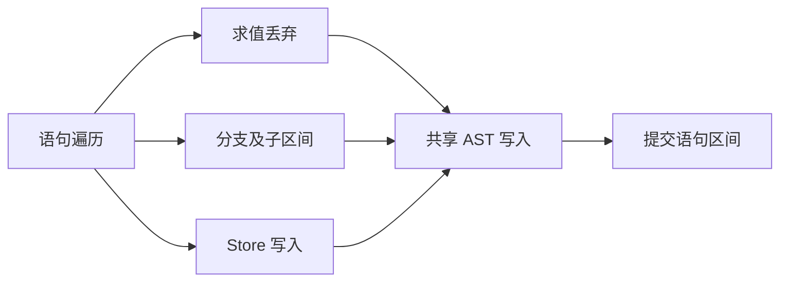
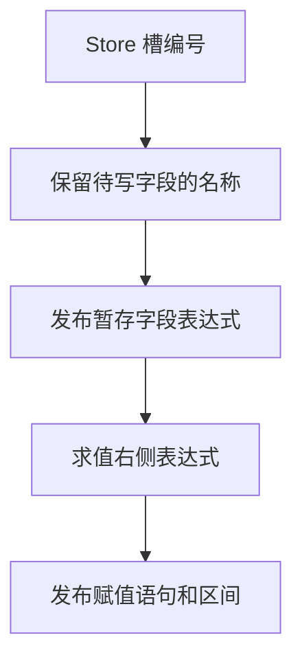

# genz 基础语句与 Store 写入自举

## Intent

将普通正文的求值丢弃、分支发布和 Store 写入迁入 Source，移除基础语句的 Zig 发布实现与待写字段的名称回填。

## Data

批首为 `4ceae24e1`。语句遍历从 `emitEvaluation`、`emitStoreWriteStatement` 和 `joinStatementBranch` 进入三个旧 Zig 步骤。Store 写入先发射暂存字段，再求值右值，最后发布赋值。求值丢弃使用原有的迭代与丢弃入口。普通分支使用已生成的条件和两个子区间。

## Edges

保留 Store 目标先于右值求值的顺序、分支子块的身份和空区间行为。名称由 AST 最终存储持有，基本语句通过窄列视图借用写入。复用已有语句遍历游标、原生分配边界和 seed 实现。

## Answer

核对三条正常入口上的 Zig 职责退出情况，集中运行语句求值顺序、作用域、返回和 Store 应用回归。用批首与候选对照五份自举清单，并与固定基线比较冷、热生成的资源占用。

三个 Source 入口分别控制求值丢弃、子区间合并后的分支发布和 Store 赋值。Store 目标的表达式列先写入 AST，再求值右侧。读取与写入沿用共享槽名格式，跨模块调用和写入复用持久名称构造。基本语句共享窄列写入，三条路径沿用语句遍历的结果区间与错误约定。删除旧的 `zx/statements/basic.zig` 及四个独立片段生成入口。

语句遍历阶段继续借用已有的原生作用域、输入 IR 和分配区。宿主只绑定输入、执行该 Source 入口并提交最终区间。seed 的写入走原有字段构造。

`4ceae24e1` 的 Source 引导器以 ReleaseSmall 和 16 个主分区生成候选，35 个构建和测试步骤全部成功，372 项编译器测试通过。九组应用回归共 327 个步骤、573 项测试通过，覆盖求值顺序、Switch 作用域、返回、带类型错误传播、Loop 和 Store 运行及库重新发布。五份活跃清单的 17,726 个生成产物逐字节一致，比较排除缓存索引 `.zxc-inputs`。

### 固定清单生成性能

固定基线为声明准备阶段的 Source 引导器。批首工具由 `7c7639b64` 生成，候选工具由 `4ceae24e1` 生成。三者都启用各自的 Source 分析和生成实现。交错测量三轮取中位数，时间单位为秒，内存为十进制 MB。

| 场景   | 工具     | 墙钟 |  CPU | 采样进程树 RSS | 系统单进程峰值 |
| ------ | -------- | ---: | ---: | -------------: | -------------: |
| 冷生成 | 固定基线 | 2.16 | 9.15 |         737.95 |         760.56 |
| 冷生成 | 批首     | 2.23 | 9.57 |         517.70 |         535.09 |
| 冷生成 | 候选     | 2.01 | 9.53 |         517.16 |         535.51 |
| 热生成 | 固定基线 | 1.68 | 6.50 |         711.64 |         730.66 |
| 热生成 | 批首     | 1.49 | 6.35 |         502.32 |         502.35 |
| 热生成 | 候选     | 1.48 | 6.31 |         502.22 |         502.22 |

冷生成较批首墙钟减少 0.22 秒，CPU 减少 0.04 秒。进程树 RSS 采样峰值减少 0.54 MB，系统单进程峰值增加 0.43 MB。较固定基线冷墙钟减少 0.15 秒，CPU 累计增加 0.38 秒，进程树 RSS 采样峰值减少 220.79 MB。未修改输入的重复生成耗时 0.03 秒。固定清单的 9,894 个产物在批首与候选之间及候选冷暖之间逐字节一致。
