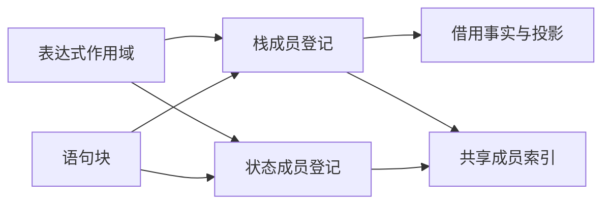
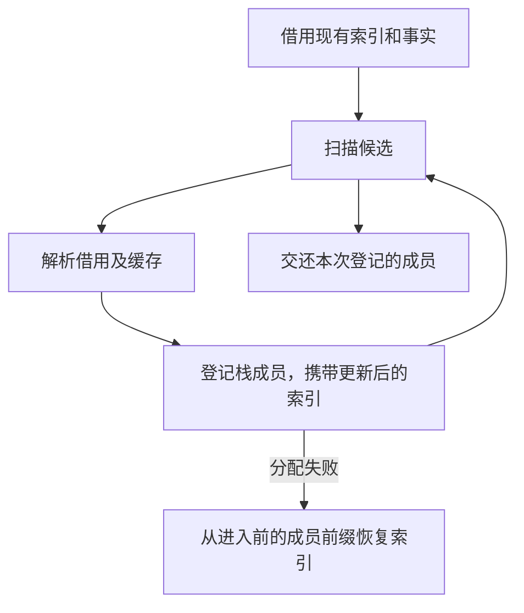

# genz 局部表示登记与恢复自举

## Intent

将函数语句块和表达式作用域的局部值登记交给 Source，集中处理状态表示、值 ABI 的栈成员和借用事实。退出表达式作用域逐阶段跨 Zig 边界的循环，沿用已有索引及失败清理规则。

## Data

批首是 `fae33d07c`。普通和值 ABI 表达式从 `scope.zig` 进入，语句块从 `statements/traversal/scope.zig` 进入。两路先登记状态成员，再登记栈成员。语句块已由 Source 扫描，表达式作用域仍由 `value_call/locals.zig` 循环调用初始化及单步入口。两路共用借用事实计算，索引分别由生成结果交给 `Lower` 的原有成员表。

## Edges

保持状态成员先于栈成员进入、先判断已有成员再计算借用、按原顺序登记可写成员，以及作用域退出时的逆序清理。索引和缓存沿用原有分配器，Source 在登记过程中传递已有数组的存储描述。原生边界保留实体存储和错误解绕。

## Answer

核对两个正式入口的索引使用，移除仅为逐阶段调用而存在的独立生成入口，集中运行作用域、借用与迭代应用回归。比较五份自举清单和冻结兼容清单，记录相邻批次与固定基线的演变。

两个入口都先在 Source 登记状态成员，再扫描并登记值 ABI 成员。值表达式的候选、借用确认、索引写入和到达尾部在一个 RX 循环内完成。语句块保留原来的正序扫描和候选条件。两者共用添加成员的 ZX 逻辑和撤销本次成员的出口，退出六个旧的独立生成入口及相应的 Zig 阶段调用。

入口和返回复用同一个存储描述，包含两套索引的计数和数组描述符，以及按需生成的借用事实。第一次尝试把两个登记值都作为独立的嵌套对象返回，生成器将共同的登记类型放入指针布局，引入物化并丢掉数组容量。使用一个明确的输入输出存储类型后，两个正式注册入口以值传递列描述，不在热路径物化登记结果。

索引登记只新增键。已有键的逻辑长度和可查找范围在原生接入层收到完整结果后提交。以旧长度为准，失败时用原键前缀就地重建两张桶表，沿用原有容量并且无需分配。借用缓存也在成功时一次提交，失败会保留调用前的缓存。

### 行为验收

- 以批首 `fae33d07c` 的 Source 引导器构建。`ReleaseSmall` 和 16 个主生成分区下，35 个构建步骤和 372 项编译器测试通过。候选引导器 SHA-256 为 `a358aabc3334bb11732d0b0d3808f6089f49077028bd93d986ca23e117af151d`。
- 批首和候选运行同一组 main、execution、host、collections、growth 清单，17,732 个生成文件逐字节一致。两个登记入口的生成代码接收并返回现有数组描述符，入口本身无新增结果对象分配。
- 七组应用回归的 417 个构建步骤及 520 项 Zig 测试通过，含 Switch 作用域、嵌套集合、值返回、借用原生边界、Task、聚合循环与迭代调用。迭代调用回归覆盖源码和归档执行，并按分配点检查编译与库产物失败清理。另有一项 Node 检查通过。
- 修改的 12 个 RX/ZX 文件均通过格式与 lint 检查。

### 性能验收

候选由 `fae33d07c` 的 Source 引导器生成，批首由 `ea1b109df` 的 Source 引导器生成。固定基线沿用 `declaration-preparation` Source 工具。三者都使用 Source 分析与生成。冻结兼容清单采用 `ReleaseSmall`、16 个分区、关闭常驻生成，三种版本各交错运行三轮。冷生成清空输出与缓存，热生成复用缓存并重建输出。

| 场景与版本        | 墙钟（秒） | CPU（秒） | 采样进程树峰值 RSS（MB） | 系统单进程峰值 RSS（MB） |
| ----------------- | ---------: | --------: | -----------------------: | -----------------------: |
| 冷生成 · 固定基线 |       2.05 |      8.88 |                   737.31 |                   760.22 |
| 冷生成 · 批首     |       1.91 |      9.36 |                   517.77 |                   540.57 |
| 冷生成 · 候选     |       1.89 |      9.34 |                   518.91 |                   542.93 |
| 热生成 · 固定基线 |       1.60 |      6.32 |                   705.31 |                   730.42 |
| 热生成 · 批首     |       1.41 |      6.17 |                   502.43 |                   502.46 |
| 热生成 · 候选     |       1.43 |      6.21 |                   501.97 |                   502.01 |

较批首，冷生成墙钟与 CPU 都减少 0.02 秒。冷生成进程树 RSS 采样峰值增加 1.15 MB，系统单进程峰值增加 2.36 MB，采样物理占用峰值减少 4.47 MB。热生成墙钟增加 0.02 秒，CPU 增加 0.04 秒，两项 RSS 峰值各减少约 0.46 MB。无修改生成保持 0.03 秒。较固定基线，冷生成墙钟减少 0.16 秒，CPU 增加 0.46 秒，进程树 RSS 采样峰值减少 218.40 MB。候选与批首的冻结清单产物及候选的冷暖产物各有 9,894 个文件逐字节一致。
