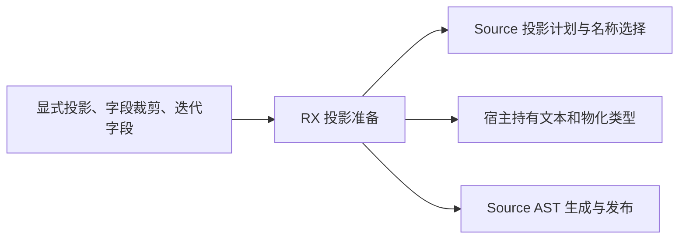

# genz 所有权投影准备自举

## Intent

让显式投影、字段裁剪和迭代字段所有权沿同一 RX 入口完成投影准备。移除 Zig 对辅助函数登记、序列推进及布局预热的编排。

## Data

起点为 `3a50c099d`。正式路径通过 `ownership/projection.zig` 运行投影计划，再准备名称、序列号和类型布局。之后才借用最新 AST 并运行已迁入 Source 的发射器。投影查询和生成共用类型表、槽位和转移事实。

## Edges

投影不需要处理时原样返回输入。先持有名称，再写序列，再物化类型和缺失布局。类型物化可能更改 AST 列，发射入口在准备结束后重新取得视图。各阶段借用原有事实和布局存储，只有需跨临时区域保留的新名称分配独立存储。

## Answer

用同一个 Source 引导器验证仓库现有所有权和集合回归。比较已验收引导器和候选引导器生成的完整清单，并用同一固定清单对比冷、暖和无修改生成及进程内存。

- 显式投影、字段裁剪与迭代字段共用 RX 准备入口。移除两个独立的计划与布局生成入口，原有 Source 发射器继续执行。
- 投影、准入查询和外提查询借用同一组类型表、槽位和转移列。生成的 Zig 借用清理引用与布局切片，复用已有的辅助名称，只有新名称复制到 AST 持有的分配器。
- 原生层仍负责持有名称、写入原生 `Lower` 序列、物化类型和刷新 AST。两个新增的宿主操作都只作用于现有物理状态，计划选择、名称复用和执行顺序由 Source 决定。
- 使用 `3a50c099d` 的 Source 引导器构建 ReleaseSmall 候选，主清单使用 16 个分区。372 项编译器测试通过。两者运行同样五份引导清单，除输入戳外，17,891 个文件逐字节一致。
- 使用候选引导器完成八组应用回归，531 个构建步骤和 999 项测试通过。覆盖字段所有权、循环列、循环初始状态、聚合循环、迭代调用、模块循环、脱离原容器的读取和对象 reduce。

固定基线、批首和候选工具均由 Source 引导，运行 Source 分析与生成。同一冻结清单使用 Zig 0.17.0、16 个分区并关闭常驻生成。下表为各工具三次交错运行的冷生成中位数。

| 引导器                             |   墙钟 |    CPU | 采样进程树峰值 RSS | 单进程峰值 RSS |
| ---------------------------------- | -----: | -----: | -----------------: | -------------: |
| 固定基线 `declaration-preparation` | 2.07 s | 9.03 s |          737.76 MB |      793.72 MB |
| 批首 `3a50c099d`                   | 1.89 s | 9.38 s |          519.78 MB |      537.59 MB |
| 候选                               | 1.89 s | 9.34 s |          521.42 MB |      547.29 MB |

较批首，冷生成墙钟持平，CPU 减少 0.04 秒，采样树峰值增加 1.64 MB，单进程峰值增加 9.70 MB。三次冷生成的单进程峰值样本分别为批首 536.05 至 543.67 MB 和候选 545.88 至 553.04 MB。进程常驻占用的采样峰值中位数增加 2.29 MB。较固定基线，冷墙钟减少 0.18 秒，CPU 增加 0.31 秒，树峰值减少 216.33 MB。

较批首，热生成墙钟增加 0.02 秒、CPU 增加 0.03 秒，无修改生成墙钟保持 0.03 秒。冻结清单冷暖和批首对照的 9,894 个文件逐字节一致。计时范围为生成，应用回归覆盖实际构建和运行。
