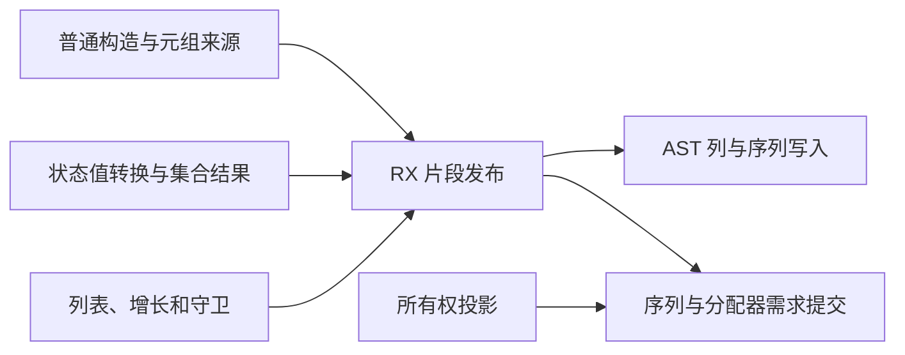

# genz 构造与转换 AST 发布自举

## Intent

普通构造、集合结果、元组来源与状态值转换共用 RX 片段发布，退出普通构造的 Zig 写入编排和状态转换的独立发布适配。所有权投影和片段发布共用序列与分配器需求的提交。

## Data

起点为 `57c0e5ebc`。普通构造依次写入表达式、稠密语句、引用与序列。元组来源只写入表达式。状态值转换先写入表达式和选中语句，再写入引用、可选的绑定与正文章节、字段及序列。现行列表、增长和守卫已使用 RX 片段入口。

## Edges

保持不同片段的稠密或稀疏写法、文本借用、字段时序和失败前缀。元组来源只提交表达式，守卫和列表保留各自的序列契约。转换暂存列直接借用，辅助声明与多段表达式仍由所有权投影入口推进。

## Answer

用同一 Source 引导器验收普通构造、元组、列表、迭代和所有权路径。比较五份完整引导清单的生成文件，并用固定清单对照冷暖生成和峰值内存。

- 普通构造、元组来源和状态转换使用原有 RX 片段发布入口。RX 决定是否增加引用与正文，ZX 根据目标位置和片段选择正文行写法。已移除 Zig 构造直接发布和状态值转换专用分支。
- 转换保留稀疏语句与变量列、引用、绑定与正文、字段和提交的先后。集合的字段仍先于正文写入。片段绑定直接借用生成列，发布继续在空暂存分配器下执行。
- 所有权投影仍独立推进多段表达式、辅助声明和文本所有权。两条发布链的最终序列与分配器需求写入共用同一个原生操作。宿主继续管理各 AST 目标列、序列和引用存储。
- 使用 `57c0e5ebc` 的 Source 引导器构建 ReleaseSmall 候选，主清单使用 16 个分区。372 项编译器测试通过。五份清单除输入戳外，17,915 个生成文件逐字节一致。
- 使用同一批首引导器生成当前源码的编译器和应用。九组回归共 713 个构建步骤、13,975 项测试通过，覆盖对象构造、列表操作与边界、状态转换、循环列、缓冲迭代、脱离原容器的读取以及字段所有权。

固定基线、批首和候选均由 Source 引导，运行 Source 分析与生成。冻结清单使用 Zig 0.17.0、16 个分区，关闭常驻生成。下表为三次交错运行的冷生成中位数。

| 引导器                             |   墙钟 |    CPU | 采样进程树峰值 RSS | 单进程峰值 RSS |
| ---------------------------------- | -----: | -----: | -----------------: | -------------: |
| 固定基线 `declaration-preparation` | 2.07 s | 8.98 s |          738.05 MB |      792.35 MB |
| 批首 `57c0e5ebc`                   | 1.92 s | 9.44 s |          519.93 MB |      548.72 MB |
| 候选                               | 1.92 s | 9.42 s |          522.83 MB |      544.49 MB |

较批首，冷生成墙钟持平，CPU 减少 0.02 秒。进程树采样峰值中位数增加 2.90 MB，候选三次采样在 519.67 至 542.46 MB 之间。单进程峰值中位数减少 4.23 MB。较固定基线，冷墙钟减少 0.15 秒，CPU 增加 0.44 秒（4.9%），进程树峰值减少 215.22 MB。

较批首，热生成墙钟持平，CPU 增加 0.01 秒。无修改生成墙钟保持 0.03 秒。冻结清单冷暖和批首对照的 9,894 个文件逐字节一致。
