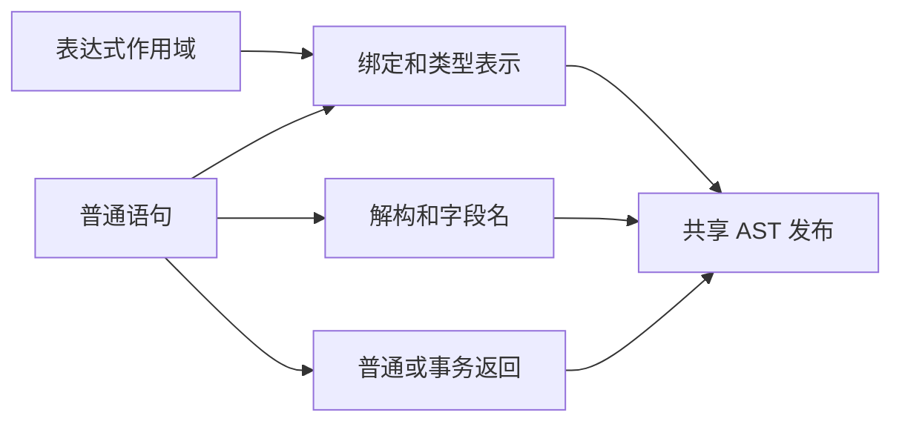
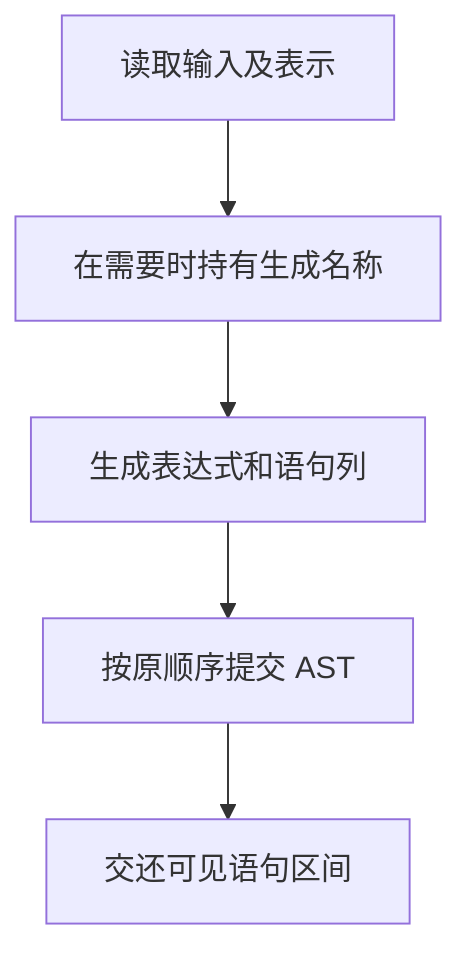

# genz 绑定、解构与结果发布自举

## Intent

沿普通语句和表达式作用域的正式入口迁移绑定、解构和返回的发射。Source 连接表示选择、类型及操作数求值、文本持有和 AST 交付。

## Data

批首为 `57d60f8fb`。绑定在 Zig 连接生成的选择和发射入口。解构在 Zig 选择捕获或普通操作数，生成片段后再次遍历字段名。返回在 Zig 分别写入表达式和语句，还要重接生成的临时名称。上一批已经收口这些入口的局部成员登记和释放。

## Edges

保持解构占位名称在求值操作数前取得，捕获默认使用原值 ABI，保持事务提交和错误结果的顺序。已持有的符号名直接借用，新文本只保留最终 AST 需要的字节。正常入口和 seed 沿用原契约。

## Answer

沿三条入口核对退役的专用 Zig 代码。集中验证语句与作用域、解构、事务结果和生成产物，对照固定清单的冷暖生成时间与内存，再更新净减计划并推送。

绑定在 RX 中连接声明选择规则、类型解析和语句提交。普通语句和表达式作用域共用该入口。绑定行的稀疏列仍由 Store 暂存器和循环声明使用，类型集中在共享 AST 接口。原先拆开的选择与发射只作为同一 Source 调用链内的步骤。

解构在求值操作数前保留元组名称，按原逻辑选择捕获或普通求值。生成数字字段名时直接留下持久文本，省去填充所有表达式后再遍历字段名的过程。事务返回的临时名称直接在标识符和声明中共用，省去两份临时文本描述列的复制与回填。

移除六个独立的生成入口。三个正式入口复用已有的 AST 行写入、语句序列和编号操作，Zig 仍借用输入列，提供分配资源并接收已提交的语句区间。首次整编发现 Store 和迭代直接消费绑定的窄列输出，最终实现沿用该布局，把发布接入移到共同的序列写入边界。

### 行为与生成验收

- 正式 Source 阶段 35 个步骤全部成功，372 项编译器测试通过。候选以 `57d60f8fb` 的 Source 引导器、ReleaseSmall 和 16 个主分区构建。
- 317 个应用构建步骤全部成功，547 项测试通过，覆盖元组绑定、带类型的错误传播、返回、分支作用域、求值顺序、Store、值返回与 Task 生命周期。
- 候选和批首工具在当前主清单、执行清单、宿主清单、集合和增长清单上生成的 17,713 个文件逐字节一致。固定性能清单的 9,894 个文件在两版之间及候选冷暖之间也一致。比较排除缓存索引 `.zxc-inputs`。

### 固定清单生成性能

使用冻结的兼容清单，三个工具交错测量三轮并取中位数。固定基线为声明准备阶段的 Source 工具，批首工具由 `fae33d07c` 生成，候选工具由 `57d60f8fb` 生成。三者均启用对应的 Source 分析与生成实现。时长单位为秒，内存以十进制 MB 表示。

| 场景   | 工具     | 墙钟 |  CPU | 采样进程树 RSS | 系统单进程峰值 |
| ------ | -------- | ---: | ---: | -------------: | -------------: |
| 冷生成 | 固定基线 | 2.09 | 8.99 |         737.82 |         766.03 |
| 冷生成 | 批首     | 1.92 | 9.42 |         516.96 |         540.38 |
| 冷生成 | 候选     | 1.93 | 9.36 |         532.94 |         541.39 |
| 热生成 | 固定基线 | 1.64 | 6.43 |         706.15 |         730.82 |
| 热生成 | 批首     | 1.44 | 6.25 |         502.50 |         502.53 |
| 热生成 | 候选     | 1.44 | 6.28 |         502.63 |         502.66 |

冷生成较批首墙钟增加 0.01 秒，CPU 减少 0.06 秒。采样进程树 RSS 增加 15.97 MB，系统单进程峰值增加 1.02 MB。同轮采样的物理内存占用中位数均为 511.90 MB，物理内存高水位中位数增加 1.06 MB。较固定基线冷墙钟减少 0.16 秒，CPU 累计增加 0.37 秒，采样进程树 RSS 减少 204.88 MB。未修改输入的重复生成耗时 0.03 秒，输出保持一致。
