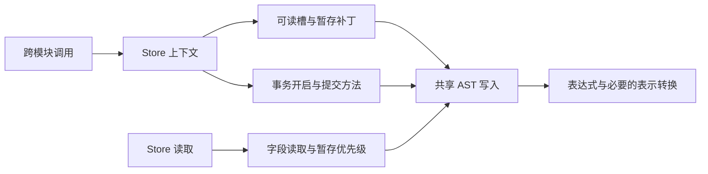
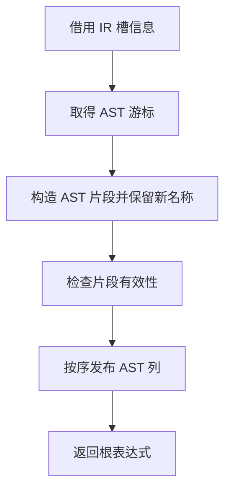

# genz 跨模块 Store 调用与读取自举

## Intent

将跨模块调用的 Store 上下文交付，以及 Store 读取的借用和表示选择，接到各自的 Source 编排入口。同步退出 Zig 的片段拼接、名称回填和编号写回。

## Data

批首为 `7c7639b64`。正式调用从 `lowerCallStore` 进入，按被调用函数的 Store 槽映射构造上下文、转交暂存补丁并生成事务方法。读取从 `lowerStore` 进入，按事务模式和类型的表示事实发射字段读取，然后选择返回原表达式、借用列表或转换表示。

## Edges

保留调用参数的求值顺序、读取时的暂存优先级、失败处理与序号递增。静态文本及持久槽名可借用，新的名称进入最终 AST 所用存储，短命的嵌套载荷仍由共享 AST 写入接口接管。保留 seed 对应实现。

## Answer

核对调用与读取的正式入口，集中运行 Store 事务、库消费及所有权回归，对照五份自举清单和固定性能输入。分配、原始列借用和 AST 物理写入仍使用共享宿主边界。

跨模块调用由 RX 启用上下文、读取 AST 游标，生成可读字段、暂存补丁和操作方法，然后按表达式、语句、声明和字段的原有顺序发布。发布成功后由同一入口更新编号并返回根表达式。Zig 的专用适配器退出，原调用入口继续借用槽列并提供暂存分配区。

构造片段时保存生成的槽名、上下文类型名与块标签。AST 写入直接借用持久文本，嵌套的短命操作数列表走共享写入接口。Store 读取保留窄列布局，在构造字段节点时取得持久槽名，暂存值和底层值的读取共享该名称。RX 发布读节点后，显式选择直接返回、列表借用或表示转换。

候选 Source 引导器由 `7c7639b64` 的引导器生成，采用 ReleaseSmall 和 16 个主分区。35 个构建与测试步骤全部通过，包含 372 项编译器测试。候选和批首工具在主、执行、宿主、集合和增长清单生成的 17,726 个产物逐字节一致，比较排除缓存索引 `.zxc-inputs`。

七组 Store 应用回归的 142 个构建和执行步骤全部通过，包含 353 项 Zig 测试和 Node 驱动的集成检查。测试覆盖直接事务、Store I/O、跨请求引用寿命、区域回收、所有权证明和库重新发布。

共享的列表借用与表示转换仍通过 genz 宿主调用。两条 Store 入口已由 Source 决定何时使用这些能力，转换内部的剩余 Zig 继续随通用 genz 路径迁移。

### 固定清单生成性能

固定基线为声明准备阶段的 Source 引导器，批首工具由 `ac6c67d5c` 生成，候选工具由 `7c7639b64` 生成。三者均使用相应的 Source 分析和生成实现。交错测量三轮并取中位数，时长单位为秒，内存以十进制 MB 表示。

| 场景   | 工具     | 墙钟 |  CPU | 采样进程树 RSS | 系统单进程峰值 |
| ------ | -------- | ---: | ---: | -------------: | -------------: |
| 冷生成 | 固定基线 | 2.11 | 9.06 |         737.89 |         761.28 |
| 冷生成 | 批首     | 1.97 | 9.49 |         524.09 |         542.47 |
| 冷生成 | 候选     | 1.91 | 9.35 |         517.64 |         547.80 |
| 热生成 | 固定基线 | 1.65 | 6.45 |         706.45 |         730.14 |
| 热生成 | 批首     | 1.44 | 6.28 |         502.53 |         502.56 |
| 热生成 | 候选     | 1.44 | 6.27 |         502.27 |         502.30 |

冷生成较批首墙钟减少 0.06 秒，CPU 减少 0.14 秒。采样进程树 RSS 减少 6.46 MB，系统单进程峰值增加 5.32 MB，物理内存采样中位数减少 4.46 MB。较固定基线冷墙钟减少 0.20 秒，CPU 增加 0.29 秒，采样进程树 RSS 减少 220.25 MB。未修改输入的重复生成耗时 0.03 秒。固定清单的 9,894 个产物在批首与候选之间及候选冷暖之间逐字节一致。
